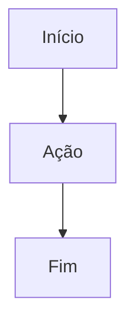

# AGENTS.md — Alexandrita Docs

> **Instruções para Agentes de IA e Desenvolvedores de Documentação**  
> Repositório: `alexandrita-docs` (Central de Conhecimento e Documentação Viva do Hubee)  
> Site em Produção: [alexandrita-docs.vercel.app](https://alexandrita-docs.vercel.app)

---

## 1. Visão Geral do Repositório

O `alexandrita-docs` é o portal central de documentação viva do ecossistema Hubee, construído com **Docusaurus v3**. Ele hospeda a arquitetura do sistema, especificações de requisitos, contratos de API, guias de boas práticas, decisões de spikes e o design system do Figma.

- **URL de Produção:** `https://alexandrita-docs.vercel.app`
- **Ambiente Local:** `http://localhost:3000` (quando rodando `npm start`)
- **Política de Integridade:** `onBrokenLinks: 'throw'` — Qualquer link quebrado ou referência inválida **interrompe o build de produção**.

---

## 2. Stack Tecnológica

| Componente | Tecnologia / Versão |
| :--- | :--- |
| **Gerador de Site Estático** | Docusaurus v3 (`@docusaurus/core`, `@docusaurus/preset-classic`) |
| **Biblioteca UI** | React (`react`, `react-dom`) |
| **Linguagem & Tipagem** | JavaScript / TypeScript / MDX (Markdown com JSX) |
| **Mecanismo de Diagramas** | Mermaid integrado (`@docusaurus/theme-mermaid`) |
| **Destaque de Código** | Prism React Renderer |
| **Hospedagem & CI/CD** | Vercel (deploy automático a cada merge na `main`) |

---

## 3. Estrutura de Diretórios de Conteúdo

```text
alexandrita-docs/
├── docs/                        # Raiz de todos os documentos (renderizados em /)
│   ├── backend/                 # Arquitetura da hubee-api, endpoints e entidades
│   ├── boas-praticas-guias/     # Guias técnicos consolidados
│   │   ├── _category_.json      # Metadados e ordenação da categoria
│   │   ├── boas-praticas-banco-de-dados.md
│   │   └── fluxo-trabalho-com-agentes.md
│   ├── figma/                   # Documentação visual, wireframes e logotipo
│   ├── frontend/                # Telas, componentes e padrões da hubee-webpage
│   ├── infra/                   # Arquitetura do sistema, topologia Neon/Render/Vercel
│   ├── primeiros-passos/        # Onboarding de novos desenvolvedores no projeto
│   ├── regras-negocio/          # Regras de negócio, personas e critérios de aceite
│   └── spikes/                  # Estudos técnicos preliminares (ex: GOL-109 permissões)
├── static/                      # Arquivos estáticos servidos diretamente
│   └── img/                     # Imagens, capturas de tela e assets gráficos
├── src/                         # Customizações de páginas e temas Docusaurus
│   └── css/custom.css           # Estilos globais da documentação
├── docusaurus.config.js         # Configurações do site, plugins, Mermaid e URLs
└── sidebars.js                  # Configuração de sidebar (gerada automaticamente do fs)
```

---

## 4. Comandos Canônicos

Sempre execute na raiz `alexandrita-docs`:

```bash
# Instalação de dependências
npm install

# Iniciar servidor de desenvolvimento com hot-reload (porta 3000)
npm start

# Validar e compilar a documentação estática (OBRIGATÓRIO antes de comitar)
npm run build

# Testar o site compilado localmente
npm run serve

# Limpar caches temporários do Docusaurus (em caso de bugs de renderização)
npm run clear
```

---

## 5. Regras Inegociáveis para Agentes ao Editar Documentos

### 5.1. Frontmatter Obrigatório
Todo arquivo Markdown (`.md`) dentro de `docs/` deve iniciar com metadados YAML:

```markdown
---
sidebar_position: 1
title: Título Amigável do Documento
description: Breve resumo do conteúdo para metatags e buscadores.
---
```

### 5.2. Categorias e Menus (`_category_.json`)
Ao criar um novo diretório em `docs/`, crie o respectivo `_category_.json`:

```json
{
  "label": "Nome da Categoria",
  "position": 3,
  "link": {
    "type": "generated-index",
    "description": "Descrição sucinta da seção."
  }
}
```

### 5.3. Links Internos Relativos
- Para referenciar outro arquivo de documentação, utilize caminhos relativos ao arquivo atual ou absolutos a partir de `docs/`.
- Nunca use URLs absolutas do localhost nos links de documentação.
- **Lembre-se:** `npm run build` falhará se houver um link apontando para um arquivo inexistente.

### 5.4. Diagramas em Mermaid
O Docusaurus do Hubee tem suporte nativo a Mermaid. Sempre prefira diagramas textuais a imagens estáticas para facilitar a manutenção contínua:

````markdown

````

---

## 6. Governança Git e Versionamento

1. **Branching:**
   - Base do repositório: `main`.
   - Crie branches no padrão: `docs/GOL-<ID>-<slug>` (ex: `docs/GOL-151-fluxo-trabalho-com-agentes`).
2. **Commits:**
   - Padrão semântico: `docs(GOL-<ID>): descrição em português`.
   - Exemplo: `docs(GOL-148): adiciona AGENTS.md no alexandrita-docs`.
3. **Validação Pré-Commit:**
   - Execute **sempre**:
     ```bash
     npm run build
     ```
   - O commit só deve ser realizado após a confirmação: `[SUCCESS] Generated static files in "build"`.
4. **Regra de Transição no YouTrack:**
   - Ao iniciar a tarefa, transicione para `State In Progress`.
   - ⚠️ **REGRA OBRIGATÓRIA:** NUNCA mova o status para verificação (`To Verify`) automaticamente. O encerramento da task e a mudança de status devem ser **explicitamente confirmados pelo desenvolvedor responsável**.
