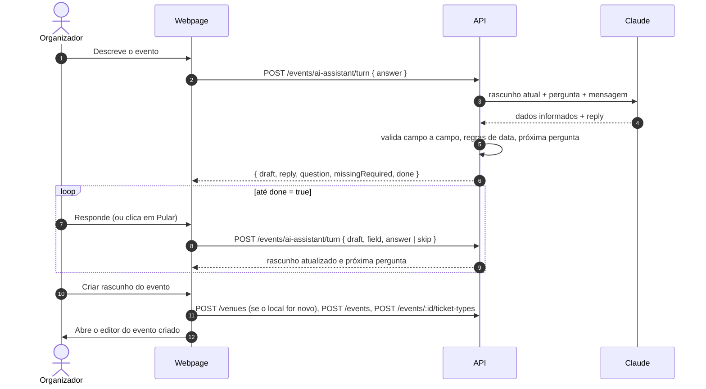

# Assistente de Criação de Evento com IA

O assistente cria o rascunho de um evento numa conversa. O organizador descreve o
evento em texto livre, o assistente pergunta o que falta, uma pergunta por vez, e
só termina quando os dados obrigatórios estão completos. No fim, o front cria o
local (se for novo), o evento como rascunho e os lotes, e abre o editor.

Ele substitui o antigo rascunho com IA de uma rodada só (`POST /events/ai-draft`,
removido na **GOL-295**), que tentava preencher o formulário inteiro de uma vez e
deixava vazio o que a IA não pegava.

| Task | O que entrega |
| --- | --- |
| **GOL-291** | `POST /events/ai-assistant/turn` na `hubee-api`. |
| **GOL-292** | Página de chat `/meus-eventos/novo/assistente` na `hubee-webpage`. |
| **GOL-293** | Criação do evento, do local e dos lotes ao fim da conversa, e saída do bloco de IA do editor. |
| **GOL-294** | Esta documentação e as requisições do Bruno. |
| **GOL-295** | Remoção do `POST /events/ai-draft` e do código ligado a ele. |

A configuração da chave da Anthropic, os limites de uso e o custo estão em
[Integração com IA](./integracao-ia.md).

## Quem decide o quê

A regra central do assistente: **a IA só interpreta a resposta; o código decide o
fluxo.**

- **IA:** lê a mensagem do organizador e devolve só os dados que ela informa, mais
  uma confirmação curta (`reply`).
- **Código (`event-ai-assistant.fields.ts`):** valida cada dado, aplica as regras de
  data, escolhe a próxima pergunta, monta o texto dela e decide quando a conversa
  termina.

Assim, uma resposta mal interpretada nunca encerra a conversa com um campo
obrigatório vazio, e o texto das perguntas não depende do modelo.



## Contrato: `POST /events/ai-assistant/turn`

**Acesso:** `@OrganizerOnly()` + `@AiRateLimited()`, igual às demais rotas de IA.
Vale para membro aceito de qualquer organização ou `ADMIN`. Nada é salvo: o
servidor não guarda estado entre as rodadas, e o rascunho vai e volta no corpo.

### Corpo

| Campo | Tipo | Regra |
| --- | --- | --- |
| `draft` | objeto | Rascunho devolvido na rodada anterior. Ausente na primeira mensagem. |
| `field` | enum | Campo da pergunta que está sendo respondida. Ausente na primeira mensagem. |
| `answer` | string | Texto livre, até 2000 caracteres, sem espaços nas pontas. Obrigatório quando `skip` não é `true`. |
| `skip` | boolean | `true` pula a pergunta de um campo opcional, **sem chamar a IA**. |

Os campos de `field` (e da pergunta) são `name`, `start`, `end`, `venue`,
`ticketTypes`, `salesStart`, `category`, `ageRating` e `description`.

### Rascunho (`draft`)

| Campo | Formato |
| --- | --- |
| `name`, `description`, `edition` | string ou `null` |
| `category` | `festas` \| `shows` \| `palestras` \| `esportes` \| `academicos` \| `outros` \| `null` |
| `ageRating` | `L` \| `10` \| `12` \| `14` \| `16` \| `18` \| `null` |
| `startDate`, `endDate`, `salesStartDate` | `AAAA-MM-DD` ou `null` |
| `startTime`, `endTime`, `salesStartTime` | `HH:mm` ou `null` |
| `venue` | `{ name, address, city, state }` ou `null`. `address` é texto livre e `state` é a sigla da UF. |
| `ticketTypes[]` | `{ batch, price, quantity, modality }`, com `price`, `quantity` e `modality` podendo ser `null` |
| `skipped[]` | Campos opcionais que o organizador pulou |

Dia e horário ficam em campos separados de propósito. Uma data sem horário nunca
vira meia-noite implícita, e o front monta a data completa no fuso de Brasília só
na hora de criar o evento.

### Resposta `200`

```json
{
  "draft": { "name": "Calourada da Engenharia", "startDate": "2030-12-05", "startTime": "21:00", "...": "..." },
  "reply": "Anotado: começa no dia 05/12/2030 às 21h.",
  "question": {
    "field": "end",
    "text": "Quando o evento termina? Pode dizer só o horário, se acabar no mesmo dia.",
    "skippable": false
  },
  "missingRequired": ["end"],
  "done": false
}
```

- `reply` é `null` quando a rodada não chamou a IA (`skip: true`).
- `question` é `null` só quando a conversa terminou, e então `done` é `true`.

### Erros

| Status | Quando |
| --- | --- |
| `400` | `answer` ausente, vazia ou com mais de 2000 caracteres; `field` desconhecido; `draft` fora do formato (data, horário ou UF inválidos); campo extra no corpo. |
| `401` | Token ausente ou inválido. |
| `403` | Usuário sem organização. Não gasta a cota de IA. |
| `429` | Limite de gerações com IA atingido, com o cabeçalho `Retry-After`. |
| `503` | IA indisponível, sem `ANTHROPIC_API_KEY` ou resposta da IA que não é um objeto JSON. |

Um valor inválido vindo da IA (uma data que não existe, um horário `25:00`, uma
categoria fora da lista) **não** gera erro: ele é descartado, registrado no log, e
a pergunta do campo volta.

## Regras da conversa

### Ordem das perguntas

A próxima pergunta é sempre o primeiro campo incompleto, nesta ordem:

1. `name` — nome do evento
2. `start` — dia e horário de início
3. `end` — término
4. `venue` — local
5. `ticketTypes` — lotes
6. `salesStart` — início das vendas
7. `category` — categoria
8. `ageRating` — classificação indicativa
9. `description` — descrição de divulgação

As perguntas consideram o que já se sabe. Com o dia de início já informado, por
exemplo, o assistente pergunta só "Que horas o evento começa no dia 05/12/2030?".
Com um lote sem quantidade, pergunta "Quantos ingressos tem o lote "Pista"?".

### Quando um campo está completo

| Campo | Completo quando |
| --- | --- |
| `name` | tem nome |
| `start`, `end`, `salesStart` | tem dia **e** horário |
| `venue` | tem cidade **e** nome do local ou endereço (evento em residência não precisa de nome) |
| `ticketTypes` | tem ao menos um lote, e todos com preço e quantidade |
| `category`, `ageRating`, `description` | tem valor |

### Obrigatórios, pular e conclusão

- **Obrigatórios:** `name`, `start`, `end` e `venue`, os dados que o `POST /events`
  exige. Eles não podem ser pulados: com `skip: true` ou uma resposta como "não
  sei", a pergunta volta com "Esse dado é obrigatório para criar o evento.".
- **Opcionais:** os demais. `skip: true`, ou uma resposta como "não sei" ou "ainda
  não definimos", colocam o campo em `skipped`, e ele não é perguntado de novo. Se
  o organizador informar o dado depois, o campo sai de `skipped`.
- **Conclusão:** `done` só fica `true` quando não há mais pergunta, ou seja, com os
  obrigatórios completos e todos os opcionais completos ou pulados. Nunca termina
  com obrigatório vazio.

### Regras de data

O código aplica estas regras depois de cada rodada, independentemente da IA:

- **Início no passado:** é apagado, e a pergunta volta com "A data de início precisa
  ser no futuro.".
- **Término só com horário:** ganha o dia do início, ou o dia seguinte quando o
  horário é menor ou igual ao de início ("das 22h às 4h").
- **Término antes do início, ou igual a ele:** é apagado, e a pergunta volta com o
  aviso.
- **Vendas depois do início do evento:** são apagadas, e a pergunta volta com o
  aviso.

## No front (`hubee-webpage`)

- **Entrada:** botão **"Criar com assistente"** em Meus eventos, e o atalho
  "Prefere criar conversando?" no topo do editor de evento novo. A rota é
  `/meus-eventos/novo/assistente`, liberada para quem pode criar eventos.
- **Chat:** uma pergunta por vez, com Enter para enviar e Shift+Enter para quebrar
  a linha. O botão **Pular** só aparece quando `question.skippable` é `true`.
- **Resumo:** ao lado do chat, com os 9 campos. Verde é completo, amarelo é parcial
  (como dia sem horário ou lote sem quantidade) e cinza é vazio ou pulado. No
  mobile, vira um bloco recolhível acima do chat.
- **Persistência:** a conversa fica no `sessionStorage` (`hubee:assistente-evento`)
  e sobrevive a recarregar a página. **Recomeçar** limpa tudo.
- **Erros:** cada falha vira uma mensagem em pt-BR, e **Tentar de novo** reenvia a
  mesma resposta sem perder a conversa.

### Criando o evento

Quando `done` é `true`, aparece o card **"Criar o rascunho do evento"**:

1. **Local:** o front procura em `GET /venues` um local da mesma cidade com o mesmo
   nome, ou com a mesma rua e número, sem diferenciar acento, maiúscula ou
   abreviações como "Av." e "R.".
   - Se encontrar, usa o local cadastrado.
   - Se não encontrar, abre o cadastro de local já preenchido com nome, rua,
     número, bairro, cidade e UF. A pessoa completa o CEP e a capacidade.
2. **Evento:** é criado como rascunho (`POST /events`) na organização ativa, com as
   datas no fuso de Brasília, como `2030-12-05T21:00:00-03:00`. Nada é publicado.
3. **Lotes:** os completos são criados (`POST /events/:id/ticket-types`), com
   `inteira` como modalidade padrão. Os incompletos, e os que falharem, viram
   **lotes sugeridos** na etapa de ingressos do editor, para revisar e criar.
4. **Final:** a conversa é limpa e o editor abre no evento criado, para os ajustes
   finais e a capa.

## Testando no Bruno

A pasta `EVENTOS/ASSISTENTE DE CRIACAO/` do [`hubee-collections`](./collections.md)
tem uma requisição por cenário. Cada uma traz um rascunho fixo no corpo, então dá
para rodar em qualquer ordem:

| Requisição | O que valida | Chama a IA |
| --- | --- | :---: |
| `POST PRIMEIRA MENSAGEM` | Extrai nome, início e local da descrição e pergunta o término. | Sim |
| `POST RESPONDER PERGUNTA` | "às 21h até as 3h" preenche o horário e joga o término para o dia seguinte. | Sim |
| `POST RESPOSTA SEM O DADO` | Resposta sem o dado não inventa nada e repete a pergunta. | Sim |
| `POST PULAR PERGUNTA` | `skip: true` em campo opcional entra em `skipped` e segue para o próximo. | Não |
| `POST PULAR CAMPO OBRIGATORIO` | `skip: true` em campo obrigatório repete a pergunta com o aviso. | Não |
| `POST ASSISTENTE SEM PERMISSAO` | Comprador sem organização recebe `403`. | Não |

As que chamam a IA precisam de `ANTHROPIC_API_KEY` na API. Sem ela, respondem
`503`. Em `production` nenhuma altera dados, mas as que chamam a IA consomem
tokens pagos e a cota do organizador.

## Onde está no código

### `hubee-api`

| Arquivo | Responsabilidade |
| --- | --- |
| `src/event/ai-assistant/event-ai-assistant.controller.ts` | Rota `POST /events/ai-assistant/turn`. |
| `src/event/ai-assistant/event-ai-assistant.service.ts` | Chama o `AiService`, valida cada campo devolvido (`sanitizePatch`), trata o pular e monta a resposta. |
| `src/event/ai-assistant/event-ai-assistant.fields.ts` | Regras de completude, regras de data, ordem e texto das perguntas. |
| `src/event/ai-assistant/event-ai-assistant.prompt.ts` e `event-ai-assistant.schema.ts` | Prompt de sistema em pt-BR e JSON schema da saída da IA. |
| `src/event/ai-assistant/dto/event-ai-assistant.dto.ts` | Corpo, rascunho e resposta. |

O schema da IA usa texto vazio (`""`) para "não mudou" nos campos de texto e de
enum, em vez de `null`. A Anthropic aceita no máximo 16 campos com tipo união
(`anyOf`) num schema, e um teste do service trava esse limite.

### `hubee-webpage`

| Arquivo | Responsabilidade |
| --- | --- |
| `src/app/(logado)/meus-eventos/novo/assistente/page.tsx` | Rota da página. |
| `src/components/conta/eventos/assistente/` | Chat, resumo e card de criação. |
| `src/hooks/useAssistenteEvento.ts` | Estado da conversa e `sessionStorage`. |
| `src/hooks/useCriarEventoAssistente.ts` | Cria local, evento e lotes. |
| `src/lib/assistente-evento.ts` | Funções puras da conversa e do resumo. |
| `src/lib/assistente-evento-criacao.ts` | Payload do evento, separação dos lotes, busca do local e preenchimento do cadastro. |
| `src/lib/lotes-sugeridos.ts` | Lotes sugeridos que o editor mostra na etapa de ingressos. |
| `src/lib/api/event-ai-assistant.ts` | Cliente da rota e mensagens de erro. |
