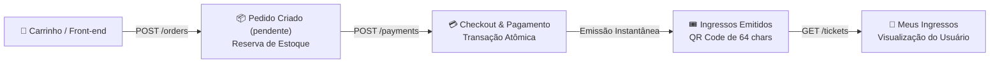
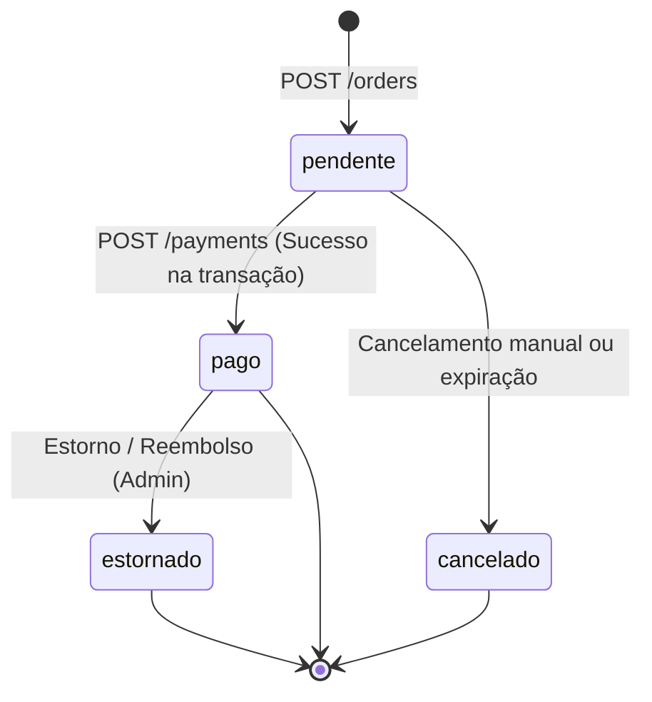
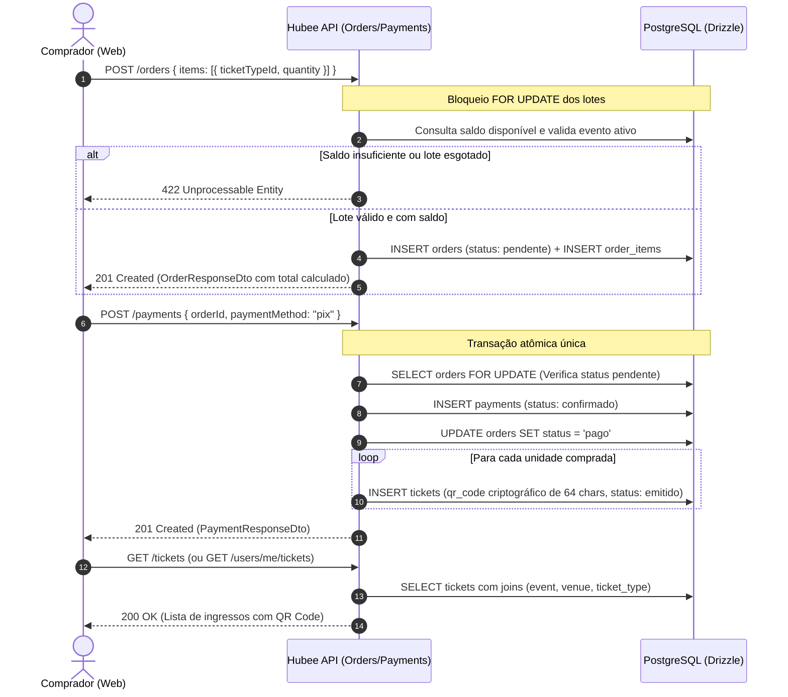

# Compra e Emissão de Ingressos

Este documento detalha a arquitetura, regras de negócio, ciclo de vida e contratos da API para o **fluxo de compra de ingressos** na plataforma Hubee, implementados na task **GOL-175** e documentados na **GOL-178**.

O fluxo cobre a jornada ponta a ponta do visitante: seleção de lotes → reserva e criação do pedido → pagamento atômico → emissão do ingresso com QR Code criptográfico → consulta da carteira de ingressos.

---

## 1. Visão Geral da Arquitetura

O processo de compra conecta três entidades principais da API: **`orders`** (pedidos e itens), **`payments`** (transações e liquidação) e **`tickets`** (ingressos emitidos vinculados ao comprador).



### Princípios Chave de Engenharia

1. **Preço Total Sempre no Servidor:** O payload de criação do pedido envia apenas `ticketTypeId` e `quantity`. O total do pedido **nunca vem do cliente**, sendo calculado diretamente pelo servidor a partir do valor unitário de cada lote ativo.
2. **Saldo Derivado (Sem Coluna de 'Vendidos'):** O estoque disponível de cada lote é uma conta derivada:
   ```text
   Saldo = ticket_types.quantity - soma(itens de pedidos 'pendente' + itens de pedidos 'pago')
   ```
   Pedidos pendentes reservam o estoque temporariamente; pedidos cancelados liberam o saldo automaticamente, eliminando riscos de descompasso em contadores desnormalizados.
3. **Controle de Concorrência com `FOR UPDATE`:** Na criação do pedido e no checkout, os registros de lotes e do pedido são bloqueados via `SELECT ... FOR UPDATE` ordenados por ID, prevenindo condições de corrida e *deadlocks* em compras simultâneas do último ingresso.
4. **Liquidação e Emissão Atômicas:** A confirmação do pagamento, a transição do status do pedido para `pago` e a geração dos ingressos ocorrem estritamente na **mesma transação de banco de dados**. Se a geração de qualquer ingresso falhar, o pedido permanece pendente e nada é emitido.

---

## 2. Ciclo de Vida do Pedido (`order_status`)

O ciclo de estados do pedido é estrito e modelado no enum `orderStatus`:



* **`pendente`:** Pedido criado com itens registrados em `order_items`. O estoque fica temporariamente reservado.
* **`pago`:** Pagamento aprovado no gateway simulado; ingressos emitidos e associados ao comprador.
* **`cancelado`:** Reserva desfeita; estoque liberado de volta ao saldo disponível do lote.
* **`estornado`:** Pagamento revertido pela organização ou administração da plataforma.

---

## 3. Diagrama de Sequência da Compra



---

## 4. Contratos de API e Endpoints

### 4.1. Criar Pedido (`POST /orders`)

Inicia a compra e reserva as cotas dos lotes selecionados.

* **Acesso:** Autenticado (`@Authenticated()`, cabeçalho `Authorization: Bearer <token>`).
* **Regra de Perfil:** Exige cadastro completo com CPF e data de nascimento (responde `403 Forbidden` caso contrário).
* **Regra de Evento:** Apenas eventos com status `published`, vendas iniciadas (`salesStartDate`) e data futura de término podem ser vendidos.

#### Request Body (`CreateOrderDto`)

```json
{
  "items": [
    {
      "ticketTypeId": "8f3e5b6a-9397-4d94-a169-2f2f3d61b111",
      "quantity": 2
    }
  ]
}
```

* `items`: Lista com no mínimo 1 e no máximo 20 itens.
* `quantity`: Inteiro entre 1 e 10 por lote. Linhas repetidas do mesmo lote no array são agregadas automaticamente antes da validação de saldo.

#### Resposta de Sucesso (`201 Created`)

```json
{
  "id": "c1f71a39-0fa1-42d4-bb0b-5d98522e8640",
  "userId": "00000000-0000-4000-8000-000000000101",
  "totalAmount": 12000,
  "status": "pendente",
  "createdAt": "2026-11-02T16:00:00.000Z",
  "updatedAt": "2026-11-02T16:00:00.000Z",
  "items": [
    {
      "id": "e2a1b5c4-d3e2-4f1a-b5c6-d7e8f9a0b1c2",
      "ticketTypeId": "8f3e5b6a-9397-4d94-a169-2f2f3d61b111",
      "quantity": 2,
      "unitPrice": 6000
    }
  ]
}
```
*Note que `totalAmount` e `unitPrice` são expressos em centavos (ex: 12000 = 120 reais).*

#### Respostas de Erro

| Status Code | Causa | Exemplo de Mensagem |
| :--- | :--- | :--- |
| `400 Bad Request` | Validação de payload | `"A quantidade mínima por lote é 1"` |
| `401 Unauthorized` | Token ausente ou inválido | `"Unauthorized"` |
| `403 Forbidden` | Perfil sem CPF ou nascimento | `"Preencha seu CPF e data de nascimento no perfil para comprar ingressos"` |
| `404 Not Found` | Lote inexistente | `"Lote não encontrado"` |
| `422 Unprocessable Entity` | Lote esgotado ou saldo insuficiente | `"Lote Pista Meia esgotado"` ou `"Restam apenas 1 ingresso(s) para o lote Pista Inteira"` |
| `422 Unprocessable Entity` | Fora do período de vendas | `"As vendas para este evento ainda não começaram"` |

---

### 4.2. Checkout e Pagamento (`POST /payments`)

Executa o pagamento do pedido e emite os ingressos correspondentes instantaneamente.

* **Acesso:** Autenticado (`@Authenticated()`).
* **Regra de Valor:** O valor pago é fixado estritamente no total do pedido pelo servidor.
* **Segurança:** Apenas o próprio comprador dono do pedido pode realizar o checkout (responde `404` se o pedido pertencer a outro usuário para evitar enumeração de IDs).

#### Request Body (`CheckoutDto`)

```json
{
  "orderId": "c1f71a39-0fa1-42d4-bb0b-5d98522e8640",
  "paymentMethod": "pix"
}
```
* `paymentMethod`: Enum com os valores aceitos (`pix`, `cartao_credito`, `boleto`).

#### Resposta de Sucesso (`201 Created`)

```json
{
  "id": "7a8b9c0d-1e2f-3a4b-5c6d-7e8f9a0b1c2d",
  "orderId": "c1f71a39-0fa1-42d4-bb0b-5d98522e8640",
  "amount": 12000,
  "paymentMethod": "pix",
  "status": "confirmado",
  "paidAt": "2026-11-02T16:02:00.000Z",
  "createdAt": "2026-11-02T16:02:00.000Z",
  "updatedAt": "2026-11-02T16:02:00.000Z"
}
```

#### Respostas de Erro

| Status Code | Causa |
| :--- | :--- |
| `401 Unauthorized` | Token ausente ou inválido. |
| `404 Not Found` | Pedido não encontrado ou pertencente a outro usuário. |
| `409 Conflict` | Pedido já possui um pagamento registrado. |
| `422 Unprocessable Entity` | Pedido já pago ou previamente cancelado. |

---

### 4.3. Listar Ingressos do Usuário (`GET /tickets` e `GET /users/me/tickets`)

Retorna a lista completa de ingressos em que o usuário autenticado é o titular (`holder_user_id`).

* **Acesso:** Autenticado (`@Authenticated()`).
* **Isolamento de Dados:** Cada usuário visualiza exclusivamente os seus próprios ingressos, mesmo administradores globais utilizando esta rota de consulta pessoal.

#### Resposta de Sucesso (`200 OK`)

```json
[
  {
    "id": "d4e5f6a7-b8c9-0d1e-2f3a-4b5c6d7e8f9a",
    "qrCode": "e4f8b2d1c7a90e3b5d6f1a8c2e4b7d9f0a1c3e5b7d9f1a3c5e7b9d1f3a5c7e9b",
    "orderId": "c1f71a39-0fa1-42d4-bb0b-5d98522e8640",
    "eventId": "f1a2b3c4-d5e6-7f8a-9b0c-1d2e3f4a5b6c",
    "ticketTypeId": "8f3e5b6a-9397-4d94-a169-2f2f3d61b111",
    "holderUserId": "00000000-0000-4000-8000-000000000101",
    "status": "emitido",
    "createdAt": "2026-11-02T16:02:00.000Z",
    "updatedAt": "2026-11-02T16:02:00.000Z",
    "event": {
      "id": "f1a2b3c4-d5e6-7f8a-9b0c-1d2e3f4a5b6c",
      "name": "InterUnifesp 2026",
      "startDate": "2026-11-20T21:00:00.000Z",
      "endDate": "2026-11-22T06:00:00.000Z",
      "photoUrl": "https://hubee.app/images/events/interunifesp.jpg",
      "venue": {
        "id": "3c4d5e6f-7a8b-9c0d-1e2f-3a4b5c6d7e8f",
        "name": "Arena Unifesp São José dos Campos",
        "address": {
          "id": "5e6f7a8b-9c0d-1e2f-3a4b-5c6d7e8f9a0b",
          "street": "Av. Cesare Mansueto Giulio Lattes",
          "number": "1201",
          "neighborhood": "Parque Tecnológico",
          "city": "São José dos Campos",
          "state": "SP",
          "zipCode": "12247-014"
        }
      }
    },
    "ticketType": {
      "id": "8f3e5b6a-9397-4d94-a169-2f2f3d61b111",
      "batch": "1º Lote",
      "price": 6000
    }
  }
]
```

---

## 5. Especificação do QR Code de Validação

Cada ingresso emitido possui uma chave única no campo `qrCode`:
- **Geração Criptográfica:** Gerada via `crypto.randomBytes(32).toString('hex')` (256 bits de entropia em 64 caracteres hexadecimais).
- **Imutabilidade e Segurança:** O hash é gerado uma única vez no momento da liquidação do pedido e não pode ser inferido ou recalculado a partir do ID do usuário ou do pedido.
- **Leitura no Frontend:** O frontend utiliza a biblioteca de renderização de QR Code em SVG/Canvas alimentada diretamente por essa string hex, permitindo que as portarias validem o ingresso sem expor dados pessoais sensíveis no código visual.

---

## 6. Integração e Telas no Front-end

A integração do fluxo de compras e visualização de ingressos na Webpage (`hubee-webpage`) conecta as chamadas da API às seguintes telas e componentes:

### 6.1. Tela de Checkout (`/checkout`)

Centraliza os dados do comprador, os métodos de pagamento suportados e o resumo financeiro dos lotes escolhidos.

* **Identificação do Comprador (`BuyerIdentificationCard`):** Exibe nome, e-mail e CPF do comprador logado. Caso o cadastro esteja incompleto (sem CPF ou nascimento), bloqueia a submissão e orienta o preenchimento para evitar o erro `403` da API.
* **Forma de Pagamento (`PaymentMethodSelector`):** Suporta PIX (com chave dinâmica copia-e-cola e QR code ilustrativo de liquidação imediata), Cartão de Crédito e Boleto Bancário.
* **Resumo do Pedido (`CheckoutOrderSummary`):** Exibe subtotal, quantidade de ingressos e valor total calculado.
* **Feedback de Erro e Concorrência:** Modais tratam respostas da API como `422` (lote esgotado durante o checkout) e `401` (sessão expirada).
* **Confirmação e Sucesso (`CheckoutSuccessView`):** Exibida imediatamente após o retorno `201 Created` de `POST /payments`, orientando o comprador a acessar a carteira de ingressos emitida.

### 6.2. Carteira Meus Ingressos (`/meus-ingressos`)

Consome `GET /tickets` (ou `GET /users/me/tickets`) para renderizar todos os ingressos do usuário logado:

* **Card de Ingresso (`MeuIngressoCard`):** Exibe banner 16:9, nome do evento, local/endereço completo, lote adquirido, badge de status (`Emitido`, `Utilizado`, `Cancelado`) e botão CTA **"Apresentar Ingresso"**.
* **Modal de Validação na Portaria (`TicketQrModal`):**
  * Renderiza o QR Code em alta definição diretamente a partir do hash de 64 caracteres (`qrCode`).
  * **Alto Contraste Obrigatório:** Exibido sempre sobre fundo branco, inclusive no tema escuro, garantindo leitura instantânea por câmeras e leitores ópticos da portaria.
  * **Código de Contingência:** Apresenta a string hexadecimal completa abaixo da imagem para digitação manual em caso de falha do leitor ou tela avariada.
  * **Acessibilidade:** Suporte a tecla `Escape`, leitor de tela e backdrop responsivo.
