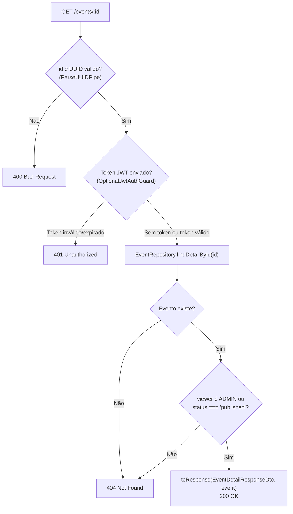

# Detalhes do evento

O endpoint `GET /events/:id` retorna os dados completos de um evento específico,
incluindo o **local** com **endereço**, a **organização** responsável e a lista
de **lotes de ingressos** (`ticketTypes`). É o endpoint consumido pela
[página de detalhes do evento](../figma/detalhes-do-evento.md) na Webpage.

Para a listagem paginada e filtrada de eventos, veja
[Busca de eventos](./busca-eventos.md).

## Acesso e visibilidade

A rota é pública e utiliza o `OptionalJwtAuthGuard` — o envio do token JWT no
cabeçalho `Authorization: Bearer <token>` é opcional:

| Quem chama | O que vê |
| --- | --- |
| Visitante (sem `Authorization`) | Apenas eventos com status `published` (`404` nos demais status) |
| Usuário autenticado (`USER`) | Apenas eventos com status `published` (`404` nos demais status) |
| Administrador (`ADMIN`) | Eventos em qualquer status (`draft`, `published`, `finished`, `cancelled`) |
| Token enviado, mas inválido ou expirado | `401 Unauthorized` |

Eventos em `draft`, `finished` ou `cancelled` respondem `404 Not Found` para
visitantes e usuários comuns (`USER`), com a mesma mensagem de um evento
inexistente. Assim, a API não revela a existência de rascunhos ou eventos não
publicados.



## Parâmetro de rota

| Parâmetro | Tipo | Validação |
| --- | --- | --- |
| `id` | `string` (UUID) | Validado pelo `ParseUUIDPipe` do NestJS antes de chegar ao service. Valores fora do formato UUID respondem `400`. |

## Arquitetura da consulta e segurança de dados

### Separação entre `findById` e `findDetailById`

No `EventRepository`, a leitura por ID é dividida em dois métodos para evitar
*joins* desnecessários em operações internas:

- **`findById(id)`**: busca apenas a linha da tabela `events` (sem relações),
  usada internamente em validações de existência e regras de negócio (`update`,
  `cancel`, tarefas, criação de lotes e emissão de ingressos).
- **`findDetailById(id)`**: usada exclusivamente por `EventService.findVisible`
  para o endpoint `GET /events/:id`, carregando em uma única consulta relacional
  do Drizzle ORM (`with`):
  - `venue` com `address` (`venues` → `addresses`);
  - `organization` (`organizations`);
  - `ticketTypes` (`ticket_types`), ordenados por `createdAt ASC`, `price ASC` e
    `id ASC`. Quando o evento ainda não possui lotes cadastrados, `ticketTypes`
    retorna `[]`.

### DTOs enxutos (prevenção de *Data Leakage*)

Como `GET /events/:id` é uma rota pública, o `EventDetailResponseDto` **não**
reaproveita os DTOs administrativos completos de organização e local. Em vez
disso, utiliza DTOs dedicados que expõem apenas os campos necessários para a
página pública via `toResponse`:

| DTO | Campos expostos | Campos internos omitidos |
| --- | --- | --- |
| `EventDetailOrganizationDto` | `id`, `name`, `description` | `representativeId`, `createdAt`, `updatedAt` |
| `EventDetailVenueDto` | `id`, `name`, `maxCapacity`, `address` (`AddressResponseDto`) | `active`, `addressId`, `createdAt`, `updatedAt` |
| `TicketTypeResponseDto` | `id`, `eventId`, `batch`, `price`, `quantity`, `createdAt`, `updatedAt` | — |

## Exemplos

### Consulta de evento publicado (`200 OK`)

```bash
curl "http://localhost:3000/events/11111111-1111-4111-8111-111111111111"
```

Resposta `200`:

```json
{
  "id": "11111111-1111-4111-8111-111111111111",
  "name": "Festa Junina 2026",
  "description": "Arraiá universitário com comidas típicas e música ao vivo",
  "ageRating": "18",
  "organizerId": "0a1b2c3d-4e5f-4a6b-8c7d-9e0f1a2b3c4d",
  "venueId": "1b2c3d4e-5f6a-4b7c-8d9e-0f1a2b3c4d5e",
  "startDate": "2026-06-20T18:00:00.000Z",
  "endDate": "2026-06-20T23:00:00.000Z",
  "salesStartDate": "2026-05-01T12:00:00.000Z",
  "status": "published",
  "category": "Festas",
  "edition": "10ª Edição",
  "photoUrl": "https://cdn.hubee.com.br/events/festa-junina-2026.jpg",
  "featured": true,
  "createdAt": "2026-01-01T00:00:00.000Z",
  "updatedAt": "2026-01-01T00:00:00.000Z",
  "venue": {
    "id": "1b2c3d4e-5f6a-4b7c-8d9e-0f1a2b3c4d5e",
    "name": "Espaço Teste",
    "maxCapacity": 500,
    "address": {
      "id": "2c3d4e5f-6a7b-4c8d-9e0f-1a2b3c4d5e6f",
      "zipCode": "12247-014",
      "street": "Av. Cesare Mansueto Giulio Lattes",
      "number": "1201",
      "complement": null,
      "neighborhood": "Eugênio de Melo",
      "city": "São José dos Campos",
      "state": "SP",
      "country": "Brasil",
      "createdAt": "2026-01-01T00:00:00.000Z",
      "updatedAt": "2026-01-01T00:00:00.000Z"
    }
  },
  "organization": {
    "id": "0a1b2c3d-4e5f-4a6b-8c7d-9e0f1a2b3c4d",
    "name": "Centro Acadêmico",
    "description": "Agremiação estudantil"
  },
  "ticketTypes": [
    {
      "id": "3d4e5f6a-7b8c-4d9e-8f0a-1b2c3d4e5f6a",
      "eventId": "11111111-1111-4111-8111-111111111111",
      "batch": "1º Lote",
      "price": 35,
      "quantity": 100,
      "createdAt": "2026-01-01T00:00:00.000Z",
      "updatedAt": "2026-01-01T00:00:00.000Z"
    }
  ]
}
```

### UUID inválido (`400 Bad Request`)

```bash
curl "http://localhost:3000/events/id-invalido"
```

```json
{
  "message": "Validation failed (uuid is expected)",
  "error": "Bad Request",
  "statusCode": 400
}
```

### Evento inexistente ou não publicado (`404 Not Found`)

```bash
curl "http://localhost:3000/events/22222222-2222-4222-8222-222222222222"
```

```json
{
  "message": "Evento 22222222-2222-4222-8222-222222222222 não encontrado",
  "error": "Not Found",
  "statusCode": 404
}
```

## Onde está no código

No repositório [`hubee-api`](https://github.com/Hubee-Unifesp/hubee-api):

| Arquivo | Responsabilidade |
| --- | --- |
| `src/event/event.controller.ts` | Rota `GET /events/:id` com `OptionalJwtAuthGuard`, `ParseUUIDPipe` e serialização via `toResponse(EventDetailResponseDto, ...)` |
| `src/event/dto/event-detail-response.dto.ts` | `EventDetailResponseDto`, `EventDetailVenueDto` e `EventDetailOrganizationDto` |
| `src/event/event.service.ts` | `findVisible(id, viewer)` — consulta `findDetailById` e aplica a regra de visibilidade por status/papel |
| `src/event/event.repository.ts` | `findDetailById(id)` com `with: { venue: { with: { address: true } }, organization: true, ticketTypes }` |
| `src/database/schema/event.schema.ts` | `eventsRelations` (`organization`, `venue`, `ticketTypes`) |
| `src/database/schema/ticket-type.schema.ts` | `ticketTypesRelations` (`event`) |

No repositório [`hubee-collections`](https://github.com/Hubee-Unifesp/hubee-collections):

- `EVENTOS/GET BUSCA POR ID.bru` — requisição pronta no Bruno (`GET {{baseUrl}}/events/{{id}}`).

