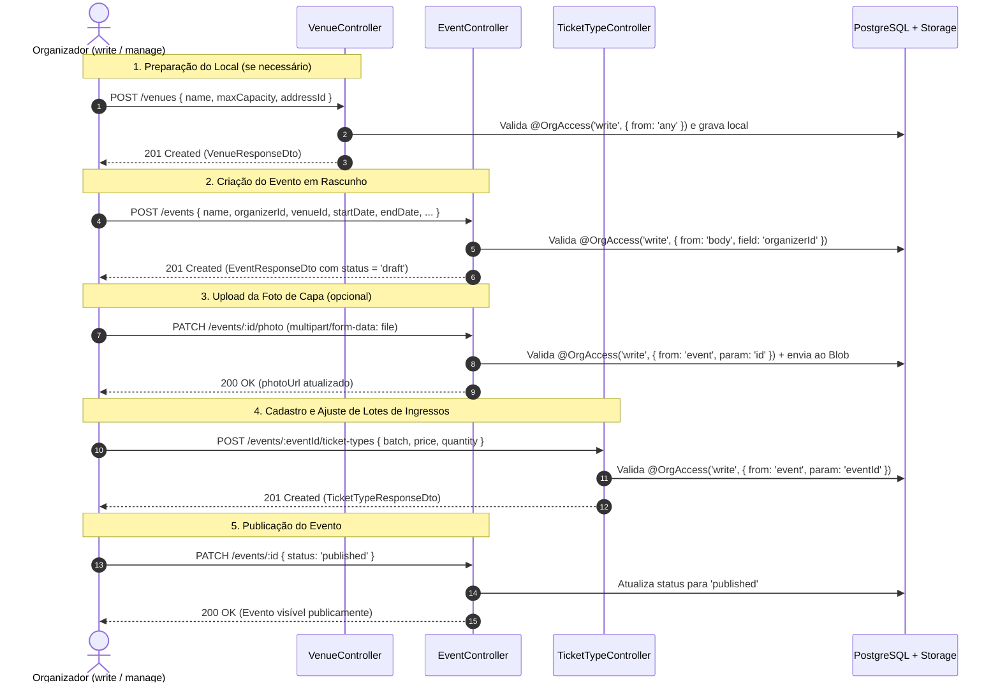

# Gerenciamento de Eventos e Lotes de Ingressos

Os módulos de **eventos** (`/events`) e **lotes de ingressos** (`/events/:eventId/ticket-types`) da `hubee-api` permitem que membros autorizados de uma [organização](./organizacoes.md) conduzam todo o ciclo de vida de um evento — desde o cadastro do local e rascunho inicial, envio da imagem de capa e configuração de lotes com controle de estoque, até a publicação na vitrine ou o cancelamento administrativo (tasks **GOL-147**, **GOL-206**, **GOL-207**, **GOL-212**, **GOL-216** e **GOL-221**).

Para a busca pública paginada e o detalhamento público do evento, consulte também:
- [Busca de eventos (`GET /events`)](./busca-eventos.md)
- [Detalhes do evento (`GET /events/:id`)](./detalhes-evento.md)

---

## 1. Fluxo Completo do Organizador

O diagrama abaixo resume a jornada ponta a ponta do organizador para criar, configurar lotes, publicar e gerenciar um evento na plataforma:



---

## 2. Matriz de Autorização RBAC (Eventos, Lotes e Locais)

A autorização nas rotas de gerenciamento é aplicada pelo decorator `@OrgAccess(level, source)` (combinando `JwtAuthGuard` e `OrganizationAccessGuard`, conforme detalhado em [Autenticação e autorização](./autenticacao.md)):

| Método | Rota | Guard / Decorator | Quem pode acessar | Não-membro da org | Membro sem nível suficiente |
| :--- | :--- | :--- | :--- | :---: | :---: |
| `POST` | `/venues` | `@OrgAccess('write', { from: 'any' })` | Membro `write`/`manage` de **qualquer** organização ativa ou `ADMIN` (`GOL-206`) | `403 Forbidden` | `403 Forbidden` (apenas `read`) |
| `POST` | `/events` | `@OrgAccess('write', { from: 'body', field: 'organizerId' })` | Membro `write`/`manage` da organização indicada em `organizerId` ou `ADMIN` | `403 Forbidden` | `403 Forbidden` (membro `read`) |
| `PATCH` | `/events/:id` | `@OrgAccess('write', { from: 'event', param: 'id' })` | Membro `write`/`manage` da organização dona do evento ou `ADMIN` | **`404 Not Found`** | **`403 Forbidden`** (membro `read`) |
| `PATCH` | `/events/:id/photo` | `@OrgAccess('write', { from: 'event', param: 'id' })` | Membro `write`/`manage` da organização dona do evento ou `ADMIN` (`GOL-221`) | **`404 Not Found`** | **`403 Forbidden`** (membro `read`) |
| `DELETE` | `/events/:id` | `@OrgAccess('manage', { from: 'event', param: 'id' })` | Apenas administrador da organização (`manage`) ou `ADMIN` global | **`404 Not Found`** | **`403 Forbidden`** (membro `read` ou `write`) |
| `POST` | `/events/:eventId/ticket-types` | `@OrgAccess('write', { from: 'event', param: 'eventId' })` | Membro `write`/`manage` da organização dona do evento ou `ADMIN` (`GOL-206`) | **`404 Not Found`** | **`403 Forbidden`** (membro `read`) |
| `GET` | `/events/:eventId/ticket-types` | `OptionalJwtAuthGuard` | Público se evento `published`; restrito a membros da org (`read`/`write`/`manage`) ou `ADMIN` nos demais status | **`404 Not Found`** (se não `published`) | — |
| `GET` | `/events/:eventId/ticket-types/:id` | `OptionalJwtAuthGuard` | Público se evento `published`; restrito a membros da org ou `ADMIN` nos demais status | **`404 Not Found`** (se não `published`) | — |
| `PATCH` | `/events/:eventId/ticket-types/:id` | `@OrgAccess('write', { from: 'event', param: 'eventId' })` | Membro `write`/`manage` da organização dona do evento ou `ADMIN` (`GOL-206`) | **`404 Not Found`** | **`403 Forbidden`** (membro `read`) |
| `DELETE` | `/events/:eventId/ticket-types/:id` | `@OrgAccess('write', { from: 'event', param: 'eventId' })` | Membro `write`/`manage` da organização dona do evento ou `ADMIN` (`GOL-206`) | **`404 Not Found`** | **`403 Forbidden`** (membro `read`) |

> **Prevenção contra enumeração (`404` vs `403`):** Sempre que a origem do `@OrgAccess` é `{ from: 'event' }`, tentativas de leitura ou escrita por usuários que **não pertencem** à organização dona do evento (ou cujo convite ainda está `pending`/`rejected`) recebem **`404 Not Found`** (`Evento <id> não encontrado`), ocultando a existência de rascunhos de outras organizações. Membros ativos da organização que possuem apenas nível inferior ao exigido (ex.: `read` tentando editar um lote ou `write` tentando cancelar o evento) recebem **`403 Forbidden`**.

---

## 3. Contratos de Gerenciamento de Eventos (`/events`)

### 3.1. Criar Evento (`POST /events`)

Cria um evento vinculado à organização `organizerId` e ao local `venueId`. Todo evento recém-criado nasce com `status = 'draft'` (rascunho) e `featured = false` (a menos que seja criado por um `ADMIN` global informando `featured: true`).

- **Autorização:** `@OrgAccess('write', { from: 'body', field: 'organizerId' })`.

#### Corpo da Requisição (`CreateEventDto`)

| Campo | Tipo | Obrigatório | Validação e Regras |
| :--- | :--- | :---: | :--- |
| `name` | `string` | Sim | Nome do evento (máximo de 255 caracteres). |
| `organizerId` | `string (uuid)` | Sim | UUID da organização responsável (deve existir e o usuário deve ter nível `write` ou `manage` nela). |
| `venueId` | `string (uuid)` | Sim | UUID do local do evento (deve existir na tabela `venues`). |
| `startDate` | `string (ISO 8601)` | Sim | Data/hora de início do evento. |
| `endDate` | `string (ISO 8601)` | Sim | Data/hora de término (`endDate` deve ser estritamente posterior a `startDate`). |
| `salesStartDate` | `string (ISO 8601)` | Não | Data/hora de abertura das vendas (`salesStartDate <= startDate`). |
| `description` | `string` | Não | Descrição detalhada do evento. |
| `ageRating` | `'L' \| '10' \| '12' \| '14' \| '16' \| '18'` | Não | Classificação indicativa (padrão `'L'` no banco). |
| `category` | `string` | Não | Categoria do evento (máximo de 100 caracteres, ex.: `"Festa"`, `"Congresso"`). |
| `edition` | `string` | Não | Edição do evento (máximo de 100 caracteres, ex.: `"2027.1"`). |
| `photoUrl` | `string (url)` | Não | URL da imagem de capa (máximo de 2048 caracteres). |
| `featured` | `boolean` | Não | Destaque na página inicial. **Restrito a `role = 'ADMIN'`** (qualquer outro usuário que enviar `featured` recebe `403 Forbidden`). |

#### Exemplo de Payload (`POST /events`)

```json
{
  "name": "Calourada Hubee",
  "description": "Recepção oficial dos ingressantes com atrações musicais.",
  "ageRating": "18",
  "organizerId": "0a1b2c3d-4e5f-4a6b-8c7d-9e0f1a2b3c4d",
  "venueId": "1b2c3d4e-5f6a-4b7c-8d9e-0f1a2b3c4d5e",
  "startDate": "2027-03-20T19:00:00.000Z",
  "endDate": "2027-03-21T02:00:00.000Z",
  "salesStartDate": "2027-02-01T12:00:00.000Z",
  "category": "Festa",
  "edition": "1ª Edição"
}
```

#### Resposta de Sucesso (`201 Created` — `EventResponseDto`)

```json
{
  "id": "11111111-1111-4111-8111-111111111111",
  "name": "Calourada Hubee",
  "description": "Recepção oficial dos ingressantes com atrações musicais.",
  "ageRating": "18",
  "organizerId": "0a1b2c3d-4e5f-4a6b-8c7d-9e0f1a2b3c4d",
  "venueId": "1b2c3d4e-5f6a-4b7c-8d9e-0f1a2b3c4d5e",
  "startDate": "2027-03-20T19:00:00.000Z",
  "endDate": "2027-03-21T02:00:00.000Z",
  "salesStartDate": "2027-02-01T12:00:00.000Z",
  "status": "draft",
  "category": "Festa",
  "edition": "1ª Edição",
  "photoUrl": null,
  "featured": false,
  "createdAt": "2026-11-09T18:00:00.000Z",
  "updatedAt": "2026-11-09T18:00:00.000Z"
}
```

#### Respostas de Erro (`POST /events`)

- **`400 Bad Request`:**
  - `A data de término deve ser posterior à data de início` (`endDate <= startDate`).
  - `A data de início das vendas não pode ser posterior ao início do evento` (`salesStartDate > startDate`).
  - Campos obrigatórios ausentes ou formatos inválidos.
- **`401 Unauthorized`:** Token JWT ausente ou inválido.
- **`403 Forbidden`:**
  - Usuário sem vínculo `write`/`manage` na organização `organizerId` (`Acesso negado`).
  - Usuário não-`ADMIN` tentando informar `featured` (`Apenas administradores podem destacar eventos na página inicial`).
- **`404 Not Found`:** `Organização <id> não encontrada` ou `Local <id> não encontrado`.

---

### 3.2. Atualizar ou Publicar Evento (`PATCH /events/:id`)

Atualiza parcialmente os dados de um evento existente ou altera seu `status` (`draft`, `published`, `finished`, `cancelled`).

- **Autorização:** `@OrgAccess('write', { from: 'event', param: 'id' })`.
- **Regras adicionais de negócio no `EventService.update`:**
  1. **Imutabilidade de organização:** O `UpdateEventDto` não aceita `organizerId` (um evento não pode ser transferido de organização).
  2. **Evento cancelado é imutável:** Se o evento já estiver com `status === 'cancelled'`, qualquer tentativa de `PATCH` retorna **`422 Unprocessable Entity`** (`Evento cancelado não pode ser alterado`).
  3. **Cancelamento via `PATCH` exige `manage`:** Se o payload enviar `"status": "cancelled"`, o serviço chama `ensureCanCancel` e exige nível **`manage`** na organização (ou `ADMIN` global), retornando **`403 Forbidden`** (`Apenas administradores da organização podem cancelar o evento`) para membros que possuem apenas `write`.
  4. **Validação cruzada de datas:** Se apenas `startDate`, `endDate` ou `salesStartDate` for enviado, a validação de período (`endDate > startDate` e `salesStartDate <= startDate`) combina os campos enviados no DTO com as datas já salvas no evento.

#### Exemplo de Payload (`PATCH /events/:id` — Publicação)

```json
{
  "name": "Calourada Hubee — Edição Oficial",
  "status": "published"
}
```

#### Respostas (`PATCH /events/:id`)

- **`200 OK`:** Retorna o `EventResponseDto` atualizado.
- **`400 Bad Request`:** Datas inconsistentes ou UUID inválido.
- **`403 Forbidden`:** Membro `read` tentando editar, membro `write` tentando enviar `status: "cancelled"`, ou não-`ADMIN` enviando `featured`.
- **`404 Not Found`:** Evento inexistente, pertencente a outra organização, ou `venueId` informado não encontrado.
- **`422 Unprocessable Entity`:** `Evento cancelado não pode ser alterado`.

---

### 3.3. Atualizar Foto de Capa do Evento (`PATCH /events/:id/photo`)

Realiza o upload da imagem de capa do evento para o serviço de armazenamento (`StorageService` / Vercel Blob) no caminho `events/<eventId>/cover.<jpg|png>`, atualiza o campo `photoUrl` do evento e remove a foto anterior caso existisse (`GOL-221`).

- **Autorização:** `@OrgAccess('write', { from: 'event', param: 'id' })`.
- **Formato:** `multipart/form-data` com o arquivo no campo `file`.
- **Validações da imagem (`validateImageUpload`):**
  - Tipos MIME aceitos (conferidos também por *magic bytes*): `image/jpeg` (`.jpg` / `.jpeg`) e `image/png` (`.png`).
  - Tamanho máximo: **2 MB** (`2 * 1024 * 1024` bytes).
- **Respostas:**
  - **`200 OK`:** Retorna `EventResponseDto` com o novo `photoUrl`.
  - **`400 Bad Request`:** Arquivo ausente ou formato diferente de JPEG/PNG.
  - **`413 Payload Too Large`:** Arquivo acima de 2 MB.
  - **`422 Unprocessable Entity`:** `Evento cancelado não pode ser alterado`.
  - **`503 Service Unavailable`:** `Não foi possível enviar a imagem. Tente novamente.` (em caso de falha no provedor de storage).

---

### 3.4. Cancelar Evento (`DELETE /events/:id`)

Cancela o evento alterando seu `status` para `'cancelled'` (não remove a linha do banco de dados, preservando o histórico de pedidos e ingressos).

- **Autorização:** `@OrgAccess('manage', { from: 'event', param: 'id' })` — exclusivo para administradores da organização (`role = 'admin'`, `permission = 'full'`) ou `ADMIN` global.
- **Respostas:**
  - **`204 No Content`:** Evento cancelado com sucesso (sem corpo de resposta).
  - **`403 Forbidden`:** Membro da organização com nível `read` ou `write`.
  - **`404 Not Found`:** Evento inexistente ou usuário não pertence à organização dona do evento.
  - **`422 Unprocessable Entity`:** `Evento já está cancelado`.

---

## 4. Contratos de Lotes de Ingressos (`/events/:eventId/ticket-types`)

Os lotes de ingressos são sub-recursos de um evento (`/events/:eventId/ticket-types`). Todas as rotas validam primeiro se o `:eventId` existe e se o lote `:id` pertence de fato àquele `:eventId` (`TicketTypeService.findOneByEvent`).

### 4.1. Criar Lote de Ingressos (`POST /events/:eventId/ticket-types`)

Cadastra um novo lote de ingressos para o evento (`GOL-206`).

- **Autorização:** `@OrgAccess('write', { from: 'event', param: 'eventId' })`.

#### Corpo da Requisição (`CreateTicketTypeDto`)

| Campo | Tipo | Obrigatório | Validação |
| :--- | :--- | :---: | :--- |
| `batch` | `string` | Sim | Identificação do lote (ex.: `"1º Lote Promocional"`, `"Lote VIP"`), entre 1 e 50 caracteres. |
| `price` | `number` | Sim | Preço unitário com até 2 casas decimais (`>= 0`, máximo `99999999.99`). Aceita `0` para lotes gratuitos. |
| `quantity` | `number (int)` | Não | Capacidade total do lote (`int >= 0`). Se omitido (`null`), o lote não possui limite máximo fixo. |

#### Exemplo de Payload (`POST /events/:eventId/ticket-types`)

```json
{
  "batch": "1º Lote Promocional",
  "price": 35.00,
  "quantity": 100
}
```

#### Resposta de Sucesso (`201 Created` — `TicketTypeResponseDto`)

```json
{
  "id": "3d4e5f6a-7b8c-4d9e-8f0a-1b2c3d4e5f6a",
  "eventId": "11111111-1111-4111-8111-111111111111",
  "batch": "1º Lote Promocional",
  "price": 35,
  "quantity": 100,
  "createdAt": "2026-11-09T18:05:00.000Z",
  "updatedAt": "2026-11-09T18:05:00.000Z"
}
```

---

### 4.2. Listar e Consultar Lotes (`GET /events/:eventId/ticket-types` e `GET /events/:eventId/ticket-types/:id`)

Retorna todos os lotes do evento (ordenados por `createdAt ASC`, `price ASC`, `id ASC`) ou um lote específico, enriquecidos com o saldo disponível em tempo real no campo `available` (`GOL-212` e `GOL-216`).

- **Autorização:** `OptionalJwtAuthGuard` + `EventService.findVisible(eventId, user)`.
  - Se o evento estiver `published`, qualquer visitante pode consultar os lotes.
  - Se o evento estiver em `draft`, `finished` ou `cancelled`, apenas membros aceitos da organização do evento e `ADMIN` recebem `200 OK`; demais chamadas recebem `404 Not Found`.

#### Cálculo do Estoque Comprometido e Saldo (`available`)

Para cada lote cujo `quantity` não é `null`, o repositório calcula a quantidade comprometida (`committed`) evitando dupla contagem entre reservas de pedidos e ingressos já emitidos (`GOL-212` / `GOL-216`):

```text
committed = emitidos_ativos + reservados_em_pedidos_sem_ingresso
available = max(0, quantity - committed)
```

- **Ingressos emitidos ativos (`emitidos_ativos`):** linhas em `tickets` com `status IN ('valid', 'used')` (ingressos `cancelled` liberam a vaga de volta ao lote).
- **Pedidos ativos ainda não emitidos (`reservados_em_pedidos_sem_ingresso`):** para cada pedido com `status IN ('pending', 'paid')`, considera-se `max(0, order_items.quantity - tickets_nao_cancelados_do_pedido_no_lote)`.

#### Exemplo de Resposta (`200 OK` — `GET /events/:eventId/ticket-types`)

```json
[
  {
    "id": "3d4e5f6a-7b8c-4d9e-8f0a-1b2c3d4e5f6a",
    "eventId": "11111111-1111-4111-8111-111111111111",
    "batch": "1º Lote Promocional",
    "price": 35,
    "quantity": 100,
    "available": 92,
    "createdAt": "2026-11-09T18:05:00.000Z",
    "updatedAt": "2026-11-09T18:05:00.000Z"
  }
]
```

---

### 4.3. Atualizar Lote de Ingressos (`PATCH /events/:eventId/ticket-types/:id`)

Atualiza parcialmente `batch`, `price` e/ou `quantity` de um lote pertencente ao evento (`GOL-206` / `GOL-212`).

- **Autorização:** `@OrgAccess('write', { from: 'event', param: 'eventId' })`.
- **Trava de integridade de estoque (`GOL-212`):** Quando `quantity` é enviado no payload, a atualização roda dentro de uma transação com *lock* pessimista (`SELECT ... FOR UPDATE`) sobre a linha do lote e confere o total comprometido (`committed`). Se `dto.quantity < committed`, a API rejeita a alteração com **`422 Unprocessable Entity`**:
  ```json
  {
    "message": "Quantidade não pode ser menor que a já comprometida (8)",
    "error": "Unprocessable Entity",
    "statusCode": 422
  }
  ```

---

### 4.4. Remover Lote de Ingressos (`DELETE /events/:eventId/ticket-types/:id`)

Remove um lote de ingressos do evento caso ainda não existam vendas ou reservas vinculadas a ele (`GOL-206`).

- **Autorização:** `@OrgAccess('write', { from: 'event', param: 'eventId' })`.
- **Proteção de integridade referencial (`409 Conflict`):** Antes de excluir, o `TicketTypeService.remove` verifica se o lote possui registros em `tickets` ou em `order_items` (`hasLinkedRecords`). Caso exista qualquer ingresso ou pedido vinculado, a exclusão é bloqueada com **`409 Conflict`**:
  ```json
  {
    "message": "Lote possui ingressos ou pedidos vinculados e não pode ser removido",
    "error": "Conflict",
    "statusCode": 409
  }
  ```
- **Sucesso:** Retorna **`204 No Content`** quando o lote é removido.

---

## 5. Testando o Fluxo Completo no Bruno (`hubee-collections`)

A pasta `EVENTOS/` no repositório [`hubee-collections`](./collections.md) disponibiliza a sequência numerada de requisições para exercitar todo o gerenciamento de eventos e lotes usando `{{baseUrl}}`, `{{tokenOrganizador}}`, `{{eventId}}` e `{{ticketTypeId}}`:

| Ordem (`seq`) | Arquivo em `EVENTOS/` | Método e Rota | Comportamento / Variáveis Salvas |
| :---: | :--- | :--- | :--- |
| `1` | `POST CRIAR EVENTO.yml` | `POST {{baseUrl}}/events` | Cria o evento em `draft` com `{{tokenOrganizador}}` e grava `res.body.id` em `{{eventId}}`. |
| `2` | `POST CRIAR EVENTO SEM PERMISSAO.yml` | `POST {{baseUrl}}/events` | Valida o bloqueio `403 Forbidden` quando chamado com `{{tokenComprador}}`. |
| `3` | `PATCH ATUALIZAR EVENTO.yml` | `PATCH {{baseUrl}}/events/:id` | Atualiza dados do evento `{{eventId}}` e publica (`status: "published"`), validando `200 OK`. |
| `4` | `POST CRIAR LOTE INGRESSO.yml` | `POST {{baseUrl}}/events/:eventId/ticket-types` | Cria um lote no evento `{{eventId}}` e grava `res.body.id` em `{{ticketTypeId}}`. |
| `5` | `GET LISTAR LOTES DO EVENTO.yml` | `GET {{baseUrl}}/events/:eventId/ticket-types` | Lista os lotes de `{{eventId}}` conferindo o retorno em array e o campo `available`. |
| `6` | `PATCH ATUALIZAR LOTE INGRESSO.yml` | `PATCH {{baseUrl}}/events/:eventId/ticket-types/:id` | Atualiza `batch`, `price` e `quantity` do lote `{{ticketTypeId}}` (`200 OK`). |
| `7` | `DELETE REMOVER LOTE INGRESSO.yml` | `DELETE {{baseUrl}}/events/:eventId/ticket-types/:id` | Remove o lote `{{ticketTypeId}}` quando não há pedidos/ingressos vinculados (`204 No Content`). |
| `8` | `DELETE CANCELAR EVENTO.yml` | `DELETE {{baseUrl}}/events/:id` | Cancela o evento `{{eventId}}` exigindo nível `manage` (`204 No Content`). |

---

## 6. Onde está no código (`hubee-api`)

| Arquivo | Responsabilidade |
| :--- | :--- |
| `src/event/event.controller.ts` | Rotas `POST /events`, `GET /events`, `GET /events/summary`, `GET /events/:id`, `PATCH /events/:id`, `PATCH /events/:id/photo` e `DELETE /events/:id`. |
| `src/event/event.service.ts` | Regras de visibilidade (`findAll`, `findVisible`), criação, edição, upload de capa, destaque (`ensureCanFeature`) e cancelamento (`ensureCanCancel`). |
| `src/ticket-type/ticket-type.controller.ts` | Rotas `POST`, `GET`, `PATCH` e `DELETE` em `/events/:eventId/ticket-types`. |
| `src/ticket-type/ticket-type.service.ts` | Validação de vínculo lote-evento, trava transacional de estoque (`quantity >= committed`) e bloqueio `409` de exclusão com vínculos. |
| `src/ticket-type/ticket-type.repository.ts` | Cálculo SQL de `countCommitted` / `withAvailable` e lock pessimista `findByIdForUpdate`. |
| `src/venue/venue.controller.ts` | Rota `POST /venues` protegida por `@OrgAccess('write', { from: 'any' })` e rotas administrativas `PATCH`/`DELETE /venues/:id` (`@AdminOnly()`). |
