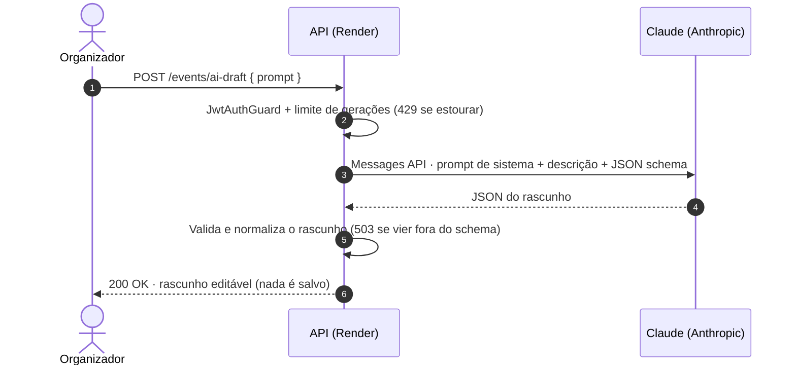

# Integração com IA (Claude)

A `hubee-api` usa o [Claude](https://platform.claude.com/docs), da Anthropic,
para gerar o rascunho de um evento a partir de uma descrição em linguagem
natural (história **GOL-226**). Esta página explica de onde vem a chave da
API, como configurar cada ambiente e o que limita o uso e o custo.

| Task | O que entrega |
| --- | --- |
| **GOL-279** | Módulo `src/ai/` com o `AiService` e a integração com o SDK da Anthropic. |
| **GOL-280** | Prompt, schema da saída estruturada e validação do rascunho de evento. |
| **GOL-281** | Limite de gerações por usuário, teto de tokens, `effort` configurável e log de consumo. |
| **GOL-282** | Chave de produção e esta documentação. |

A rota que expõe o rascunho (`POST /events/ai-draft`) é da **GOL-263**.

## Como a chamada funciona



A chave fica só na API. O navegador nunca fala com a Anthropic, e a Webpage
não precisa de nenhuma variável nova.

## Variáveis de ambiente

Todas são opcionais: a API sobe mesmo sem elas. Valores inválidos impedem o
boot, com uma mensagem apontando a variável, como as demais variáveis da API.

| Variável | Padrão | Para quê |
| --- | --- | --- |
| `ANTHROPIC_API_KEY` | — | Chave da API da Anthropic. Sem ela, as rotas de IA respondem `503`. |
| `ANTHROPIC_MODEL` | `claude-opus-5-5` | Modelo usado nas chamadas. |
| `AI_TIMEOUT_MS` | `30000` | Tempo máximo de espera pela resposta, em milissegundos. |
| `AI_MAX_TOKENS` | `16000` | Teto de tokens de saída por chamada, incluindo o raciocínio do modelo. |
| `AI_EFFORT` | `medium` | Esforço do modelo: `low`, `medium`, `high`, `xhigh` ou `max`. Mais esforço gasta mais tokens. |
| `AI_RATE_LIMIT_MAX` | `5` | Gerações por usuário dentro da janela. O excesso responde `429`. |
| `AI_RATE_LIMIT_WINDOW_MS` | `60000` | Tamanho da janela do limite, em milissegundos. |

As quatro últimas chegam com a **GOL-281**. Os valores de exemplo estão no
[`.env.example`](https://github.com/Hubee-Unifesp/hubee-api/blob/develop/.env.example)
da `hubee-api`.

## Rodando localmente sem chave

Não é preciso ter uma chave para desenvolver no backend:

- **A API sobe normalmente.** Só as rotas de IA respondem
  `503 Service Unavailable` com a mensagem "A geração com IA não está
  disponível no momento. Tente novamente em instantes.".
- **Os testes não usam a chave.** `npm run test` simula o provedor de IA com
  respostas prontas (as fixtures em `src/event/ai-draft/__fixtures__/`), então
  a suíte roda sem rede e sem custo.

Para testar a geração de verdade na sua máquina, peça uma chave de
desenvolvimento a quem administra a organização da Anthropic e coloque no seu
`.env`:

```bash
ANTHROPIC_API_KEY=sk-ant-...
```

Use uma chave de desenvolvimento, nunca a de produção. O `.env` já está no
`.gitignore`; não coloque a chave em nenhum arquivo versionado, issue, PR ou
mensagem.

## Obtendo a chave de produção

A chave de produção fica num workspace próprio do
[Console da Anthropic](https://platform.claude.com), com limite de gasto
mensal. Quem faz este passo precisa ser administrador da organização no
Console.

1. **Criar o workspace.** Em
   [Workspaces](https://platform.claude.com/settings/workspaces), clique em
   **Create workspace**, dê um nome (por exemplo, `hubee-producao`) e confirme.
   Separar produção num workspace permite limitar o gasto dela sem afetar
   outros usos da organização.
2. **Definir o limite de gasto.** Em
   [Spend limits](https://platform.claude.com/settings/spend-limits), na seção
   **Workspace limits**, escolha o workspace e clique em **Set limit** ao lado
   de **Monthly spend limit**. Se a organização é cobrada direto pela
   Anthropic, configure também um alerta em **Email notifications** para ser
   avisado antes de o limite estourar.
3. **Criar a chave.** Crie uma API key restrita a esse workspace. Prefira uma
   chave de conta de serviço a uma chave pessoal, para que a chave não dependa
   da conta de quem a criou.
4. **Guardar a chave.** O Console mostra a chave inteira uma única vez. Ela vai
   direto para o Render (seção seguinte); não é preciso guardá-la em outro
   lugar.

Quando o limite mensal é atingido, a Anthropic recusa as chamadas, e a API
transforma o erro em `503`. Para liberar, aumente o limite no Console ou
espere o mês virar.

## Configurando a produção (Render)

1. No painel do Render, abra o serviço da `hubee-api` e vá em **Environment**.
2. Adicione `ANTHROPIC_API_KEY` com a chave criada no Console.
3. Se quiser mudar algum padrão da tabela de variáveis, adicione a variável
   correspondente. Sem isso, valem os padrões.
4. Salve com nova implantação. A API só lê as variáveis no boot, então a chave
   passa a valer depois do deploy.

Para conferir, gere um rascunho pela rota de IA com um usuário organizador. Se
a resposta for `503` com a mensagem de IA indisponível, a chave não foi lida:
verifique o nome da variável e se o deploy terminou.

## Uso e custo

Cada geração é uma chamada paga à Anthropic. Os controles, do mais imediato ao
mais amplo:

- **Limite por usuário.** Cada usuário pode fazer até `AI_RATE_LIMIT_MAX`
  gerações a cada `AI_RATE_LIMIT_WINDOW_MS`. O excesso responde `429` com o
  cabeçalho `Retry-After` e a mensagem "Você atingiu o limite de gerações com
  IA. Tente novamente em N segundos.". A contagem fica na memória da API, então
  reinicia a cada deploy e é separada por instância.
- **Teto por chamada.** `AI_MAX_TOKENS` limita a resposta e `AI_EFFORT`
  controla quanto o modelo raciocina. Baixar o `effort` deixa a geração mais
  barata e mais rápida.
- **Limite mensal do workspace.** Configurado no Console, é a última barreira
  contra um gasto inesperado.

### Acompanhando o consumo

Cada chamada gera uma linha no log da API, sem o texto do prompt:

```text
feature=event-ai-draft model=claude-opus-5-5 effort=medium stop_reason=end_turn input_tokens=1830 output_tokens=612 cache_creation_tokens=0 cache_read_tokens=0
```

- `feature` diz qual funcionalidade fez a chamada.
- `input_tokens` e `output_tokens` são os tokens cobrados.
- `cache_creation_tokens` e `cache_read_tokens` mostram o uso do cache do
  prompt de sistema. Tokens lidos do cache saem mais baratos, mas o cache só
  entra em ação quando o prompt passa do tamanho mínimo do modelo, então é
  normal os dois ficarem em `0`.

O gasto consolidado fica na página de uso do Console da Anthropic, filtrando
pelo workspace de produção.

## Se a chave vazar

1. Desative a chave no Console da Anthropic. Ela para de funcionar na hora.
2. Crie uma nova chave no mesmo workspace.
3. Troque `ANTHROPIC_API_KEY` no Render e faça um novo deploy.

Entre o passo 1 e o fim do deploy, as rotas de IA respondem `503`; o resto da
API não é afetado.
