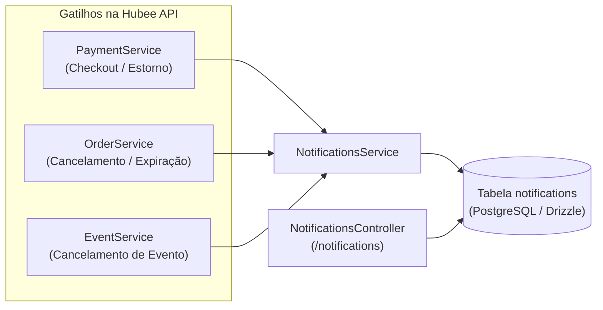

# Notificações In-App

Este documento descreve a arquitetura, o modelo de dados (`notifications`), os gatilhos transacionais automáticos e os contratos de API dos endpoints `/notifications` da [`hubee-api`](https://github.com/Hubee-Unifesp/hubee-api), implementados na task **GOL-268** e documentados na **GOL-269** (Story **GOL-241**).

---

## 1. Visão Geral

O módulo `NotificationsModule` (`src/notifications/`) provê a central de notificações in-app para **compradores** e **organizadores**. As notificações são gravadas de forma síncrona e transacional junto aos fluxos principais de negócio (checkout, estorno, cancelamento de pedido e cancelamento de evento), sem depender de filas externas ou envio de e-mail nesta etapa.



---

## 2. Modelo de Dados (`notification.schema.ts`)

A tabela `notifications` é definida em `src/database/schema/notification.schema.ts` e criada pela migration `0009_notifications.sql`:

| Coluna | Tipo PostgreSQL | Nulo? | Padrão | Descrição |
| :--- | :--- | :---: | :--- | :--- |
| `id` | `uuid` (PK) | Não | `gen_random_uuid()` | Identificador único da notificação |
| `user_id` | `uuid` (FK `users.id`) | Não | — | Usuário destinatário (`ON DELETE CASCADE`) |
| `type` | `notification_type` | Não | — | Tipo do evento que originou a notificação |
| `title` | `varchar(255)` | Não | — | Título curto exibido no card de notificação |
| `message` | `varchar(1000)` | Não | — | Mensagem descritiva em português |
| `href` | `varchar(500)` | Sim | `null` | Rota interna de destino ao clicar na notificação |
| `read_at` | `timestamptz` | Sim | `null` | Data/hora de leitura (`null` = não lida) |
| `created_at` | `timestamptz` | Não | `now()` | Data/hora de criação |

- **Índice:** `notifications_user_id_created_at_idx` sobre `(user_id, created_at)` para otimizar a listagem ordenada e a contagem de não lidas por usuário.

### Tipos de Notificação (`notification_type`)

| Valor (`type`) | Destinatário | Gatilho | `href` Padrão |
| :--- | :--- | :--- | :--- |
| `payment_confirmed` | Comprador (`order.userId`) | Pagamento confirmado e ingressos emitidos no checkout (`POST /payments`) | `/conta/ingressos` |
| `order_cancelled` | Comprador (`order.userId`) | Pedido pendente cancelado manualmente (`DELETE /orders/:id`), via admin (`PATCH /orders/:id`) ou por expiração de reserva | `/conta/pedidos` |
| `order_refunded` | Comprador (`order.userId`) | Pagamento estornado (`PATCH /orders/:orderId/payments` com `status: 'estornado'`) | `/conta/pedidos` |
| `event_cancelled` | Compradores e titulares com ingressos ativos no evento | Evento cancelado (`DELETE /events/:id` ou `PATCH /events/:id` com `status: 'cancelled'`) | `/conta/pedidos` |
| `new_sale` | Membros com convite `accepted` na organização do evento | Nova venda confirmada no checkout (`POST /payments`) | `/organizador/eventos/:eventId` |
| `batch_sold_out` | Membros com convite `accepted` na organização do evento | Quando um pagamento confirmado esgota a última vaga paga do lote (`quantity - soldBefore > 0` e `quantity - sold <= 0`, ignorando reservas pendentes) | `/organizador/eventos/:eventId` |

---

## 3. Contratos dos Endpoints (`/notifications`)

Todas as rotas do `NotificationsController` exigem autenticação JWT via `@Authenticated()` (`Authorization: Bearer <token>`) e serializam a saída com `toResponse`.

---

### 3.1. Listar Notificações do Usuário (`GET /notifications`)

Retorna as notificações pertencentes ao usuário autenticado, ordenadas de forma decrescente por `createdAt` (e `id`), acompanhadas do contador total de notificações não lidas (`unreadCount`).

- **Acesso:** `@Authenticated()` (qualquer usuário autenticado vê apenas as próprias notificações).

#### Parâmetros de Query (`QueryNotificationsDto`)

| Parâmetro | Tipo | Obrigatório? | Padrão | Descrição |
| :--- | :--- | :---: | :--- | :--- |
| `unreadOnly` | `boolean` (`true` \| `false`) | Não | `false` | Quando `true`, filtra `data` para retornar apenas notificações com `readAt: null` |
| `limit` | `integer` (`1` a `100`) | Não | `20` | Quantidade máxima de notificações retornadas em `data` |
| `offset` | `integer` (`>= 0`) | Não | `0` | Deslocamento para paginação |

> O campo `unreadCount` retorna sempre o total de notificações não lidas do usuário autenticado, independentemente dos filtros `unreadOnly`, `limit` ou `offset`.

#### Resposta de Sucesso (`200 OK` — `NotificationListResponseDto`)

```json
{
  "data": [
    {
      "id": "b7e23c91-5a40-4d8e-9b1c-8392014c21a0",
      "userId": "00000000-0000-4000-8000-000000000101",
      "type": "payment_confirmed",
      "title": "Pagamento confirmado",
      "message": "Seu pagamento foi aprovado e seus ingressos para o evento \"Intercomp 2027\" já estão disponíveis.",
      "href": "/conta/ingressos",
      "readAt": null,
      "createdAt": "2026-11-22T04:20:00.000Z"
    }
  ],
  "unreadCount": 1
}
```

#### Respostas de Erro

| Status Code | Causa | Exemplo de Mensagem |
| :--- | :--- | :--- |
| `400 Bad Request` | Parâmetro de query inválido (`unreadOnly`, `limit` ou `offset`) | `"O filtro unreadOnly deve ser um booleano"` / `"O limite deve ser no máximo 100"` |
| `401 Unauthorized` | Token JWT ausente, expirado ou inválido | `"Unauthorized"` |

---

### 3.2. Marcar Notificação como Lida (`PATCH /notifications/:id/read`)

Marca uma notificação específica do usuário autenticado como lida, preenchendo `readAt` com a data/hora atual. Caso a notificação já esteja marcada como lida, retorna `200 OK` mantendo o `readAt` original (idempotente).

- **Acesso:** `@Authenticated()`.
- **Isolamento:** Caso a notificação não exista ou pertença a outro usuário, a API responde `404 Not Found` para evitar enumeração de recursos de terceiros.

#### Parâmetros de Rota

| Parâmetro | Tipo | Descrição |
| :--- | :--- | :--- |
| `id` | `string` (UUID) | Identificador da notificação |

#### Resposta de Sucesso (`200 OK` — `NotificationResponseDto`)

```json
{
  "id": "b7e23c91-5a40-4d8e-9b1c-8392014c21a0",
  "userId": "00000000-0000-4000-8000-000000000101",
  "type": "payment_confirmed",
  "title": "Pagamento confirmado",
  "message": "Seu pagamento foi aprovado e seus ingressos para o evento \"Intercomp 2027\" já estão disponíveis.",
  "href": "/conta/ingressos",
  "readAt": "2026-11-22T04:25:12.000Z",
  "createdAt": "2026-11-22T04:20:00.000Z"
}
```

#### Respostas de Erro

| Status Code | Causa | Exemplo de Mensagem |
| :--- | :--- | :--- |
| `400 Bad Request` | Parâmetro `:id` não é um UUID válido (`ParseUUIDPipe`) | `"Validation failed (uuid is expected)"` |
| `401 Unauthorized` | Token JWT ausente, expirado ou inválido | `"Unauthorized"` |
| `404 Not Found` | Notificação inexistente ou pertencente a outro usuário | `"Notificação <id> não encontrada"` |

---

### 3.3. Marcar Todas como Lidas (`PATCH /notifications/read-all`)

Marca todas as notificações ainda não lidas (`readAt IS NULL`) do usuário autenticado como lidas em uma única operação e retorna a quantidade de registros atualizados.

- **Acesso:** `@Authenticated()`.

#### Resposta de Sucesso (`200 OK` — `ReadAllNotificationsResponseDto`)

```json
{
  "updatedCount": 3
}
```

#### Respostas de Erro

| Status Code | Causa | Exemplo de Mensagem |
| :--- | :--- | :--- |
| `401 Unauthorized` | Token JWT ausente, expirado ou inválido | `"Unauthorized"` |
