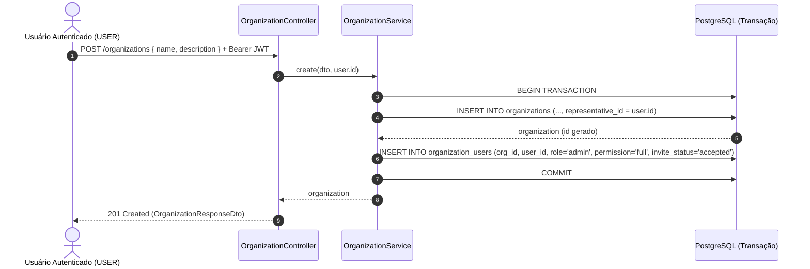
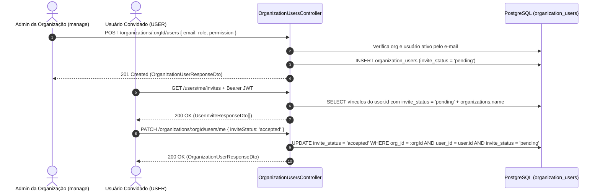

# Organizações

O módulo de **organizações** (`/organizations`) e de **membros da organização** (`/organizations/:orgId/users` e `/users/me/invites`) da `hubee-api` gerencia as entidades organizadoras de eventos (atléticas, centros acadêmicos, produtoras, coletivos), seus vínculos e convites de equipe, aplicando o controle de acesso baseado em papéis (**RBAC**) definido na [Matriz de Permissões (RBAC)](../regras-negocio/matriz-permissoes-rbac.md) (tasks **GOL-197**, **GOL-198** e **GOL-275**). Veja também a especificação visual de interface em [Membros e Convites da Organização](../figma/membros-e-convites-organizacao.md).

---

## 1. Regra de Negócio: Cadastro por Usuário Autenticado e Vínculo Automático (`GOL-197`)

> **Regra de Negócio Crucial (GOL-197):** Ao criar uma organização (`POST /organizations`), o usuário logado é automaticamente vinculado a ela com `role = 'admin'` e nível `'manage'`, sem necessidade de ser um Administrador Global (`role = 'ADMIN'`).

Quando qualquer usuário autenticado (`role = 'USER'` ou `role = 'ADMIN'`) executa `POST /organizations`, o `OrganizationService.create` executa **duas operações atômicas dentro de uma mesma transação de banco de dados (`db.transaction`)**:

1. **Operação A — Criação na tabela `organizations`:** Insere o registro da organização definindo obrigatoriamente `representativeId` com o `user.id` extraído do token JWT (`@CurrentUser()`).
2. **Operação B — Vínculo automático na tabela `organization_users`:** Utiliza o `id` da organização recém-criada para inserir imediatamente o vínculo de administrador para o usuário criador:
   - `orgId`: `organization.id`
   - `userId`: `user.id`
   - `role`: `'admin'`
   - `permission`: `'full'`
   - `inviteStatus`: `'accepted'`



Como o vínculo nasce com `invite_status = 'accepted'`, `role = 'admin'` e `permission = 'full'`, o nível efetivo calculado para o criador na organização é **`manage`**. Dessa forma, a consulta imediatamente seguinte a `GET /users/me` (ou `GET /auth/me`) já retorna a organização criada dentro do array `organizations` do usuário, habilitando a gestão da organização e de seus eventos sem necessidade de novo login.

---

## 2. Resumo de Endpoints e Controle de Acesso

| Método | Rota | Guard / Decorator | Quem pode acessar | Status de Sucesso |
| :--- | :--- | :--- | :--- | :--- |
| `POST` | `/organizations` | `@Authenticated()` | Qualquer usuário autenticado (`USER` ou `ADMIN`) | `201 Created` |
| `GET` | `/organizations` | Público | Qualquer visitante ou usuário | `200 OK` |
| `GET` | `/organizations/:id` | Público | Qualquer visitante ou usuário | `200 OK` |
| `PATCH` | `/organizations/:id` | `@OrgAccess('manage', { from: 'param', param: 'id' })` | Administrador da organização (nível `manage`) ou `ADMIN` global | `200 OK` |
| `DELETE` | `/organizations/:id` | `@AdminOnly()` | Apenas Administrador Global da plataforma (`role = 'ADMIN'`) | `204 No Content` |
| `POST` | `/organizations/:orgId/users` | `@OrgAccess('manage', { from: 'org', param: 'orgId' })` | Administrador da organização (nível `manage`) ou `ADMIN` global | `201 Created` |
| `GET` | `/organizations/:orgId/users` | `@OrgAccess('manage', { from: 'org', param: 'orgId' })` | Administrador da organização (nível `manage`) ou `ADMIN` global | `200 OK` |
| `PATCH` | `/organizations/:orgId/users/:userId` | `@OrgAccess('manage', { from: 'org', param: 'orgId' })` | Administrador da organização (nível `manage`) ou `ADMIN` global | `200 OK` |
| `DELETE` | `/organizations/:orgId/users/:userId` | `@OrgAccess('manage', { from: 'org', param: 'orgId' })` | Administrador da organização (nível `manage`) ou `ADMIN` global | `204 No Content` |
| `GET` | `/users/me/invites` | `@Authenticated()` | Usuário autenticado (lista apenas seus convites pendentes) | `200 OK` |
| `PATCH` | `/organizations/:orgId/users/me` | `@Authenticated()` | Usuário autenticado convidado (aceitar ou recusar próprio convite) | `200 OK` |

---

## 3. Contratos dos Endpoints

### 3.1. Criar Organização (`POST /organizations`)

Cria uma nova organização e vincula transacionalmente o usuário autenticado como administrador (`role: 'admin'`, `permission: 'full'`, `inviteStatus: 'accepted'`, nível `manage`).

- **Autenticação:** `Authorization: Bearer <access_token>` (`@Authenticated()`).

#### Corpo da Requisição (`CreateOrganizationDto`)

| Campo | Tipo | Obrigatório | Validação / Comportamento |
| :--- | :--- | :---: | :--- |
| `name` | `string` | Sim | Não vazio (`trim` automático), máximo de 255 caracteres. |
| `description` | `string` | Não | Descrição textual opcional da organização. |
| `representativeId` | `string (uuid)` | Não | Opcional no DTO; no serviço é sempre sobrescrito pelo `user.id` do usuário autenticado que está criando a organização. |

#### Exemplo de Payload (Request)

```json
{
  "name": "Atlética Unifesp",
  "description": "Associação Atlética Acadêmica do Campus São José dos Campos."
}
```

#### Resposta de Sucesso (`201 Created` — `OrganizationResponseDto`)

```json
{
  "id": "550e8400-e29b-41d4-a716-446655440000",
  "name": "Atlética Unifesp",
  "description": "Associação Atlética Acadêmica do Campus São José dos Campos.",
  "representativeId": "b75bc7ce-51e0-4c22-984e-5d5c753a2908",
  "createdAt": "2026-11-08T18:00:00.000Z",
  "updatedAt": "2026-11-08T18:00:00.000Z"
}
```

#### Reflexo Imediato em `GET /users/me` (`200 OK`)

Após o `201 Created`, a chamada a `GET /users/me` com o mesmo token passa a listar o vínculo ativo com nível `manage`:

```json
{
  "id": "b75bc7ce-51e0-4c22-984e-5d5c753a2908",
  "fullName": "Maria Silva",
  "email": "maria@example.com",
  "role": "USER",
  "organizations": [
    {
      "orgId": "550e8400-e29b-41d4-a716-446655440000",
      "organizationName": "Atlética Unifesp",
      "role": "admin",
      "permission": "full",
      "level": "manage"
    }
  ]
}
```

#### Respostas de Erro

- **`400 Bad Request`:** `name` ausente, vazio após `trim` ou acima de 255 caracteres.
- **`401 Unauthorized`:** Token JWT ausente, inválido ou expirado.

---

### 3.2. Listar Organizações (`GET /organizations`)

Retorna a lista de organizações cadastradas, permitindo filtro opcional por nome.

#### Query Params (`QueryOrganizationDto`)

| Parâmetro | Tipo | Obrigatório | Comportamento |
| :--- | :--- | :---: | :--- |
| `name` | `string` | Não | Busca parcial *case-insensitive* (`ILIKE %name%`) pelo nome da organização. |

#### Exemplo de Resposta (`200 OK`)

```json
[
  {
    "id": "550e8400-e29b-41d4-a716-446655440000",
    "name": "Atlética Unifesp",
    "description": "Associação Atlética Acadêmica do Campus São José dos Campos.",
    "representativeId": "b75bc7ce-51e0-4c22-984e-5d5c753a2908",
    "createdAt": "2026-11-08T18:00:00.000Z",
    "updatedAt": "2026-11-08T18:00:00.000Z"
  }
]
```

---

### 3.3. Buscar Organização por ID (`GET /organizations/:id`)

Retorna os dados públicos de uma organização específica a partir do seu UUID.

#### Resposta de Sucesso (`200 OK`)

```json
{
  "id": "550e8400-e29b-41d4-a716-446655440000",
  "name": "Atlética Unifesp",
  "description": "Associação Atlética Acadêmica do Campus São José dos Campos.",
  "representativeId": "b75bc7ce-51e0-4c22-984e-5d5c753a2908",
  "createdAt": "2026-11-08T18:00:00.000Z",
  "updatedAt": "2026-11-08T18:00:00.000Z"
}
```

#### Respostas de Erro

- **`400 Bad Request`:** Parâmetro `:id` não está no formato UUID.
- **`404 Not Found`:** Organização não encontrada:
  ```json
  {
    "message": "Organização 550e8400-e29b-41d4-a716-446655440000 não encontrada",
    "error": "Not Found",
    "statusCode": 404
  }
  ```

---

### 3.4. Atualizar Organização (`PATCH /organizations/:id`)

Atualiza parcialmente os dados cadastrais da organização (`name`, `description`, `representativeId`).

- **Autorização:** Protegido por `@OrgAccess('manage', { from: 'param', param: 'id' })`. Apenas um membro da organização com nível efetivo **`manage`** (`role = 'admin'`, `permission = 'full'` e `invite_status = 'accepted'`) ou um **Administrador Global (`role = 'ADMIN'`)** pode editar a organização.

#### Corpo da Requisição (`UpdateOrganizationDto`)

| Campo | Tipo | Obrigatório | Validação |
| :--- | :--- | :---: | :--- |
| `name` | `string` | Não | Se enviado, não pode ser vazio (`trim` automático) nem `null`, máximo de 255 caracteres. |
| `description` | `string` | Não | Nova descrição da organização. |
| `representativeId` | `string (uuid)` | Não | UUID de um usuário existente (retorna `404` se o representante não existir). |

#### Exemplo de Payload (Request)

```json
{
  "name": "Atlética Unifesp - Gestão 2026",
  "description": "Descrição atualizada pelo administrador da organização."
}
```

#### Resposta de Sucesso (`200 OK` — `OrganizationResponseDto`)

```json
{
  "id": "550e8400-e29b-41d4-a716-446655440000",
  "name": "Atlética Unifesp - Gestão 2026",
  "description": "Descrição atualizada pelo administrador da organização.",
  "representativeId": "b75bc7ce-51e0-4c22-984e-5d5c753a2908",
  "createdAt": "2026-11-08T18:00:00.000Z",
  "updatedAt": "2026-11-08T18:15:00.000Z"
}
```

#### Comportamento de Erros de Permissão no `PATCH /organizations/:id` (`403` vs `404`)

O `OrganizationAccessGuard` configurado com `{ from: 'param', param: 'id' }` diferencia estritamente **membros sem permissão suficiente** de **não-membros**:

| Cenário do Usuário Autenticado | Status HTTP | Motivo e Regra de Segurança |
| :--- | :---: | :--- |
| **Membro da organização com nível `write` ou `read`** (`role = 'member'`, `invite_status = 'accepted'`) | **`403 Forbidden`** | O usuário já pertence à organização e tem permissão para visualizá-la, mas seu papel não possui o nível `manage` exigido para alterar dados cadastrais. |
| **Não-membro da organização** (sem vínculo em `organization_users`, ou com convite `pending` / `rejected`) ou **organização inexistente** | **`404 Not Found`** | Para evitar enumeração e não vazar a existência ou os vínculos da organização a usuários externos, a API responde com o mesmo `404 Not Found` de um recurso inexistente. |

- **Exemplo de Resposta `403 Forbidden` (membro `read` ou `write` tentando editar):**
  ```json
  {
    "message": "Acesso negado",
    "error": "Forbidden",
    "statusCode": 403
  }
  ```

- **Exemplo de Resposta `404 Not Found` (usuário sem vínculo aceito na organização ou ID inexistente):**
  ```json
  {
    "message": "Organização 550e8400-e29b-41d4-a716-446655440000 não encontrada",
    "error": "Not Found",
    "statusCode": 404
  }
  ```

---

### 3.5. Remover Organização (`DELETE /organizations/:id`)

Remove o registro de uma organização pelo seu UUID.

- **Autorização:** Protegido por `@AdminOnly()` (exclusivo para administradores globais com `role = 'ADMIN'`).
- **Respostas:**
  - **`204 No Content`:** Organização removida com sucesso (sem corpo de resposta).
  - **`401 Unauthorized`:** Token ausente ou inválido.
  - **`403 Forbidden`:** Usuário autenticado com `role = 'USER'` (mesmo que seja administrador da organização, a exclusão definitiva da entidade é restrita ao `ADMIN` da plataforma).
  - **`404 Not Found`:** Organização não encontrada.

---

## 4. Gerenciamento de Membros e Convites (`GOL-275`)

O módulo `OrganizationUsersController` gerencia tanto o ciclo de vida de membros administrado pelos gestores da organização quanto o fluxo de autoatendimento em que o usuário convidado consulta e responde aos seus próprios convites pendentes.

### 4.1. Regras de Autorização (`@OrgAccess('manage')` vs `@Authenticated()`)

As rotas de membros dividem-se em **dois modelos distintos de autorização**:

1. **Gestão da equipe da organização (`@OrgAccess('manage', { from: 'org', param: 'orgId' })`):**
   - Aplicado em `POST /organizations/:orgId/users`, `GET /organizations/:orgId/users`, `PATCH /organizations/:orgId/users/:userId` e `DELETE /organizations/:orgId/users/:userId`.
   - Permite acesso ao **Administrador Global (`role = 'ADMIN'`)** ou a um membro com **vínculo aceito** (`invite_status = 'accepted'`) na organização `:orgId` e nível efetivo **`manage`** (`role = 'admin'` e `permission = 'full'`).
   - O `OrganizationAccessGuard` consulta o vínculo no banco a cada requisição (sem depender de cache no token JWT) e diferencia:
     - **Membro com nível `write` ou `read`:** recebe **`403 Forbidden`** (`"Acesso negado"`).
     - **Não-membro** (sem vínculo ou com convite `pending`/`rejected`) ou **organização inexistente:** recebe **`404 Not Found`** (`"Organização <orgId> não encontrada"`), evitando vazar existência ou vínculos da organização.

2. **Fluxo do próprio convidado (`@Authenticated()`):**
   - Aplicado em `GET /users/me/invites` e `PATCH /organizations/:orgId/users/me`.
   - Qualquer usuário autenticado (`JwtAuthGuard`) pode consultar e responder aos **seus próprios** convites, pois o `userId` é extraído diretamente do JWT via `@CurrentUser()`. Como o convidado ainda não possui vínculo aceito na organização, essas rotas **não** utilizam `@OrgAccess`.
   - No `OrganizationUsersController`, a rota estática `PATCH organizations/:orgId/users/me` é registrada **antes** da rota parametrizada `PATCH organizations/:orgId/users/:userId` para impedir que `:userId` (`ParseUUIDPipe`) capture o segmento literal `"me"`.



---

### 4.2. Convidar Membro por E-mail (`POST /organizations/:orgId/users`)

Convida um usuário ativo cadastrado na plataforma para ingressar na organização `:orgId` a partir de seu **e-mail** (não recebe mais `userId` no corpo). O vínculo é sempre criado com `inviteStatus = 'pending'`.

- **Autorização:** `@OrgAccess('manage', { from: 'org', param: 'orgId' })`.

#### Corpo da Requisição (`CreateOrganizationUserDto`)

| Campo | Tipo | Obrigatório | Validação / Comportamento |
| :--- | :--- | :---: | :--- |
| `email` | `string` (`email`) | Sim | Passa por `@NormalizeEmail()` (`trim` + `toLowerCase()`). Não pode ser vazio e deve ser um e-mail válido de usuário com status `ACTIVE`. |
| `role` | `'admin' \| 'member'` | Sim | Papel do usuário na organização (`OrganizationRole`). |
| `permission` | `'full' \| 'read_only'` | Sim | Permissão do usuário na organização (`OrganizationPermission`). |

#### Exemplo de Payload (Request)

```json
{
  "email": "membro@exemplo.com",
  "role": "member",
  "permission": "full"
}
```

#### Resposta de Sucesso (`201 Created` — `OrganizationUserResponseDto`)

```json
{
  "orgId": "550e8400-e29b-41d4-a716-446655440000",
  "userId": "c3d4e5f6-a7b8-49c0-9123-456789abcdef",
  "userName": "João Pereira",
  "userEmail": "membro@exemplo.com",
  "role": "member",
  "permission": "full",
  "inviteStatus": "pending",
  "createdAt": "2026-11-20T21:00:00.000Z",
  "updatedAt": "2026-11-20T21:00:00.000Z"
}
```

#### Respostas de Erro

- **`400 Bad Request`:** `email` ausente/inválido, enum `role`/`permission` inválido ou `:orgId` não é UUID válido.
- **`401 Unauthorized`:** Token JWT ausente, inválido ou expirado.
- **`403 Forbidden`:** Usuário autenticado é membro `read` ou `write` (sem nível `manage`).
- **`404 Not Found`:**
  - Usuário solicitante sem vínculo aceito na organização ou organização inexistente (`"Organização <orgId> não encontrada"`).
  - Nenhum usuário ativo encontrado para o e-mail informado (`"Usuário não encontrado."`).
- **`409 Conflict`:** O usuário já possui vínculo (pendente, aceito ou recusado) com essa organização:
  ```json
  {
    "message": "Este usuário já está vinculado a esta organização.",
    "error": "Conflict",
    "statusCode": 409
  }
  ```

---

### 4.3. Listar Membros da Organização (`GET /organizations/:orgId/users`)

Lista todos os membros e convites vinculados à organização `:orgId`, fazendo junção com `users` para incluir `userName` e `userEmail`.

- **Autorização:** `@OrgAccess('manage', { from: 'org', param: 'orgId' })`.

#### Exemplo de Resposta (`200 OK` — `OrganizationUserResponseDto[]`)

```json
[
  {
    "orgId": "550e8400-e29b-41d4-a716-446655440000",
    "userId": "b75bc7ce-51e0-4c22-984e-5d5c753a2908",
    "userName": "Maria Silva",
    "userEmail": "maria@example.com",
    "role": "admin",
    "permission": "full",
    "inviteStatus": "accepted",
    "createdAt": "2026-11-08T18:00:00.000Z",
    "updatedAt": "2026-11-08T18:00:00.000Z"
  },
  {
    "orgId": "550e8400-e29b-41d4-a716-446655440000",
    "userId": "c3d4e5f6-a7b8-49c0-9123-456789abcdef",
    "userName": "João Pereira",
    "userEmail": "membro@exemplo.com",
    "role": "member",
    "permission": "full",
    "inviteStatus": "pending",
    "createdAt": "2026-11-20T21:00:00.000Z",
    "updatedAt": "2026-11-20T21:00:00.000Z"
  }
]
```

#### Respostas de Erro

- **`400 Bad Request`:** Parâmetro `:orgId` não é um UUID válido.
- **`401 Unauthorized`:** Token JWT ausente, inválido ou expirado.
- **`403 Forbidden`:** Membro com nível `read` ou `write` tentando listar membros sem `manage`.
- **`404 Not Found`:** Organização inexistente ou usuário sem vínculo aceito nessa organização.

---

### 4.4. Atualizar Papel, Permissão ou Status de Membro (`PATCH /organizations/:orgId/users/:userId`)

Atualiza parcialmente `role`, `permission` ou `inviteStatus` de um vínculo existente na organização.

- **Autorização:** `@OrgAccess('manage', { from: 'org', param: 'orgId' })`.

#### Corpo da Requisição (`UpdateOrganizationUserDto`)

| Campo | Tipo | Obrigatório | Validação |
| :--- | :--- | :---: | :--- |
| `role` | `'admin' \| 'member'` | Não | Novo papel na organização. |
| `permission` | `'full' \| 'read_only'` | Não | Novo nível de permissão. |
| `inviteStatus` | `'pending' \| 'accepted' \| 'rejected'` | Não | Novo status do convite. |

> Pelo menos um dos campos (`role`, `permission` ou `inviteStatus`) deve ser informado; caso o body seja enviado vazio (`{}`), a API responde `400 Bad Request`.

#### Exemplo de Payload (Request)

```json
{
  "role": "admin",
  "permission": "full"
}
```

#### Resposta de Sucesso (`200 OK` — `OrganizationUserResponseDto`)

```json
{
  "orgId": "550e8400-e29b-41d4-a716-446655440000",
  "userId": "c3d4e5f6-a7b8-49c0-9123-456789abcdef",
  "userName": "João Pereira",
  "userEmail": "membro@exemplo.com",
  "role": "admin",
  "permission": "full",
  "inviteStatus": "accepted",
  "createdAt": "2026-11-20T21:00:00.000Z",
  "updatedAt": "2026-11-20T21:12:00.000Z"
}
```

#### Respostas de Erro

- **`400 Bad Request`:** Body vazio (`"Informe ao menos um campo para atualizar: role, permission ou inviteStatus."`), valor fora dos enums ou UUID inválido em `:orgId`/`:userId`.
- **`401 Unauthorized`:** Token JWT ausente, inválido ou expirado.
- **`403 Forbidden`:** Membro sem nível `manage`.
- **`404 Not Found`:** Organização inexistente/não-membro ou vínculo usuário–organização não encontrado (`"Vínculo entre este usuário e esta organização não encontrado."`).

---

### 4.5. Remover Membro ou Cancelar Convite (`DELETE /organizations/:orgId/users/:userId`)

Remove definitivamente o vínculo entre o usuário `:userId` e a organização `:orgId` (tanto para remover membros ativos quanto para cancelar convites pendentes).

- **Autorização:** `@OrgAccess('manage', { from: 'org', param: 'orgId' })`.
- **Respostas:**
  - **`204 No Content`:** Vínculo removido com sucesso (sem corpo de resposta).
  - **`400 Bad Request`:** Parâmetro `:orgId` ou `:userId` não é um UUID válido.
  - **`401 Unauthorized`:** Token JWT ausente ou inválido.
  - **`403 Forbidden`:** Membro com nível `read` ou `write` (sem `manage`).
  - **`404 Not Found`:** Organização inexistente, solicitante não-membro ou vínculo não encontrado (`"Vínculo entre este usuário e esta organização não encontrado."`).

---

### 4.6. Listar Meus Convites Pendentes (`GET /users/me/invites`)

Retorna todos os convites de organização com status **`pending`** destinados ao usuário autenticado, já trazendo o nome da organização (`organizationName`). Convites já aceitos (`accepted`) ou recusados (`rejected`) não são listados.

- **Autorização:** `@Authenticated()` (qualquer usuário autenticado com `Authorization: Bearer <access_token>`).

#### Resposta de Sucesso (`200 OK` — `UserInviteResponseDto[]`)

```json
[
  {
    "orgId": "550e8400-e29b-41d4-a716-446655440000",
    "organizationName": "Atlética Unifesp",
    "userId": "c3d4e5f6-a7b8-49c0-9123-456789abcdef",
    "role": "member",
    "permission": "full",
    "inviteStatus": "pending",
    "createdAt": "2026-11-20T21:00:00.000Z",
    "updatedAt": "2026-11-20T21:00:00.000Z"
  }
]
```

*(Quando não houver convites pendentes, retorna `200 OK` com `[]`.)*

#### Respostas de Erro

- **`401 Unauthorized`:** Token JWT ausente, inválido ou expirado.

---

### 4.7. Responder Convite Pendente (`PATCH /organizations/:orgId/users/me`)

Permite ao próprio usuário autenticado aceitar ou recusar um convite que esteja com status **`pending`** na organização `:orgId`.

- **Autorização:** `@Authenticated()` (o `userId` é obtido exclusivamente do token JWT via `@CurrentUser()`).

#### Corpo da Requisição (`RespondOrganizationInviteDto`)

| Campo | Tipo | Obrigatório | Validação |
| :--- | :--- | :---: | :--- |
| `inviteStatus` | `'accepted' \| 'rejected'` | Sim | Aceita apenas `'accepted'` ou `'rejected'` (`"inviteStatus deve ser accepted ou rejected."`). |

#### Exemplo de Payload (Request)

```json
{
  "inviteStatus": "accepted"
}
```

#### Resposta de Sucesso (`200 OK` — `OrganizationUserResponseDto`)

```json
{
  "orgId": "550e8400-e29b-41d4-a716-446655440000",
  "userId": "c3d4e5f6-a7b8-49c0-9123-456789abcdef",
  "userName": "João Pereira",
  "userEmail": "membro@exemplo.com",
  "role": "member",
  "permission": "full",
  "inviteStatus": "accepted",
  "createdAt": "2026-11-20T21:00:00.000Z",
  "updatedAt": "2026-11-20T21:05:00.000Z"
}
```

Após responder com `'accepted'`, a chamada subsequente a `GET /users/me` passa a incluir a organização na lista `organizations` com o nível efetivo correspondente (`read`, `write` ou `manage`). Caso o usuário responda `'rejected'`, o convite deixa de aparecer em `GET /users/me/invites` e não habilita acesso à organização.

#### Respostas de Erro

- **`400 Bad Request`:** `inviteStatus` ausente ou diferente de `'accepted'`/`'rejected'`, ou `:orgId` não é UUID válido.
- **`401 Unauthorized`:** Token JWT ausente, inválido ou expirado.
- **`404 Not Found`:** Usuário não possui convite com status `pending` para a organização `:orgId` (inclui convite inexistente ou já respondido anteriormente):
  ```json
  {
    "message": "Convite pendente não encontrado para este usuário nesta organização.",
    "error": "Not Found",
    "statusCode": 404
  }
  ```

---

### 4.8. Matriz Completa de Códigos de Resposta (Membros e Convites)

| Código HTTP | Significado | Endpoints onde ocorre |
| :---: | :--- | :--- |
| **`200 OK`** | Listagem ou atualização concluída com sucesso (`OrganizationUserResponseDto` ou `UserInviteResponseDto[]`) | `GET /organizations/:orgId/users`, `PATCH /organizations/:orgId/users/:userId`, `GET /users/me/invites`, `PATCH /organizations/:orgId/users/me` |
| **`201 Created`** | Convite criado por e-mail com `inviteStatus = 'pending'` (`OrganizationUserResponseDto`) | `POST /organizations/:orgId/users` |
| **`204 No Content`** | Vínculo removido com sucesso sem corpo de resposta | `DELETE /organizations/:orgId/users/:userId` |
| **`400 Bad Request`** | Payload inválido (`email`, enums, body vazio no `PATCH` ou `inviteStatus` inválido) ou UUID inválido na rota | `POST`, `GET`, `PATCH` e `DELETE` em `/organizations/:orgId/users*` |
| **`401 Unauthorized`** | Token Bearer ausente, inválido ou expirado | Todas as 6 rotas |
| **`403 Forbidden`** | Usuário autenticado é membro `read` ou `write` da organização, mas não possui nível `manage` nem role global `ADMIN` | `POST /organizations/:orgId/users`, `GET /organizations/:orgId/users`, `PATCH /organizations/:orgId/users/:userId`, `DELETE /organizations/:orgId/users/:userId` |
| **`404 Not Found`** | Solicitante não é membro aceito da organização; organização/vínculo/usuário ativo inexistente; ou convite não está `pending` | Todas as rotas com `:orgId` (`POST`, `GET`, `PATCH`, `DELETE` de gestão e `PATCH .../users/me`) |
| **`409 Conflict`** | E-mail convidado pertence a um usuário que já possui vínculo (`pending`, `accepted` ou `rejected`) na organização | `POST /organizations/:orgId/users` |

---

## 5. Testando via Bruno (`hubee-collections`)

A pasta `ORGANIZACOES/` no repositório [`hubee-collections`](./collections.md) contém as requisições do CRUD de organizações configuradas com `{{baseUrl}}` e variáveis de ambiente:

1. `POST CRIAR ORGANIZACAO.yml` — Cria a organização com `{{tokenOrganizador}}` e salva automaticamente o `id` retornado em `{{organizationId}}`.
2. `GET LISTAR ORGANIZACOES.yml` — Lista organizações filtrando por `?name=Atlética`.
3. `GET BUSCAR ORGANIZACAO.yml` — Consulta `{{baseUrl}}/organizations/:id` usando `{{organizationId}}`.
4. `PATCH ATUALIZAR ORGANIZACAO.yml` — Atualiza `name` e `description` usando `{{tokenOrganizador}}` (cenário de sucesso com nível `manage`, status `200`).
5. `PATCH ATUALIZAR ORGANIZACAO SEM PERMISSAO.yml` — Tenta atualizar a organização com `{{tokenComprador}}` (cenário de bloqueio RBAC da GOL-197, retornando `404` para não-membro ou `403` para membro sem `manage`).
6. `DELETE REMOVER ORGANIZACAO.yml` — Remove a organização `{{organizationId}}` com `{{tokenAdmin}}` (`204 No Content` para `ADMIN` global).

Na sequência, a pasta `MEMBROS DA ORGANIZACAO/` exercita todo o fluxo de convite, aceite e gestão de membros (`GOL-275`):

1. `POST ADICIONAR MEMBRO.yml` — Convida `{{emailComprador}}` para `{{organizationId}}` usando `{{tokenOrganizador}}`, valida `201` e salva `{{userId}}`.
2. `GET LISTAR MEMBROS.yml` — Lista os membros da organização com `{{tokenOrganizador}}` validando `userName` e `userEmail` (`200`).
3. `GET LISTAR MEUS CONVITES.yml` — Consulta os convites pendentes usando `{{tokenComprador}}` (`GET /users/me/invites`, `200`).
4. `PATCH RESPONDER CONVITE.yml` — Aceita o convite da organização usando `{{tokenComprador}}` (`PATCH /organizations/:orgId/users/me`, `200`).
5. `PATCH ATUALIZAR MEMBRO.yml` — Altera `role` e `permission` do membro `{{userId}}` usando `{{tokenOrganizador}}` (`200`).
6. `DELETE REMOVER MEMBRO.yml` — Remove o vínculo de `{{userId}}` usando `{{tokenOrganizador}}` (`204 No Content`).
