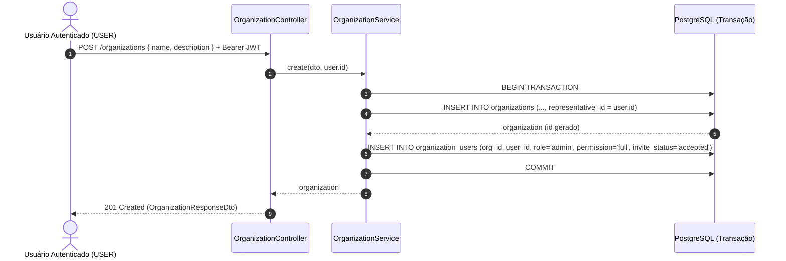

# Organizações

O módulo de **organizações** (`/organizations`) da `hubee-api` gerencia as entidades organizadoras de eventos (atléticas, centros acadêmicos, produtoras, coletivos) e aplica o controle de acesso baseado em papéis (**RBAC**) por organização definido na [Matriz de Permissões (RBAC)](../regras-negocio/matriz-permissoes-rbac.md) (tasks **GOL-197** e **GOL-198**).

---

## 1. Regra de Negócio: Cadastro por Usuário Autenticado e Vínculo Automático (`GOL-197`)

> **Regra de Negócio Crucial (GOL-197):** Ao criar uma organização (`POST /organizations`), o usuário logado é automaticamente vinculado a ela com `role = 'admin'` e nível `'manage'`, sem necessidade de ser um Administrador Global (`role = 'ADMIN'`).

Quando qualquer usuário autenticado (`role = 'USER'` ou `role = 'ADMIN'`) executa `POST /organizations`, o `OrganizationService.create` executa **duas operações atômicas dentro de uma mesma transação de banco de dados (`db.transaction`)**:

1. **Operação A — Criação na tabela `organizations`:** Insere o registro da organização definindo obrigatoriamente `representativeId` com o `user.id` extraído do token JWT (`@CurrentUser()`).
2. **Operação B — Vínculo automático na tabela `organization_users`:** Utiliza o `id` da organização recém-criada para inserir imediatamente o vínculo de administrador para o usuário criador:
   - `orgId`: `organization.id`
   - `userId`: `user.id`
   - `role`: `'admin'`
   - `permission`: `'full'`
   - `inviteStatus`: `'accepted'`



Como o vínculo nasce com `invite_status = 'accepted'`, `role = 'admin'` e `permission = 'full'`, o nível efetivo calculado para o criador na organização é **`manage`**. Dessa forma, a consulta imediatamente seguinte a `GET /users/me` (ou `GET /auth/me`) já retorna a organização criada dentro do array `organizations` do usuário, habilitando a gestão da organização e de seus eventos sem necessidade de novo login.

---

## 2. Resumo de Endpoints e Controle de Acesso

| Método | Rota | Guard / Decorator | Quem pode acessar | Status de Sucesso |
| :--- | :--- | :--- | :--- | :--- |
| `POST` | `/organizations` | `@Authenticated()` | Qualquer usuário autenticado (`USER` ou `ADMIN`) | `201 Created` |
| `GET` | `/organizations` | Público | Qualquer visitante ou usuário | `200 OK` |
| `GET` | `/organizations/:id` | Público | Qualquer visitante ou usuário | `200 OK` |
| `PATCH` | `/organizations/:id` | `@OrgAccess('manage', { from: 'param', param: 'id' })` | Administrador da organização (nível `manage`) ou `ADMIN` global | `200 OK` |
| `DELETE` | `/organizations/:id` | `@AdminOnly()` | Apenas Administrador Global da plataforma (`role = 'ADMIN'`) | `204 No Content` |

---

## 3. Contratos dos Endpoints

### 3.1. Criar Organização (`POST /organizations`)

Cria uma nova organização e vincula transacionalmente o usuário autenticado como administrador (`role: 'admin'`, `permission: 'full'`, `inviteStatus: 'accepted'`, nível `manage`).

- **Autenticação:** `Authorization: Bearer <access_token>` (`@Authenticated()`).

#### Corpo da Requisição (`CreateOrganizationDto`)

| Campo | Tipo | Obrigatório | Validação / Comportamento |
| :--- | :--- | :---: | :--- |
| `name` | `string` | Sim | Não vazio (`trim` automático), máximo de 255 caracteres. |
| `description` | `string` | Não | Descrição textual opcional da organização. |
| `representativeId` | `string (uuid)` | Não | Opcional no DTO; no serviço é sempre sobrescrito pelo `user.id` do usuário autenticado que está criando a organização. |

#### Exemplo de Payload (Request)

```json
{
  "name": "Atlética Unifesp",
  "description": "Associação Atlética Acadêmica do Campus São José dos Campos."
}
```

#### Resposta de Sucesso (`201 Created` — `OrganizationResponseDto`)

```json
{
  "id": "550e8400-e29b-41d4-a716-446655440000",
  "name": "Atlética Unifesp",
  "description": "Associação Atlética Acadêmica do Campus São José dos Campos.",
  "representativeId": "b75bc7ce-51e0-4c22-984e-5d5c753a2908",
  "createdAt": "2026-11-08T18:00:00.000Z",
  "updatedAt": "2026-11-08T18:00:00.000Z"
}
```

#### Reflexo Imediato em `GET /users/me` (`200 OK`)

Após o `201 Created`, a chamada a `GET /users/me` com o mesmo token passa a listar o vínculo ativo com nível `manage`:

```json
{
  "id": "b75bc7ce-51e0-4c22-984e-5d5c753a2908",
  "fullName": "Maria Silva",
  "email": "maria@example.com",
  "role": "USER",
  "organizations": [
    {
      "orgId": "550e8400-e29b-41d4-a716-446655440000",
      "organizationName": "Atlética Unifesp",
      "role": "admin",
      "permission": "full",
      "level": "manage"
    }
  ]
}
```

#### Respostas de Erro

- **`400 Bad Request`:** `name` ausente, vazio após `trim` ou acima de 255 caracteres.
- **`401 Unauthorized`:** Token JWT ausente, inválido ou expirado.

---

### 3.2. Listar Organizações (`GET /organizations`)

Retorna a lista de organizações cadastradas, permitindo filtro opcional por nome.

#### Query Params (`QueryOrganizationDto`)

| Parâmetro | Tipo | Obrigatório | Comportamento |
| :--- | :--- | :---: | :--- |
| `name` | `string` | Não | Busca parcial *case-insensitive* (`ILIKE %name%`) pelo nome da organização. |

#### Exemplo de Resposta (`200 OK`)

```json
[
  {
    "id": "550e8400-e29b-41d4-a716-446655440000",
    "name": "Atlética Unifesp",
    "description": "Associação Atlética Acadêmica do Campus São José dos Campos.",
    "representativeId": "b75bc7ce-51e0-4c22-984e-5d5c753a2908",
    "createdAt": "2026-11-08T18:00:00.000Z",
    "updatedAt": "2026-11-08T18:00:00.000Z"
  }
]
```

---

### 3.3. Buscar Organização por ID (`GET /organizations/:id`)

Retorna os dados públicos de uma organização específica a partir do seu UUID.

#### Resposta de Sucesso (`200 OK`)

```json
{
  "id": "550e8400-e29b-41d4-a716-446655440000",
  "name": "Atlética Unifesp",
  "description": "Associação Atlética Acadêmica do Campus São José dos Campos.",
  "representativeId": "b75bc7ce-51e0-4c22-984e-5d5c753a2908",
  "createdAt": "2026-11-08T18:00:00.000Z",
  "updatedAt": "2026-11-08T18:00:00.000Z"
}
```

#### Respostas de Erro

- **`400 Bad Request`:** Parâmetro `:id` não está no formato UUID.
- **`404 Not Found`:** Organização não encontrada:
  ```json
  {
    "message": "Organização 550e8400-e29b-41d4-a716-446655440000 não encontrada",
    "error": "Not Found",
    "statusCode": 404
  }
  ```

---

### 3.4. Atualizar Organização (`PATCH /organizations/:id`)

Atualiza parcialmente os dados cadastrais da organização (`name`, `description`, `representativeId`).

- **Autorização:** Protegido por `@OrgAccess('manage', { from: 'param', param: 'id' })`. Apenas um membro da organização com nível efetivo **`manage`** (`role = 'admin'`, `permission = 'full'` e `invite_status = 'accepted'`) ou um **Administrador Global (`role = 'ADMIN'`)** pode editar a organização.

#### Corpo da Requisição (`UpdateOrganizationDto`)

| Campo | Tipo | Obrigatório | Validação |
| :--- | :--- | :---: | :--- |
| `name` | `string` | Não | Se enviado, não pode ser vazio (`trim` automático) nem `null`, máximo de 255 caracteres. |
| `description` | `string` | Não | Nova descrição da organização. |
| `representativeId` | `string (uuid)` | Não | UUID de um usuário existente (retorna `404` se o representante não existir). |

#### Exemplo de Payload (Request)

```json
{
  "name": "Atlética Unifesp - Gestão 2026",
  "description": "Descrição atualizada pelo administrador da organização."
}
```

#### Resposta de Sucesso (`200 OK` — `OrganizationResponseDto`)

```json
{
  "id": "550e8400-e29b-41d4-a716-446655440000",
  "name": "Atlética Unifesp - Gestão 2026",
  "description": "Descrição atualizada pelo administrador da organização.",
  "representativeId": "b75bc7ce-51e0-4c22-984e-5d5c753a2908",
  "createdAt": "2026-11-08T18:00:00.000Z",
  "updatedAt": "2026-11-08T18:15:00.000Z"
}
```

#### Comportamento de Erros de Permissão no `PATCH /organizations/:id` (`403` vs `404`)

O `OrganizationAccessGuard` configurado com `{ from: 'param', param: 'id' }` diferencia estritamente **membros sem permissão suficiente** de **não-membros**:

| Cenário do Usuário Autenticado | Status HTTP | Motivo e Regra de Segurança |
| :--- | :---: | :--- |
| **Membro da organização com nível `write` ou `read`** (`role = 'member'`, `invite_status = 'accepted'`) | **`403 Forbidden`** | O usuário já pertence à organização e tem permissão para visualizá-la, mas seu papel não possui o nível `manage` exigido para alterar dados cadastrais. |
| **Não-membro da organização** (sem vínculo em `organization_users`, ou com convite `pending` / `rejected`) ou **organização inexistente** | **`404 Not Found`** | Para evitar enumeração e não vazar a existência ou os vínculos da organização a usuários externos, a API responde com o mesmo `404 Not Found` de um recurso inexistente. |

- **Exemplo de Resposta `403 Forbidden` (membro `read` ou `write` tentando editar):**
  ```json
  {
    "message": "Acesso negado",
    "error": "Forbidden",
    "statusCode": 403
  }
  ```

- **Exemplo de Resposta `404 Not Found` (usuário sem vínculo aceito na organização ou ID inexistente):**
  ```json
  {
    "message": "Organização 550e8400-e29b-41d4-a716-446655440000 não encontrada",
    "error": "Not Found",
    "statusCode": 404
  }
  ```

---

### 3.5. Remover Organização (`DELETE /organizations/:id`)

Remove o registro de uma organização pelo seu UUID.

- **Autorização:** Protegido por `@AdminOnly()` (exclusivo para administradores globais com `role = 'ADMIN'`).
- **Respostas:**
  - **`204 No Content`:** Organização removida com sucesso (sem corpo de resposta).
  - **`401 Unauthorized`:** Token ausente ou inválido.
  - **`403 Forbidden`:** Usuário autenticado com `role = 'USER'` (mesmo que seja administrador da organização, a exclusão definitiva da entidade é restrita ao `ADMIN` da plataforma).
  - **`404 Not Found`:** Organização não encontrada.

---

## 4. Testando via Bruno (`hubee-collections`)

A pasta `ORGANIZACOES/` no repositório [`hubee-collections`](./collections.md) contém todas as requisições configuradas com `{{baseUrl}}` e variáveis de ambiente:

1. `POST CRIAR ORGANIZACAO.yml` — Cria a organização com `{{tokenOrganizador}}` e salva automaticamente o `id` retornado em `{{organizationId}}`.
2. `GET LISTAR ORGANIZACOES.yml` — Lista organizações filtrando por `?name=Atlética`.
3. `GET ORGANIZACAO POR ID.yml` — Consulta `{{baseUrl}}/organizations/:id` usando `{{organizationId}}`.
4. `PATCH ATUALIZAR ORGANIZACAO.yml` — Atualiza `name` e `description` usando `{{tokenOrganizador}}` (cenário de sucesso com nível `manage`, status `200`).
5. `PATCH ORGANIZACAO SEM PERMISSAO.yml` — Tenta atualizar a organização com `{{tokenComprador}}` (cenário de bloqueio RBAC da GOL-197, retornando `404` para não-membro ou `403` para membro sem `manage`).
6. `DELETE ORGANIZACAO.yml` — Remove a organização `{{organizationId}}` (`204 No Content` para `ADMIN` global).
