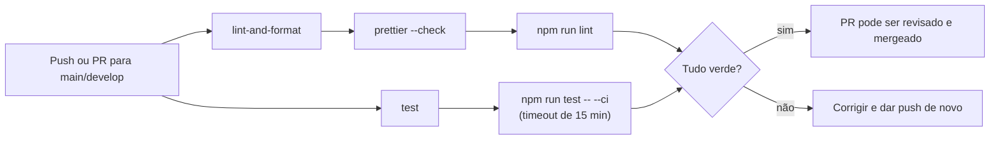

# Boas práticas de CI e testes — Hubee API

> Documento de referência para o time: para que servem os testes e o CI, como
> eles estão montados na `hubee-api` e como rodar tudo na sua máquina antes de
> abrir um PR.

## Índice

1. [Para que serve](#1-para-que-serve)
2. [Como está no nosso repo](#2-como-está-no-nosso-repo)
3. [Como rodar](#3-como-rodar)
4. [O que o CI roda](#4-o-que-o-ci-roda)
5. [Boas práticas ao escrever testes](#5-boas-práticas-ao-escrever-testes)
6. [Checklist antes do PR](#6-checklist-antes-do-pr)
7. [Problemas comuns](#7-problemas-comuns)

---

## 1. Para que serve

Testes e CI existem para que nenhum PR quebre a `develop` sem ninguém
perceber.

- **Testes** provam que a regra de negócio funciona e pegam regressões cedo:
  uma regra de pedido, um filtro de evento ou uma permissão que mudou sem
  querer.
- **CI** (Integração Contínua) roda essas provas no GitHub em toda push e PR,
  numa máquina limpa, igual para todo mundo. Tira o "na minha máquina
  funciona": se o lint, o Prettier ou os testes falham lá, o PR não está
  pronto.
- **Proteção de rotas** é o caso mais crítico: um endpoint que fica público
  por engano vaza dados. Por isso existe uma suíte só para isso
  (`src/auth/route-protection.spec.ts`).

## 2. Como está no nosso repo

### Stack

| Peça | O que usamos |
| :--- | :--- |
| Runner de testes | Jest 30 + `ts-jest`, em modo ESM (`node --experimental-vm-modules`) |
| Requisições HTTP nos testes | `supertest` + `@nestjs/testing` |
| Banco nos testes | `@electric-sql/pglite`: Postgres de verdade, rodando em memória |
| Lint | `oxlint src/ test/ --deny-warnings` (qualquer warning reprova) |
| Formatação | Prettier (`src/**/*.ts` e `test/**/*.ts`) |
| Git hooks | Husky: `commit-msg` (padrão de commit) e `pre-push` (lint) |
| CI | GitHub Actions: `.github/workflows/ci.yml` |

### Tipos de teste

Hoje são 67 arquivos `*.spec.ts` em `src/`, ao lado do código que testam.

| Tipo | Arquivo | O que testa | Banco |
| :--- | :--- | :--- | :--- |
| Unitário de service | `*.service.spec.ts` | Regra de negócio isolada; repositórios e `DRIZZLE` são mocks (`jest.fn()`) | Nenhum |
| DTO / validação | `dto/*.dto.spec.ts`, `common/validation/*.spec.ts` | Mensagens e regras do `class-validator` | Nenhum |
| Integração | `*.integration.spec.ts` | Controller + service + SQL real via HTTP | PGlite com as migrations aplicadas |
| Proteção de rotas | `src/auth/route-protection.spec.ts` | Quem pode chamar cada rota (401/403/404/2xx) | Fake |
| E2E | `test/*.e2e-spec.ts` | `AppModule` inteiro subindo | Variáveis falsas (`test/setup-e2e.ts`) |

### Configuração do Jest (`jest.config.ts`)

- Roda todo arquivo que termina em `.spec.ts`.
- Lê os path aliases do `tsconfig.json` (não duplique aliases no Jest).
- Ignora a pasta `.claude/`: worktrees de agentes ficam lá com uma cópia do
  repo, e sem isso cada suíte rodaria duas vezes.
- `maxWorkers: '50%'`: cada worker carrega o PGlite (~800 MB de RAM). Usar
  todos os núcleos esgota a memória e faz os testes de integração estourarem
  timeout.
- Cobertura vai para `./coverage`.

## 3. Como rodar

Sempre na raiz da `hubee-api`. Nenhum comando de teste precisa de banco
online, Docker ou `.env`.

```bash
# Todos os testes (unitários + integração + proteção de rotas)
npm run test

# Um arquivo só
npm run test src/auth/route-protection.spec.ts

# Testes cujo nome bate com um texto
npm run test -- -t "Proteção de rotas"

# Modo watch (re-roda ao salvar)
npm run test:watch

# Cobertura (relatório em coverage/)
npm run test:cov

# E2E (test/*.e2e-spec.ts)
npm run test:e2e

# Debug com breakpoints (chrome://inspect)
npm run test:debug

# Lint e formatação
npm run lint
npm run format
```

Para simular exatamente o CI na sua máquina:

```bash
npx prettier --check "src/**/*.ts" "test/**/*.ts" && npm run lint && npm run test -- --ci
```

## 4. O que o CI roda

O workflow **Code Quality** (`.github/workflows/ci.yml`) roda em toda push e
PR para `main` e `develop`, com Node 20 e `npm ci`. São dois jobs em paralelo:



| Job | Passos | Reprova quando |
| :--- | :--- | :--- |
| `lint-and-format` | `prettier --check` e `npm run lint` | Arquivo fora do padrão do Prettier ou qualquer warning do oxlint |
| `test` | `npm run test -- --ci` | Algum teste falha, ou a suíte passa de 15 minutos |

:::note
O job `test` entrou na GOL-223. Até essa branch ser mergeada, a `develop` só
roda o job `lint-and-format`. O E2E (`npm run test:e2e`) não roda no CI.
:::

O repositório também tem dois workflows que não testam nada, só avisam no
Discord: `discord-review-alert.yml` (PR aberto ou pronto para revisão) e
`discord-merge-alert.yml` (PR mergeado).

### Hooks locais (Husky)

Rodam antes do CI, na sua máquina:

- **`commit-msg`**: recusa commits fora do padrão `tipo(GOL-123): descrição`.
- **`pre-push`**: roda `npm run lint`. Os testes **não** rodam no push; rode
  `npm run test` você mesmo.

### Lendo uma falha no CI

1. No PR, clique em **Details** ao lado do check vermelho.
2. Abra o passo que falhou. No job `test`, procure por `FAIL` e pelo `●` que
   abre cada teste quebrado.
3. Reproduza local com o mesmo comando do passo (seção 3) e só então corrija.
4. Falhou só no CI e passa local? Veja [Problemas comuns](#7-problemas-comuns).

## 5. Boas práticas ao escrever testes

### Regras do time

- **Endpoint novo ou alterado = caso novo em `route-protection.spec.ts`.**
  Coloque a rota na lista certa (`PUBLIC_ROUTES`, `AUTHENTICATED_ROUTES`,
  `ORGANIZER_*_ROUTES`, `ORGANIZER_ONLY_ROUTES`). Rota que não está em lista
  nenhuma é tratada como só ADMIN. O teste `toda rota das listas existe nos
  controllers` pega rota escrita errada.
- **Nunca dependa do Neon.** Teste que precisa de SQL usa PGlite. A suíte
  tem que passar sem internet.
- **Mensagens em pt-BR.** Os nomes de `describe`/`it` seguem o padrão dos
  arquivos existentes: português, dizendo o comportamento
  (`'401 sem token'`, `'403 para membro só leitura'`).

### Qual tipo escrever

- **Regra de negócio** (cálculo, status, quem pode o quê dentro do service) →
  unitário do service, com repositório mockado. É o mais rápido.
- **Query, filtro, join, constraint do banco** → integração com PGlite. Mock
  não prova SQL.
- **Validação de entrada** → spec do DTO.
- **Permissão de rota** → `route-protection.spec.ts`.

### Testes de integração com PGlite

- Crie o banco no `beforeAll` com `new PGlite()` e aplique os arquivos de
  `src/database/migrations/*.sql` na ordem, como em
  `src/auth/auth.integration.spec.ts`. Migration nova que sua feature precisa
  tem que entrar nessa lista.
- **Feche tudo no `afterAll`**: `await app?.close()` e
  `await pglite?.close()`. Instância esquecida segura memória e deixa o Jest
  pendurado.
- Um PGlite por arquivo, não por teste: subir o banco é a parte cara.
- Cada teste cria os dados de que precisa (helpers `make*`), sem depender da
  ordem dos outros testes.

### Em geral

- Teste comportamento, não implementação: verifique status HTTP, corpo da
  resposta e o que ficou no banco, não quais funções internas foram chamadas.
- Resposta da API nunca pode trazer `password` / `password_hash`; vale um
  `expect` explícito quando o endpoint devolve usuário.
- Evite `setTimeout` e esperas fixas; elas deixam a suíte lenta e instável.
- Não suba `maxWorkers` nem coloque `--runInBand` no script padrão para
  "consertar" um teste: ache a causa.

## 6. Checklist antes do PR

- [ ] `npm run lint` sem nenhum warning
- [ ] `npx prettier --check "src/**/*.ts" "test/**/*.ts"` passa (ou rode `npm run format`)
- [ ] `npm run test` verde
- [ ] Endpoint novo/alterado está em `route-protection.spec.ts`
- [ ] Regra nova tem teste unitário; query nova tem teste de integração
- [ ] Commit no padrão `tipo(GOL-ID): descrição`
- [ ] Checks do CI verdes no PR antes de pedir revisão

## 7. Problemas comuns

| Sintoma | Causa provável | O que fazer |
| :--- | :--- | :--- |
| Testes de integração dão timeout ou a máquina trava | Muitos workers com PGlite ao mesmo tempo | Feche apps pesados; rode só o arquivo que interessa; não remova o `maxWorkers: '50%'` |
| Suítes aparecem duplicadas | Worktree de agente dentro de `.claude/` | Já ignorado no `jest.config.ts`; confira se você não tem cópia do repo em outro lugar dentro do projeto |
| `Cannot use import statement outside a module` | Rodou `npx jest` direto | Use `npm run test`, que passa `--experimental-vm-modules` |
| Teste de integração quebra com tabela ou coluna inexistente | Migration nova não aplicada no `beforeAll` | Adicione o `.sql` da migration na lista do spec |
| `jest.fn` não reconhecido / tipos estranhos | `jest` global no modo ESM | Importe de `@jest/globals`: `import { jest, describe, it, expect } from '@jest/globals'` |
| Passa local, falha no CI | Ordem entre testes, dado compartilhado ou diferença de ambiente | Rode `npm run test -- --ci` local e verifique se cada teste cria os próprios dados |
| CI vermelho no Prettier | Arquivo não formatado | `npm run format` e commit de novo |
