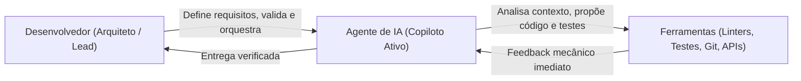
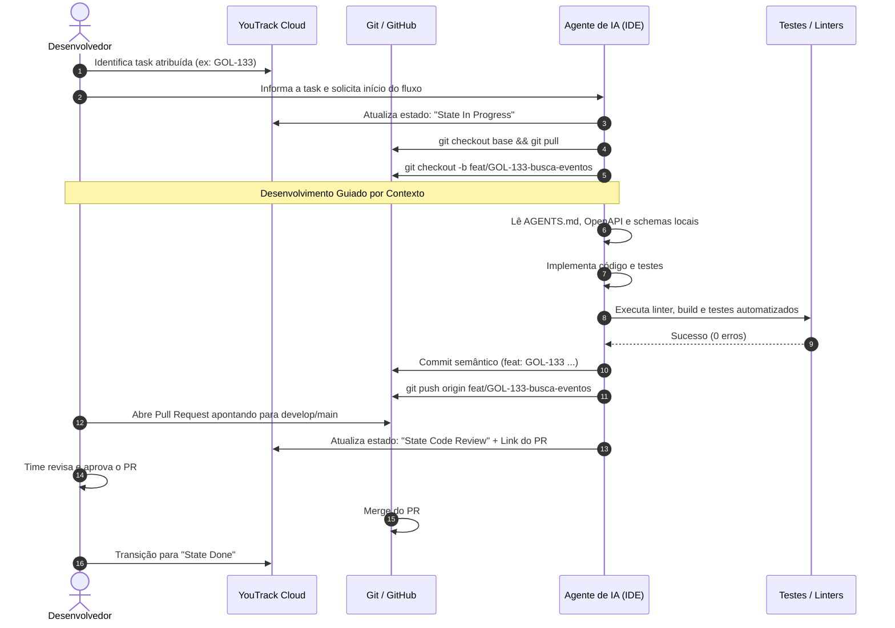
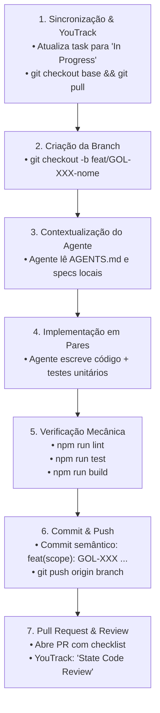

# Fluxo de Trabalho e Melhores Práticas com Agentes de IA

> **Documento de Referência da Equipe Golf — Projeto Hubee**  
> Este guia estabelece o padrão de **Engenharia de Software Orientada por Agentes** (*Agentic Software Engineering*) adotado pela equipe. Ele orienta como utilizar ferramentas de inteligência artificial de forma profissional, rastreável e disciplinada, integrando o ciclo de desenvolvimento entre **YouTrack**, **Git/GitHub** e os repositórios do projeto.

---

## 1. Visão Geral e Filosofia de Trabalho

O uso de agentes de IA (como Antigravity, Cursor, Windsurf, Claude Code ou GitHub Copilot Workspace) no projeto Hubee não se resume a "gerar trechos de código". Tratamos o agente como um **parceiro de pair-programming arquitetural**:



- **O Desenvolvedor é o Arquiteto:** Você é o responsável técnico pela solução. Cabe a você definir o escopo, direcionar o agente com o contexto correto e aprovar cada linha gerada.
- **Context-First (Context-Driven Development):** O agente nunca deve escrever código sem antes ler a documentação viva, as regras de negócio, os contratos de API e a estrutura existente.
- **Rastreabilidade Obrigatória:** Toda alteração de código precisa nascer de uma tarefa no YouTrack (`GOL-XXX`) e passar por um fluxo limpo no Git.

---

## 2. Diagrama do Ciclo de Vida da Tarefa (E2E)

O fluxo completo de desenvolvimento segue um ciclo padronizado, ilustrado abaixo:



---

## 3. Boas Práticas no Git/GitHub (Anti-Desastre)

A regra número um para evitar conflitos, perdas de código e quebra do ambiente de produção é a **disciplina de ramificação (*branching*)**.

### 3.1. A Regra de Ouro: NUNCA commitar na `develop` ou `main`

> ⚠️ **Atenção Absoluta:** É estritamente proibido fazer alterações ou commits diretamente nas branches protegidas (`main` ou `develop`). Todo e qualquer trabalho deve ocorrer em uma **feature branch** isolada.

### 3.2. Checklist Obrigatório de Inicialização de Task

Antes de pedir ao agente qualquer linha de código, exija a execução deste checklist no terminal:

```bash
# 1. Garanta que seu repositório local está limpo (sem arquivos não commitados)
git status

# 2. Mude para a branch base (develop na hubee-api e hubee-webpage; main no alexandrita-docs)
git checkout develop   # ou main, conforme o repositório

# 3. Baixe e aplique as atualizações mais recentes do repositório remoto
git fetch origin --prune
git pull origin develop

# 4. Crie sua nova branch a partir da base atualizada
git checkout -b <tipo>/GOL-<ID>-<descricao-curta>
```

### 3.3. Padrão de Nomenclatura de Branches

A nomenclatura de branches deve seguir o padrão semântico abaixo, sempre contendo o ID da issue no YouTrack:

| Tipo | Padrão | Exemplo |
| :--- | :--- | :--- |
| **Funcionalidade** | `feat/GOL-<ID>-<slug>` | `feat/GOL-133-busca-eventos-filtros` |
| **Correção de Bug** | `fix/GOL-<ID>-<slug>` | `fix/GOL-150-restaurar-header-navbar` |
| **Documentação** | `docs/GOL-<ID>-<slug>` | `docs/GOL-151-fluxo-trabalho-com-agentes` |
| **Investigação / Spike** | `spike/GOL-<ID>-<slug>` | `spike/GOL-109-permissoes-organizador` |
| **Testes** | `test/GOL-<ID>-<slug>` | `test/GOL-40-testes-entidade-usuario` |

### 3.4. Commits Semânticos

Cada commit deve ser atômico (uma mudança lógica coesa) e seguir a convenção de Conventional Commits:

```bash
# Exemplos corretos:
git commit -m "feat(events): GOL-133 adicionar filtros por data e categoria na busca"
git commit -m "fix(header): GOL-150 restaurar componente Header na tela inicial"
git commit -m "test(auth): GOL-144 cobrir decorator de organizador com testes unitarios"
```

---

## 4. Integrando o Agente com o YouTrack

Para que o agente trabalhe de forma autônoma e rápida na gestão da sprint, podemos conectá-lo diretamente à **API REST do YouTrack**. Assim, o agente pode:
- Ler os requisitos e critérios de aceite da tarefa.
- Mudar status da tarefa sem você precisar abrir o navegador.
- Criar dependências, subtasks e adicionar tags.

### 4.1. Como Obter o Permanent Token no YouTrack

1. Acesse o YouTrack da universidade: [https://es-unifesp.youtrack.cloud](https://es-unifesp.youtrack.cloud).
2. Clique no seu avatar no canto superior direito e selecione **Profile** (Perfil).
3. Vá para a aba **Account Security** (Segurança da Conta).
4. Na seção **Tokens**, clique em **New Token...**.
5. Dê um nome ao token (ex: `Agente-Antigravity` ou `Cursor-Token`).
6. No escopo de permissões, marque **YouTrack** (ou *Read and update issues, agile boards and commands*).
7. Clique em **Create** e copie o token gerado (`perm-...`).

> 🔒 **Segurança:** Nunca comite seu token no Git ou coloque em arquivos públicos. Guarde-o em variáveis de ambiente ou arquivos ignorados pelo `.gitignore`.

### 4.2. Estrutura de Conexão com a API

A instância e os dados principais do nosso projeto são:

```ini
YOUTRACK_BASE_URL=https://es-unifesp.youtrack.cloud/api
PROJECT_ID=0-7 (GOL)
BOARD_ID=204-13 (Golf Desenvolvimento de Projeto)
SPRINT_ATUAL=218-61 (SPR04)
```

### 4.3. O "Super-Poder": YouTrack Commands API

A forma mais rápida de manipular o YouTrack através do agente é utilizando o endpoint de comandos:  
`POST https://es-unifesp.youtrack.cloud/api/commands`

O payload é um JSON simples contendo a query do comando e a lista de issues afetadas:

```json
{
  "query": "State In Progress",
  "issues": [
    { "idReadable": "GOL-133" }
  ]
}
```

#### Comandos Rápidos Mais Usados:

| Ação Desejada | Query de Comando YouTrack |
| :--- | :--- |
| **Iniciar Tarefa** | `State In Progress` |
| **Enviar para Code Review** | `State Code Review` |
| **Finalizar Tarefa** | `State Done` |
| **Atribuir a você** | `Assignee yuji.furukawa` (ou seu login) |
| **Tornar Subtask de uma Story** | `subtask of GOL-123` |
| **Adicionar Dependência** | `depends on GOL-149` |
| **Adicionar Tag** | `tag Quality` |

### 4.4. Script Utilitário para o Agente (PowerShell / Bash)

Você pode disponibilizar para o seu agente um script simples para execução direta. Exemplo em PowerShell:

```powershell
# youtrack-cmd.ps1
param(
    [string]$IssueId,
    [string]$Command
)

$token = $env:YOUTRACK_TOKEN
$headers = @{
    "Authorization" = "Bearer $token"
    "Content-Type"  = "application/json"
    "Accept"        = "application/json"
}

$body = @{
    query = $Command
    issues = @(@{ idReadable = $IssueId })
} | ConvertTo-Json

$response = Invoke-RestMethod -Uri "https://es-unifesp.youtrack.cloud/api/commands" `
    -Method Post -Headers $headers -Body $body

Write-Host "Comando '$Command' executado com sucesso em $IssueId!" -ForegroundColor Green
```

Com isso, você pode simplesmente dizer ao agente no prompt:
> *"Agente, atualize a task GOL-133 para 'In Progress' e vincule dependência na GOL-149."*

O agente executará a chamada de API em menos de 2 segundos.

---

## 5. Context-Driven Development (Uso de `AGENTS.md`)

O maior erro ao usar IA em engenharia de software é abrir o chat e pedir: *"Faça a tela de busca"*. O agente não sabe quais componentes existem, qual biblioteca de estilos usamos, como a API responde ou onde ficam os testes.

### 5.1. O que é o `AGENTS.md`?

O `AGENTS.md` é a **"Constituição do Repositório"** para IAs. Ele deve residir na raiz de cada projeto e conter:
1. **Visão da Stack:** Frameworks (Next.js, NestJS, Docusaurus), versão do Node, gerenciador de pacotes (`npm`).
2. **Arquitetura de Pastas:** Onde ficam componentes, rotas, hooks, serviços, controllers, DTOs e testes.
3. **Comandos Canônicos:** Como rodar linters (`npm run lint`), testes (`npm run test`) e build (`npm run build`).
4. **Regras Inegociáveis:** Ex: "Nunca use `any` no TypeScript", "Sempre trate erros HTTP", "Nunca altere o schema do banco sem migration".

### 5.2. Como instruir o Agente a ler o contexto

Sempre utilize a técnica de **ancoragem de contexto** no seu prompt inicial:

```text
"Agente, vamos trabalhar na tarefa GOL-133 (Buscar Eventos).
Antes de propor qualquer código:
1. Leia o arquivo AGENTS.md na raiz do repositório.
2. Analise os componentes existentes em src/components/ e os DTOs em src/types/.
3. Verifique o contrato da API no repositório alexandrita-docs.
Somente após essa leitura, apresente o plano de implementação."
```

---

## 6. Passo a Passo Completo: Executando uma Task do Início ao Fim

Abaixo está o roteiro operacional que cada membro da equipe deve seguir ao assumir uma tarefa:



### Detalhamento das Etapas:

1. **Abertura:** Você e o agente atualizam a task no YouTrack para `In Progress`.
2. **Branching:** Cria-se a branch no padrão `tipo/GOL-XXX-slug` a partir da base atualizada.
3. **Análise Prévia:** O agente lê os contratos e os arquivos relevantes.
4. **Implementação:** O agente gera os componentes/endpoints junto com os respectivos testes.
5. **Auditoria Local:** O agente executa:
   - `npm run lint` (garante estilo e ausência de warnings).
   - `npm run test` (garante que nada foi quebrado e a nova funcionalidade está coberta).
   - `npm run build` (garante compilação TypeScript estrita).
6. **Entrega:** Commit semântico com a identificação da task e push.
7. **Pull Request:** Criação do PR no GitHub contendo:
   - Link direto para a issue no YouTrack.
   - Resumo das decisões técnicas tomadas.
   - Checklist de testes manuais e automatizados realizados.
   - Atualização do YouTrack para `Code Review`.

---

## 7. Tabela de Anti-Padrões (O que NUNCA Fazer)

| Anti-Padrão | Consequência | Ação Correta |
| :--- | :--- | :--- |
| **Commitar direto na `develop` ou `main`** | Conflito catastrófico de merge, código instável quebrando o time. | Sempre criar branch `feat/GOL-XXX` a partir da base atualizada. |
| **Copiar e colar código sem rodar linters/testes** | Erros de sintaxe ou tipagem no CI/CD, quebrando a pipeline. | Exigir que o agente execute `npm run lint` e `npm run test` antes do commit. |
| **Hardcodar tokens e segredos no código** | Vazamento de credenciais e falhas de segurança no repositório. | Usar variáveis de ambiente (`.env`) e tokens mantidos fora do controle de versão. |
| **Fazer prompt sem fornecer contexto** | Alucinação de bibliotecas, componentes duplicados e padrões divergentes. | Instruir o agente a ler os arquivos de contexto (`AGENTS.md`, OpenAPI, schemas). |
| **Esquecer de atualizar o YouTrack** | Visão distorcida do progresso do time e desorganização da sprint. | Usar os scripts e comandos de API para manter o YouTrack sempre em dia. |
