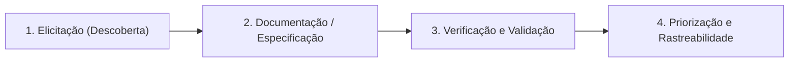
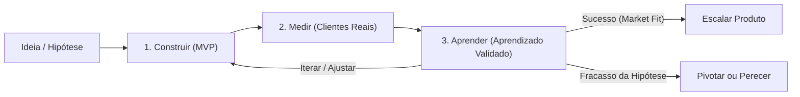
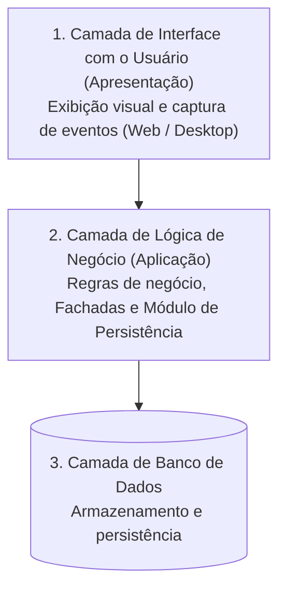
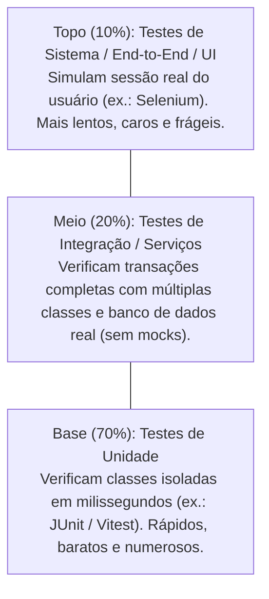
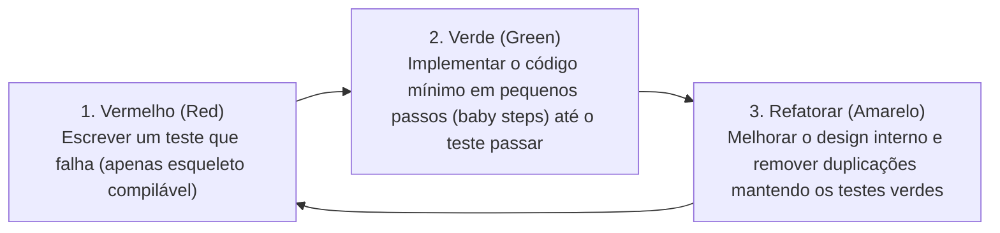

# Resumo: Engenharia de Software Moderna (Capítulos 1, 3, 7 e 8)

> **Referência Bibliográfica:** VALENTE, Marco Tulio. *Engenharia de Software Moderna: Princípios e Práticas para Desenvolvimento de Software com Produtividade*. Disponível em: [https://engsoftmoderna.info](https://engsoftmoderna.info).

## Índice

1. [Capítulo 1 — Introdução](#1-capítulo-1--introdução)
2. [Capítulo 3 — Requisitos](#2-capítulo-3--requisitos)
3. [Capítulo 7 — Arquitetura](#3-capítulo-7--arquitetura)
4. [Capítulo 8 — Testes](#4-capítulo-8--testes)

---

## 1. Capítulo 1 — Introdução

### 1.1. Definição, Contexto Histórico e a Crise do Software

- **Definição:** Engenharia de Software é a área da Computação dedicada à aplicação de abordagens sistemáticas, disciplinadas e quantificáveis para desenvolver, operar, manter e evoluir sistemas de software com produtividade e qualidade.
- **Evolução Histórica:** Nas décadas de 1940 e 1950, computadores eram restritos a cálculos científicos pontuais e a preocupação central era o hardware. Ao final da década de 1960, a popularização dos computadores trouxe a demanda por grandes sistemas comerciais (folha de pagamento, estoque, finanças), expondo a falta de métodos formais para construção de software em larga escala.
- **Conferência da OTAN (Garmisch, Alemanha, 1968):** Marco fundador da área. Cerca de 50 cientistas da computação cunharam o termo **Engenharia de Software** para defender que a construção de sistemas deveria se basear em fundamentos teóricos e práticos rigorosos, à semelhança das engenharias tradicionais.

### 1.2. "Não Existe Bala de Prata" (Frederick Brooks, 1987)

No ensaio clássico *No Silver Bullet: Essence and Accidents of Software Engineering*, Frederick Brooks divide os desafios do desenvolvimento de software em duas categorias:

| Categoria | Definição | Exemplos / Características |
| :--- | :--- | :--- |
| **Dificuldades Essenciais** | Inerentes à própria natureza conceitual do software. Dificilmente serão eliminadas por qualquer nova ferramenta ou método ("bala de prata"). | **1. Complexidade:** Software é uma das construções humanas mais intrincadas (sistemas reais chegam a milhões ou bilhões de linhas de código). **2. Conformidade:** Software precisa se moldar continuamente a regras humanas, leis e instituições que mudam constantemente (ao contrário das leis imutáveis da Física). **3. Facilidade de Mudanças (Mutabilidade):** Pressão constante por evolução; quanto mais bem-sucedido é um software, maior a demanda por modificações. **4. Invisibilidade:** Natureza abstrata e ausência de representação física/geométrica dificultam a visualização e a estimativa de esforço. |
| **Dificuldades Acidentais** | Associadas a limitações tecnológicas ou ferramentais do momento; podem ser mitigadas com treinamento, melhores ferramentas, linguagens e frameworks. | Compiladores com mensagens obscuras, IDEs instáveis, ausência de documentação em bibliotecas, interfaces mal projetadas. |

### 1.3. O Corpo de Conhecimento da Engenharia de Software (SWEBOK)

Baseado no *Guide to the Software Engineering Body of Knowledge* (IEEE), o capítulo sintetiza as **12 áreas de conhecimento** fundamentais:

1. **Engenharia de Requisitos:** Define *o que* o sistema deve fazer (**Requisitos Funcionais**) e *como/sob quais restrições* deve operar (**Requisitos Não-Funcionais**, como desempenho, disponibilidade, tolerância a falhas, segurança, privacidade, interoperabilidade, capacidade, manutenibilidade e usabilidade).
2. **Projeto de Software (*Software Design*):** Define as unidades de código e suas interfaces, sem entrar nos detalhes internos de implementação dos métodos:
   - **Interfaces Providas:** Serviços públicos que o módulo oferece ao restante do sistema.
   - **Interfaces Requeridas (Dependências):** Interfaces de outros módulos das quais a unidade depende para funcionar.
   - **Arquitetura de Software:** Projeto em nível mais alto de abstração, tratando de pacotes, camadas ou serviços.
3. **Construção de Software:** Codificação propriamente dita, englobando escolha de algoritmos, estruturas de dados, frameworks, tratamento de exceções, padrões de nomenclatura e ferramental (IDEs, depuradores, SGBDs).
4. **Testes de Software:** Execução do programa com um conjunto finito de casos para verificar o comportamento esperado.
   - **Princípio de Dijkstra:** *"Testes de software mostram a presença de bugs, mas não a sua ausência."*
   - **Verificação vs. Validação:**
     - **Verificação:** *"Estamos implementando o sistema corretamente?"* (conformidade técnica com a especificação).
     - **Validação:** *"Estamos implementando o sistema correto?"* (atendimento às reais necessidades do cliente/mercado).
   - **Terminologia de Anomalias (IEEE):**
     - **Defeito (ou Bug, Erro, Falta / *Fault*):** Código que não está de acordo com sua especificação estática.
     - **Falha (*Failure*):** Comportamento incorreto observável em tempo de execução quando um código com defeito é efetivamente executado (ex.: explosão do foguete *Ariane 5* em 1996 por falha na conversão de ponto flutuante de 64 bits para inteiro de 16 bits).
5. **Manutenção e Evolução de Software:**
   - **Manutenção Corretiva:** Correção de bugs reportados por usuários em produção.
   - **Manutenção Preventiva:** Correção de defeitos latentes antes que provoquem falhas reais (ex.: adequação de sistemas para o Bug do Milênio / Y2K).
   - **Manutenção Adaptativa:** Adaptação do sistema a mudanças no ambiente externo, versão de linguagem, legislação ou customização para novos clientes.
   - **Refactoring:** Modificações internas que melhoram a estrutura, legibilidade e projeto do código **preservando seu comportamento externo**.
   - **Manutenção Evolutiva (ou Perfectiva):** Inclusão de novas funcionalidades ou melhorias substanciais nas existentes.
   - **Sistemas Legados:** Sistemas antigos baseados em tecnologias ultrapassadas, de manutenção mais custosa e arriscada, porém frequentemente críticos para a operação do negócio.
6. **Gerência de Configuração:** Uso de controle de versões (ex.: Git) aliado a políticas de gerenciamento de *releases*, destacando o **Versionamento Semântico (`MAJOR.MINOR.PATCH` ou `x.y.z`)**:
   - Incremento em `x` (*Major*): mudanças incompatíveis na API ou grandes reformulações;
   - Incremento em `y` (*Minor*): adição de pequenas funcionalidades mantendo compatibilidade;
   - Incremento em `z` (*Patch*): apenas correções de bugs.
7. **Gerência de Projetos:** Gestão de contratos, prazos, custos, riscos, recursos humanos e *stakeholders* (partes afetadas ou interessadas no projeto).
   - **Lei de Brooks (*The Mythical Man-Month*, 1975):** *"A inclusão de novos desenvolvedores em um projeto que está atrasado contribui para torná-lo ainda mais atrasado."*
   - **Causas da Lei de Brooks:** Tempo necessário para novos membros compreenderem a arquitetura existente e crescimento quadrático dos canais de comunicação na equipe, dado por `C = n(n - 1) / 2` (ex.: 3 desenvolvedores = 3 canais; 4 desenvolvedores = 6 canais; 10 desenvolvedores = 45 canais). Por isso, preconizam-se equipes pequenas.
8. **Processos de Desenvolvimento de Software:**
   - **Processos Waterfall (Cascata / *Plan-Driven*):** Etapas estritamente sequenciais (requisitos, análise, projeto, codificação, testes e produção). Principal limitação: demora de meses ou anos até validar o produto com o cliente, período no qual os requisitos mudam.
   - **Processos Ágeis (Iterativos e Incrementais):** Propostos a partir do Manifesto Ágil (2001). Entregas funcionais em ciclos curtos (Sprints de 1 a 4 semanas) com validação constante junto aos usuários (XP, Scrum, Kanban, Lean) e práticas técnicas como testes automatizados, TDD e **Integração Contínua** (integração diária de código para evitar conflitos tardios).
9. **Modelos de Software:** Representações abstratas de mais alto nível (ex.: diagramas UML).
   - **Engenharia Avante (*Forward Engineering*):** Criação de modelos antes do código para guiar o projeto.
   - **Engenharia Reversa (*Reverse Engineering*):** Criação de modelos a partir de código existente para compreender sua estrutura.
10. **Qualidade de Software (Classificação de Bertrand Meyer):**
    - **Qualidade Externa:** Fatores perceptíveis pelos usuários finais sem análise do código-fonte (correção, robustez, eficiência, portabilidade, facilidade de uso, compatibilidade).
    - **Qualidade Interna:** Propriedades de implementação aferidas por engenheiros de software (modularidade, legibilidade, manutenibilidade, testabilidade).
    - Assegurada por métricas (de código e de processo) e práticas como **Revisões de Código (*Code Review*)** via Pull Requests.
11. **Prática Profissional e Ética:** Diretrizes curriculares, regulamentação e responsabilidade ética regida por códigos profissionais (ACM, IEEE Computer Society e Código de Ética da SBC).
12. **Aspectos Econômicos:** Decisões de monetização, precificação e análise de **Custo de Oportunidade** (ex.: o trade-off econômico entre alocar a equipe para corrigir uma lista de bugs ou desenvolver novas funcionalidades para captar clientes).

### 1.4. Classificação de Sistemas de Software (Bertrand Meyer)

| Categoria | Perfil do Sistema | Risco / Abordagem de Engenharia de Software |
| :--- | :--- | :--- |
| **Sistemas A (*Acute* / Missão Crítica)** | Sistemas onde falhas causam prejuízos catastróficos ou perda de vidas humanas (controle aéreo, UTIs, usinas nucleares, veículos autônomos). | Exigem processos rígidos, certificação externa, especificação formal e redundância de hardware e software. |
| **Sistemas B (*Business* / Comerciais)** | Aplicações corporativas, sistemas Web, e-commerce, bibliotecas, frameworks e ferramentas de software básico. | **Alvo principal do livro:** beneficiam-se diretamente de práticas ágeis, padrões de projeto, arquitetura modular e testes automatizados para elevar produtividade e qualidade. |
| **Sistemas C (*Casuais*)** | Scripts pontuais, trabalhos acadêmicos, ferramentas internas simples mantidas por 1 ou 2 programadores. | Baixa exigência de qualidade interna. O principal risco é o **Over-engineering** (aplicar processos e arquiteturas complexas sem necessidade). |

---

## 2. Capítulo 3 — Requisitos

### 2.1. Importância e Tipos de Requisitos

> *"A parte mais difícil de construir um sistema de software é decidir precisamente o que construir."* — Frederick Brooks

- **Requisitos Funcionais vs. Não-Funcionais:**
  - **Funcionais:** Definem *o que* o sistema deve fazer (suas funcionalidades), usualmente descritos em linguagem natural.
  - **Não-Funcionais:** Definem *sob quais restrições* e com qual qualidade de serviço o sistema opera. Para evitar descrições vagas (como *"o sistema deve ser rápido"*), **devem ser especificados quantitativamente por meio de métricas**:

| Requisito Não-Funcional | Métricas Quantitativas Típicas |
| :--- | :--- |
| **Desempenho** | Transações por segundo (TPS), tempo de resposta, latência, vazão (*throughput*). |
| **Espaço** | Consumo de memória RAM, disco e cache. |
| **Confiabilidade** | Percentual de disponibilidade (ex.: 99,99%), Tempo Médio Entre Falhas (*MTBF*). |
| **Robustez** | Tempo Médio de Recuperação após falha (*MTTR*), probabilidade de perda de dados. |
| **Usabilidade** | Tempo necessário para treinamento de usuários. |
| **Portabilidade** | Percentual de linhas de código portáveis entre plataformas. |

- **Requisitos de Usuário vs. Requisitos de Sistema (Ian Sommerville):**
  - **Requisitos de Usuário:** Declarações de alto nível escritas em linguagem natural pelos usuários/clientes, mais próximas do **problema**.
  - **Requisitos de Sistema:** Especificações técnicas, precisas e detalhadas redigidas pelos desenvolvedores, mais próximas da **solução** (um requisito de usuário costuma se desdobrar em múltiplos requisitos de sistema).

### 2.2. Engenharia de Requisitos

Conjunto sistemático de atividades de descoberta, análise, especificação e manutenção dos requisitos ao longo do ciclo de vida do software.

1. **Elicitação de Requisitos:** Atividade de descobrir e extrair os requisitos junto aos *stakeholders*.
   - **Técnicas:** Entrevistas, questionários, leitura de documentos/formulários organizacionais, workshops, prototipação, análise de cenários e **Etnografia** (observação silenciosa e imersiva do usuário em seu ambiente real de trabalho, sem interferência do desenvolvedor).
2. **Documentação:** Pode ser ágil e enxuta (**Histórias de Usuários**) ou formal e extensiva (**Documento de Especificação de Requisitos**, como o padrão **IEEE 830** utilizado em processos Waterfall).
3. **Critérios de Verificação e Validação (5 Propriedades de Bons Requisitos):**
   - **Corretos:** Refletem fielmente as regras reais do domínio.
   - **Precisos:** Isentos de ambiguidades interpretativas (comuns em linguagem natural na precedência de operadores lógicos `E` / `OU`).
   - **Completos:** Não omitem funcionalidades ou restrições essenciais.
   - **Consistentes:** Não apresentam contradições entre si (ex.: um stakeholder pedir 99,9% de disponibilidade e outro definir 90%).
   - **Verificáveis:** Permitem a criação de testes objetivos para comprovar seu atendimento.
4. **Priorização e Rastreabilidade (*Traceability*):**
   - Requisitos devem ser priorizados conforme restrições de prazo e orçamento.
   - **Rastreabilidade:** Capacidade bidirecional de, dado um requisito, localizar os trechos de código que o implementam e, dado um trecho de código, identificar qual requisito o originou.
5. **Barreiras Comuns na Prática (Survey Industrial):** Requisitos incompletos/não documentados (48%), falhas de comunicação com o cliente (41%), mudanças constantes (33%), especificações abstratas (33%), fatores políticos internos e **barreira cognitiva** (jargão específico dos especialistas do domínio).

### 2.3. Escolha da Técnica de Requisitos conforme o Cenário

| Cenário do Projeto / Produto | Técnica Recomendada |
| :--- | :--- |
| Requisitos mudam com frequência; sistema comercial não crítico. | **Histórias de Usuários** (com representante do cliente presente no time). |
| Requisitos mais estáveis; exigência contratual detalhada ou órgãos de certificação. | **Casos de Uso** / Especificação detalhada. |
| Mercado incerto ou desconhecido; dúvida sobre a própria relevância do problema. | **Produto Mínimo Viável (MVP)** e **Testes A/B**. |

### 2.4. Histórias de Usuários (*User Stories*)

Substituem documentos extensos por comunicação verbal frequente, alinhando-se aos valores do Manifesto Ágil.

- **Equação dos 3 C's (Ron Jeffries):**
  > **História de Usuário = Cartão + Conversas + Confirmação**
  1. **Cartão:** Lembrete curto escrito pelo cliente em sua própria linguagem. Formato padrão após mapear os **papéis de usuários (*user roles*)**:
     > *"Como um `[papel de usuário]`, eu gostaria de `[realizar algo com o sistema]`"*
  2. **Conversas:** Comunicação verbal contínua durante a Sprint entre os desenvolvedores e o representante dos clientes (*Product Owner*) para detalhar os requisitos.
  3. **Confirmação (Testes de Aceitação):** Cenários e critérios objetivos definidos pelo cliente no início da iteração para validar se a história foi concluída na *Sprint Review*. Previne também o **Gold Plating** (quando desenvolvedores adicionam sofisticações não solicitadas que não agregam valor ao cliente).

- **Propriedades INVEST para Boas Histórias:**
  - **I — Independentes (*Independent*):** Podem ser implementadas em qualquer ordem, sem dependências mútuas fortes.
  - **N — Negociáveis (*Negotiable*):** O cartão não é um contrato fechado, mas um convite à conversa onde cliente e equipe técnica ajustam detalhes.
  - **V — Valiosas (*Valuable*):** Devem agregar valor direto ao negócio do cliente. **Não existem "histórias técnicas"** (ex.: *"migrar banco ou estudar framework"*); tarefas técnicas de investigação para viabilizar histórias são chamadas de **Spikes**.
  - **E — Estimáveis (*Estimable*):** A equipe consegue estimar o esforço necessário para sua implementação.
  - **S — Sucintas / Pequenas (*Small*):** Histórias no topo do backlog devem ser implementáveis em até uma semana. Histórias grandes e complexas são chamadas de **Épicos** e permanecem no fundo do backlog até serem divididas.
  - **T — Testáveis (*Testable*):** Possuem critérios de confirmação claros e verificáveis.

- **Requisitos Não-Funcionais em Histórias:** Não devem ser alocados em uma única Sprint isolada; devem ser incorporados aos **Critérios de Conclusão (*Done Criteria* / *Definition of Done*)** exigidos de todas as histórias em todas as iterações.

### 2.5. Casos de Uso (*Use Cases*)

Propostos por Ivar Jacobson no contexto do Processo Unificado (UP) e da UML, são documentos textuais detalhados que descrevem a interação entre um **Ator** (usuário ou sistema externo) e o sistema para atingir um objetivo.

- **Estrutura de um Caso de Uso:**
  1. **Título:** Iniciado por verbo no infinitivo (ex.: *Transferir Valores entre Contas*).
  2. **Ator Principal:** Entidade externa que interage com o sistema.
  3. **Fluxo Normal (Fluxo Feliz):** Sequência numerada de passos em que tudo ocorre com sucesso (sem comandos condicionais `se`). Pode reutilizar outro caso de uso via **inclusão** (indicado pelo nome sublinhado, funcionando como uma chamada de macro).
  4. **Extensões:** Passos alternativos ou tratamentos de erros/exceções vinculados à numeração do fluxo normal (ex.: `2a`, `3a`, `5a`, `5b`).
  5. **Seções Opcionais:** Propósito, Pré-condições, Pós-condições e Casos de Uso Relacionados.

- **Boas Práticas na Escrita de Casos de Uso:**
  - Usar linguagem simples e direta (sujeito = ator ou sistema + verbo de ação);
  - Manter o fluxo normal curto (Alistair Cockburn recomenda **no máximo 9 passos** no cenário principal);
  - Não escrever pseudo-código de algoritmos (evitar `if`, `for`, `while`);
  - Omitir detalhes de interface gráfica ou tecnologia (documentar *o que* é feito, e não *"clicar no botão verde"*);
  - Evitar casos de uso CRUD triviais isolados (agrupar em um único caso *"Gerenciar Entidade"*);
  - Padronizar termos mantendo um **Glossário** unificado do projeto.

- **Diagrama de Casos de Uso (UML):** Funciona apenas como um **índice gráfico** mostrando a fronteira do sistema, atores e relacionamentos de inclusão/extensão. O valor real da técnica reside no **texto** dos casos de uso, e não no diagrama.

### 2.6. Produto Mínimo Viável (MVP — *Minimum Viable Product*)

Conceito central do *Lean Startup* (Eric Ries), derivado da Manufatura Lean (eliminação de desperdício: **falhar rápido e barato** quando se atua sob alta incerteza).

- **Definição:** Versão funcional mínima de um produto capaz de testar uma **hipótese de negócio** junto a usuários reais (*early adopters*).
- **Ciclo Construir — Medir — Aprender (*Build — Measure — Learn*):**

- **Decisões Pós-Ciclo:**
  1. **Iterar:** Ajustar requisitos e repetir o ciclo;
  2. **Escalar (*Market Fit*):** Investir recursos na construção completa do produto;
  3. **Pivotar ou Perecer:** Realizar um **Pivô** (mudar radicalmente o produto ou mercado preservando o aprendizado prévio) ou encerrar o projeto (*perecer*).
- **Métricas Acionáveis vs. Métricas de Vaidade:**
  - **Métricas de Vaidade (*Vanity Metrics*):** Números superficiais que inflam o ego mas não orientam decisões (ex.: total bruto de *pageviews*).
  - **Métricas Acionáveis (*Actionable Metrics*):** Indicadores que guiam ações de negócio e produto (ex.: percentual de conversão de visitantes em compradores, ticket médio, itens por compra, CAC).
  - **Métricas de Funil:** **A**quisição (visitas) -> **A**tivação (cadastro) -> **R**etenção (retorno) -> **R**eceita (compra) -> **R**ecomendação (indicação).
- **Exemplos Clássicos:** MVPs operacionais sem automação de software (Zappos validando venda de sapatos online comprando manualmente em lojas físicas; Dropbox validando demanda com um vídeo demonstrativo de 3 minutos) e MVPs de software enxutos (CSIndexbr começando com menos de 200 linhas de Python e planilhas embutidas).
- **Diferença entre MVP e Protótipo:** Protótipos não são necessariamente mínimos, não visam testar viabilidade comercial em produção e não são produtos finais. O MVP é um produto real mínimo em operação (devendo ter qualidade suficiente na infraestrutura e UX para não invalidar a hipótese por **falso negativo** técnico).
- **Design Sprint (Knapp et al.):** Método estruturado em **time-box de 5 dias** com equipe multidisciplinar de ~7 pessoas (incluindo um **Tomador de Decisões**) para construir e validar um protótipo inicial antes do MVP:
  - *Dia 1 (Segunda):* Entender e delimitar o problema (Convergência);
  - *Dia 2 (Terça):* Propor alternativas de solução livremente (Divergência);
  - *Dia 3 (Quarta):* Escolher a solução vencedora pelo tomador de decisões (Convergência);
  - *Dia 4 (Quinta):* Construir o protótipo (ex.: telas HTML estáticas);
  - *Dia 5 (Sexta):* Testar individualmente com 5 clientes reais.

### 2.7. Testes A/B (*Split Tests*)

Abordagem experimental e dirigida por dados para decidir entre duas versões de um sistema que diferem em um requisito mutuamente exclusivo.

- **Estrutura do Experimento:**
  - **Versão de Controle (A):** Sistema atual (*status quo* — Hipótese Nula `H0`).
  - **Versão de Tratamento (B):** Sistema com a modificação avaliada (Hipótese Alternativa `H1`). Quando há mais variações, denomina-se **Teste A/B/n**.
  - **Taxa de Conversão:** Métrica objetiva utilizada para comparar o desempenho entre os grupos.
- **Rigor Estatístico:**
  - Os usuários são roteados **aleatoriamente** entre Controle e Tratamento.
  - **Erro do Tipo I (Falso Positivo):** Concluir que B é superior a A quando, na realidade, `H0` é verdadeira. A probabilidade desse erro é o **Nível de Significância (`alfa`)** (tipicamente `5%`), sendo `(1 - alfa)` o **Nível de Confiança** (`95%`).
  - **Tamanho da Amostra:** Deve ser calculado previamente com base na taxa de conversão atual, no ganho mínimo esperado e no nível de confiança. Quanto menor a taxa base ou menor o ganho relativo desejado, maior a amostra exigida.
  - **Regra de Ouro:** **Jamais encerrar o Teste A/B prematuramente** no primeiro dia em que o ganho esperado aparecer; o teste só tem validade estatística ao completar integralmente a amostra planejada.
  - **Teste A/A:** Execução da mesma versão A para ambos os grupos com o objetivo de auditar e validar a ferramenta de experimentação (se um grupo vencer no teste A/A, há falha metodológica ou de instrumentação).

---

## 3. Capítulo 7 — Arquitetura

### 3.1. Conceito de Arquitetura de Software

1. **Visão Estrutural (Alto Nível):** Organização macro do sistema em módulos de maior granularidade (pacotes, camadas, subsistemas ou serviços) que são **relevantes para os objetivos centrais do sistema**, definindo quais módulos podem usar serviços de outros.
2. **Visão de Decisões Críticas (Ralph Johnson):** *"Arquitetura trata das coisas importantes, sejam elas quais forem."* Engloba as decisões de projeto mais importantes e **difíceis de reverter no futuro** (incluindo linguagem de programação, banco de dados e topologia de módulos).
   - **Debate Tanenbaum-Torvalds (1992):** Controvérsia histórica entre **Arquitetura Monolítica** (adotada pelo Linux, onde todo o sistema operacional executa em um único binário em modo supervisor; mais simples de construir inicialmente, mas propensa a inchaço e degradação ao longo das décadas, como alertado por Ken Thompson) e **Arquitetura Microkernel** (defendida por Andrew Tanenbaum no Minix, isolando apenas funções básicas no kernel e executando o restante em processos independentes).

### 3.2. Arquitetura em Camadas (*Layered Architecture*)

Padrão no qual o sistema é organizado hierarquicamente: a camada `n` somente pode utilizar serviços da camada imediatamente inferior (`n - 1`).

- **Vantagens:** Particionamento da complexidade, disciplina estrita de dependências, facilidade para substituir uma camada inteira por outra compatível (ex.: trocar TCP por UDP na pilha de rede) e reúso de uma camada inferior por múltiplas camadas superiores.
- **Arquitetura em Três Camadas (*Three-Tier*):** Padrão clássico para sistemas corporativos distribuídos:

- **Arquitetura em Duas Camadas:** Une Interface e Lógica de Negócio na máquina cliente comunicando-se diretamente com o Banco de Dados (exige maior poder computacional no cliente).

### 3.3. Arquitetura MVC (*Model-View-Controller*)

Proposta originalmente no final dos anos 1970 para o Smalltalk-80 visando estruturar aplicações com interfaces gráficas.

- **Componentes do MVC:**
  - **Visão (*View*):** Apresentação visual (telas, janelas, botões, páginas HTML).
  - **Controladoras (*Controller*):** Tratam e interpretam eventos de entrada e solicitam alterações no estado do Modelo ou da Visão.
  - **Modelo (*Model*):** Armazena os dados e implementa a lógica de domínio da aplicação.
- **Regra de Dependência no MVC:**
  > **MVC = (Visão + Controladoras) + Modelo = Interface Gráfica + Modelo**
  A Interface Gráfica depende do Modelo (e o observa para atualizar a tela quando o estado muda), mas **o Modelo não possui qualquer conhecimento ou dependência para classes de Visão ou Controladoras**.
- **3 Principais Vantagens do MVC:**
  1. **Especialização do trabalho:** Separação clara entre desenvolvedores de front-end e de regras de domínio;
  2. **Múltiplas Visões:** O mesmo Modelo pode ser exibido simultaneamente por diferentes interfaces (ex.: relógio analógico e digital);
  3. **Testabilidade:** Isolar o Modelo de componentes visuais facilita drasticamente a escrita de testes automatizados para a lógica de negócio.
- **MVC Clássico vs. MVC Web:** Frameworks Web (Ruby on Rails, Spring, Django) adaptaram a terminologia MVC para a arquitetura Web (View = templates HTML, Controller = roteamento/tratamento HTTP, Model = regras e persistência), aproximando-se na prática de uma arquitetura em três camadas.
- **Single Page Applications (SPAs):** Aplicações Web (React, Vue, Angular) que carregam o código de interface no navegador e comunicam-se assincronamente com o servidor, evitando recarregamentos de página e aplicando a separação MVC no cliente com recursos como *two-way data binding*.

### 3.4. Microsserviços (*Microservices*)

Decomposição do sistema em serviços pequenos e autônomos que executam em **processos independentes** (sem compartilhamento de memória), comunicando-se exclusivamente via interfaces públicas de rede.

- **Motivação (Gargalo do Monolito):** Em um monolito, todos os módulos executam em um único processo; mudanças em um módulo podem causar efeitos colaterais imprevistos em outros, forçando processos de *release* lentos e burocráticos que conflitam com a agilidade das equipes.
- **Lei de Conway (1968):** *"Empresas tendem a adotar arquiteturas de software que são cópias de suas estruturas organizacionais."* Microsserviços espelham organizações com múltiplos times pequenos, autônomos e descentralizados.
- **Autonomia de Dados:** Cada microsserviço deve gerenciar seu **próprio banco de dados**, evitando que um banco único compartilhado se torne um gargalo burocrático e de acoplamento.

| Vantagens dos Microsserviços | Desvantagens e Desafios (Quando Evitar) |
| :--- | :--- |
| **1. Evolução e Deploy Independentes:** Cada equipe lança novas versões no seu próprio ritmo. | **1. Complexidade de Sistema Distribuído:** Exige protocolos de rede (HTTP/REST), serialização e tratamento de falhas de comunicação. |
| **2. Escalabilidade Horizontal Fina:** Permite replicar em nuvem apenas os serviços que sofrem gargalo de performance. | **2. Latência de Rede:** Chamadas remotas via rede possuem custo e atraso ordens de grandeza maiores que chamadas de métodos em memória. |
| **3. Heterogeneidade Tecnológica:** Cada serviço pode usar a linguagem, framework e banco de dados mais adequados. | **3. Transações Distribuídas:** Garantir atomicidade entre múltiplos bancos independentes é complexo (exige *Two-Phase Commit* ou consistência eventual). |
| **4. Falhas Parciais:** A queda de um serviço não essencial não derruba todo o sistema (ao contrário da falha total no monolito). | |

### 3.5. Arquiteturas Distribuídas Desacopladas: Filas de Mensagens vs. Publish/Subscribe

Ambos os padrões utilizam um intermediário (*Broker*) para promover comunicação assíncrona e garantir duas formas fundamentais de desacoplamento:
- **Desacoplamento no Espaço:** Produtores e consumidores não precisam conhecer a identidade ou localização uns dos outros.
- **Desacoplamento no Tempo:** Produtores e consumidores não precisam estar disponíveis simultaneamente (o broker retém as mensagens/eventos caso o destinatário esteja fora do ar).

| Característica | Arquitetura Orientada a Mensagens (Filas / *Queues*) | Arquitetura Publish/Subscribe (Orientada a Eventos) |
| :--- | :--- | :--- |
| **Atores** | **Produtores** (clientes) e **Consumidores** (servidores) mediados por uma fila FIFO. | **Publicadores (*Publishers*)** e **Assinantes (*Subscribers*)** mediados por um Broker de Eventos (organizados em **Tópicos**). |
| **Estilo de Comunicação** | **1 para 1 (Ponto-a-Ponto):** Cada mensagem da fila é consumida e processada por **um único** servidor. | **1 para N (Comunicação em Grupo):** Um evento publicado notifica **todos** os assinantes daquele tópico. |
| **Modelo de Entrega** | **Pull:** Os servidores consumidores puxam as mensagens da fila conforme sua capacidade. | **Push (Notificação Assíncrona):** Os assinantes registram interesse previamente e são invocados pelo broker quando o evento ocorre. |
| **Caso de Uso Típico** | Distribuir tarefas pesadas de processamento entre múltiplos trabalhadores (ex.: fila de provisionamento em telecom). | Propagar um fato de negócio para múltiplos sistemas independentes (ex.: venda de passagem aérea notificando Milhagem, Marketing e Contabilidade). |

### 3.6. Outros Padrões e Anti-Padrões Arquiteturais

- **Pipes e Filtros (*Pipes and Filters*):** Arquitetura orientada a fluxo de dados onde programas independentes (**filtros**) processam entradas e geram saídas conectadas por buffers (**pipes**), permitindo alta composicionalidade e execução paralela (ex.: comandos Unix `ls | grep csv | sort`).
- **Cliente/Servidor:** Dois módulos comunicando-se via rede onde clientes requisitam serviços e aguardam resposta (impressão, arquivos, bancos de dados, Web).
- **Peer-to-Peer (P2P):** Nós (*pares*) atuam simultaneamente como clientes e servidores (ex.: protocolo BitTorrent).
- **Anti-Padrão *Big Ball of Mud* (Grande Bola de Lama):** Proposto por Foote e Yoder para descrever sistemas sem arquitetura definida, onde qualquer módulo depende de qualquer outro ("código espaguete"). Gera aumento severo no tempo de aprendizado de novos engenheiros, regressões constantes ao corrigir bugs e paralisia na entrega de novas funcionalidades — problemas que práticas isoladas (como revisão de código ou programação em pares) não conseguem sanar sem modularização arquitetural.

---

## 4. Capítulo 8 — Testes

### 4.1. Testes Automatizados e a Pirâmide de Testes

> *"Código sem testes é código ruim."* — Michael Feathers

No desenvolvimento ágil e moderno, testes deixaram de ser uma fase manual tardia executada por uma equipe separada e passaram a ser **automatizados**, escritos pelos próprios desenvolvedores do código de produção (tornando o sistema **auto-testável**).

A **Pirâmide de Testes** (Mike Cohn) classifica os testes automatizados por granularidade, custo e velocidade:

### 4.2. Testes de Unidade

- **Terminologia Essencial (xUnit / JUnit):**
  - **Sistema sob Teste (*System Under Test* — SUT):** O código de produção que está sendo testado.
  - **Teste (*Test Method*):** Método público que exercita o SUT (anotado com `@Test`).
  - **Fixture:** Estado inicial (objetos e dados) preparado para o teste (comumente configurado em métodos `@Before`, executados em uma nova instância antes de cada `@Test`).
  - **Caso de Teste (*Test Case*):** Classe que agrupa métodos de teste de uma unidade (ex.: `StackTest`).
  - **Suíte de Testes (*Test Suite*):** Conjunto de casos de teste executados pela ferramenta.
- **Estrutura de um Método de Teste (3 Etapas):**
  1. Configurar a **Fixture** (instanciar e inicializar objetos);
  2. Chamar o método do **SUT**;
  3. Verificar se o retorno atende ao esperado por meio de asserções (`assertEquals`, `assertTrue`, `assertFalse`, ou verificação de exceções esperadas).
- **Quando Escrever Testes de Unidade:**
  1. Logo após implementar uma pequena funcionalidade;
  2. Antes mesmo de escrever o código de produção (**TDD**);
  3. Ao corrigir um bug reportado (escreve-se primeiro um teste que reproduz o bug e falha, corrige-se o código e garante-se que o teste passe);
  4. Durante sessões de depuração (substituindo comandos `println` descartáveis por testes permanentes na suíte).
- **3 Principais Benefícios dos Testes de Unidade:**
  1. **Detecção prematura de bugs** ainda na fase de desenvolvimento;
  2. **Proteção contra Regressões:** Garante que novas funcionalidades, correções ou refatorações não quebrem comportamentos que já funcionavam;
  3. **Documentação viva:** Especifica de forma executável e atualizada como as classes de produção devem ser utilizadas.

### 4.3. Princípios FIRST e Test Smells

#### Princípios FIRST para Bons Testes de Unidade

| Letra | Princípio | Descrição |
| :---: | :--- | :--- |
| **F** | **Fast (Rápidos)** | Devem executar em milissegundos para que o desenvolvedor possa rodá-los a todo instante. |
| **I** | **Independent (Independentes)** | A ordem de execução não deve importar; um teste não pode alterar estado global que afete outro teste. |
| **R** | **Repeatable (Determinísticos)** | Devem produzir sempre o mesmo resultado. Testes não-determinísticos são chamados de **Testes Flaky (Erráticos)** (frequentemente causados por concorrência, threads e `sleep`), gerando falsos alarmes. |
| **S** | **Self-checking (Auto-verificáveis)** | O resultado deve ser binário (verde/vermelho) e automático, sem exigir inspeção manual de saídas. |
| **T** | **Timely (Oportunos)** | Devem ser escritos o quanto antes (junto ou antes do código de produção, e nunca deixados para o fim do projeto). |

#### Test Smells (Anti-Padrões em Testes) e Uso de `assert`

- **Teste Obscuro:** Teste longo, complexo e difícil de compreender, perdendo seu papel de documentação.
- **Teste com Lógica Condicional:** Presença de comandos `if` ou laços dentro do teste (testes devem ter fluxo estritamente linear).
- **Duplicação de Código em Testes:** Código repetido entre métodos de teste que deveria ser refatorado (ex.: movido para `@Before`).
- **Número de `assert` por Teste:** Como regra geral, prefere-se um único `assert` por método para isolar rapidamente a causa de uma falha. Contudo, a regra não deve ser dogmática: justificam-se múltiplos `assert` ao validar vários campos de um mesmo objeto retornado ou testar chamadas sucessivas de uma função pura simples.

### 4.4. Cobertura de Testes (*Test Coverage*)

> **Cobertura de Comandos (`C0`) = (Número de comandos executados pelos testes) / (Total de comandos executáveis do programa)**

- **Cobertura de Comandos (`C0`) vs. Cobertura de Branches (`C1`):**
  - `C0` mede o percentual de linhas/instruções executadas.
  - `C1` mede o percentual de desvios condicionais (`true` e `false` de cada `if`) exercitados. **`C1` é mais rigorosa que `C0`:** um método com um `if` sem `else` pode atingir `100%` de cobertura de comandos com apenas um teste, mas terá apenas `50%` de cobertura de branches se a condição falsa não for testada.
- **Qual a Cobertura Ideal?**
  - Não existe um número absoluto obrigatório (atingir 100% raramente é produtivo devido a *getters/setters*, código visual ou assíncrono).
  - Referências de mercado: projetos bem testados costumam superar **70%** (mediana no Google é ~78%, com recomendação de ~85%; projetos com TDD superam 90%), enquanto coberturas **abaixo de 50%** são preocupantes.
  - **Importante:** `100%` de cobertura não prova ausência de bugs (ex.: um erro de operador `>` em vez de `>=` pode ter `100%` de cobertura de comandos e de branches e ainda assim falhar no valor limite).

### 4.5. Testabilidade (*Design for Testability*)

Medida de quão fácil é escrever testes automatizados para um sistema. Código com **alta coesão, baixo acoplamento, responsabilidade única, inversão de dependências e separação entre apresentação e modelo** apresenta naturalmente alta testabilidade.

- **Técnicas Práticas de Refatoração para Testabilidade:**
  1. **Extrair lógica de domínio da infraestrutura/UI:** Separar cálculos e regras de negócio de classes acopladas a frameworks Web (ex.: extrair `IMCModel` de dentro de `IMCServlet`).
  2. **Isolar comportamento síncrono de código assíncrono:** Extrair a lógica matemática/algorítmica pura para um método síncrono testável deterministicamente, deixando o método assíncrono apenas com a responsabilidade de criar a *thread*.

### 4.6. Mocks, Stubs e Objetos Dublê (*Test Doubles*)

Quando uma classe sob teste depende de um recurso externo lento ou complexo (banco de dados, API REST, objetos de requisição HTTP), utiliza-se um **objeto dublê** que emula a dependência em memória.

- **Taxonomia de Objetos Dublê (Gerard Meszaros):**
  1. **Dummy:** Objeto passado apenas para preencher parâmetros obrigatórios de um método, sem ser utilizado na execução.
  2. **Fake:** Possui uma implementação funcional simplificada e leve da dependência (ex.: banco de dados em memória implementado com tabela hash).
  3. **Stub:** Emula a dependência retornando respostas pré-programadas (`when(...).thenReturn(...)`), permitindo realizar **testes de estado**.
  4. **Mock:** Além de emular respostas, registra como foi chamado pelo SUT para permitir **testes comportamentais / de interação** (`verify(mock).metodo(...)`).
- **Limitações e Cuidados com Mocks:**
  - **Aumento do acoplamento e fragilidade:** Mocks acoplam o teste a detalhes internos de implementação do método testado; mudanças internas podem quebrar o teste mesmo que o comportamento externo continue correto.
  - **Restrições técnicas:** Em geral, não é trivial criar mocks para métodos estáticos, construtores ou classes/métodos finais (`final`).

### 4.7. Desenvolvimento Dirigido por Testes (TDD — *Test-Driven Development*)

Prática originada no Extreme Programming (XP) na qual **o teste de unidade é escrito antes do código de produção** (*Test-First Development*), seguindo o ciclo **Vermelho — Verde — Refatorar**:

- **Os 3 Objetivos Principais do TDD:**
  1. **Garantir a escrita de testes:** Como o teste é a primeira atividade de programação, evita-se que seja esquecido ou cortado por pressão de prazo;
  2. **Código com alta testabilidade e cobertura:** O desenvolvedor já estrutura a classe pensando em como testá-la (coberturas tipicamente > 90%);
  3. **Melhoria do Design de Interfaces:** Ao escrever o teste primeiro, o desenvolvedor coloca-se na posição de **primeiro cliente/usuário da classe**, projetando assinaturas e interfaces mais simples e intuitivas.

### 4.8. Testes de Integração, Sistema e Outras Categorias

- **Testes de Integração (ou de Serviços):** Testam uma funcionalidade completa envolvendo diversas classes, pacotes e dependências reais (como banco de dados real inicializado vazio, **sem uso de mocks**).
- **Testes de Sistema (*End-to-End* / Interface):** Testam o sistema completo simulando um usuário real (ex.: automação de navegador via Selenium). Mais custosos, lentos, sujeitos a *timeouts* e frágeis a mudanças visuais, além de dificultarem a localização exata da linha de código que originou uma falha.
- **Testes Caixa-Preta (Funcionais) vs. Caixa-Branca (Estruturais):**
  - **Caixa-Preta:** Escritos exclusivamente com base na interface pública e especificação externa do código, sem conhecer sua implementação interna.
  - **Caixa-Branca:** Escritos analisando a estrutura interna do código-fonte e os caminhos/desvios de cobertura.
- **Técnicas de Seleção de Dados de Teste (Caixa-Preta):**
  Como testes exaustivos são computacionalmente impossíveis e testes puramente randômicos são ineficientes, aplicam-se duas técnicas complementares:
  1. **Partição por Classes de Equivalência:** Divide-se o domínio de entrada em subconjuntos (classes de equivalência) cujos elementos têm a mesma probabilidade de revelar um bug (ex.: cada faixa salarial do Imposto de Renda) e testa-se um valor representativo de cada partição.
  2. **Análise de Valor Limite (*Boundary Value Analysis*):** Testa-se o sistema especificamente nos valores de fronteira de cada classe de equivalência e seus valores imediatamente adjacentes (ex.: `limite - 0,01`, `limite`, `limite + 0,01`), pois grande parte dos bugs concentra-se nas condições de contorno.
- **Testes de Aceitação:** Testes **manuais** realizados pelos clientes com dados reais para **validação** do sistema:
  - **Testes Alfa:** Realizados com poucos usuários em ambiente controlado (ex.: junto aos desenvolvedores).
  - **Testes Beta:** Realizados com um grupo maior de usuários no ambiente real do cliente.
- **Testes de Requisitos Não-Funcionais:** Testes de desempenho/carga (ex.: simulação de tráfego de *Black Friday*), testes de usabilidade (observação de sessões de uso) e testes de falhas/resiliência (simulação de queda de servidores ou data centers).
