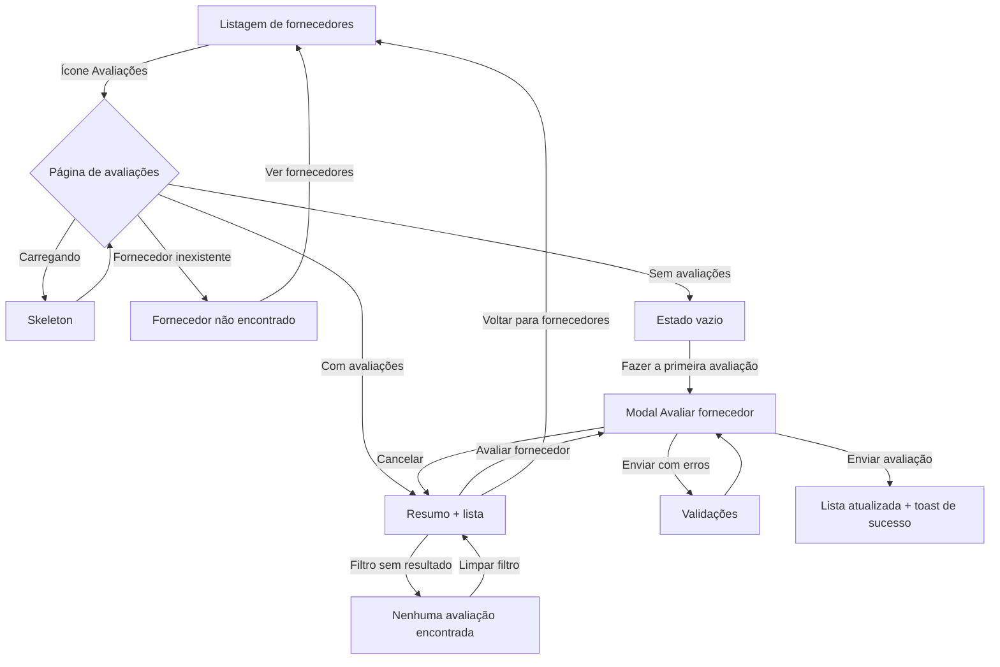

# Avaliação de Fornecedores

Esta seção apresenta os desenhos de interface da **avaliação de fornecedores** da área logada do organizador, desenvolvidos no escopo da tarefa **GOL-244**. Depois de um evento, os membros da organização registram como foi o serviço de cada fornecedor. As avaliações ficam consolidadas em uma página por fornecedor e a média aparece na listagem de fornecedores.

- **Rotas:** `/conta/fornecedores` (coluna "Avaliação") e `/conta/fornecedores/[id]/avaliacoes` (página de avaliações)
- **Origem YouTrack:** [GOL-244 • Desenho da interface de avaliação de fornecedores](https://es-unifesp.youtrack.cloud/issue/GOL-244)
- **Documentação relacionada:** [Gestão de Fornecedores](https://es-unifesp.youtrack.cloud/issue/GOL-201) (GOL-201), [Interfaces do Organizador](./interfaces-do-organizador.md) e [Guia de Estilo](./guia-de-estilo.md)
- **Base técnica:** `hubee-webpage` (Next.js 16, Tailwind CSS 4, shadcn/ui)

Todas as telas estão em **Desktop (1440px)** e **Mobile (375px)**, nos temas **Claro** e **Escuro**, com os tokens `hubee-*` do [Guia de Estilo](./guia-de-estilo.md).

:::info Telas geradas a partir do protótipo navegável
As imagens desta página foram capturadas do protótipo implementado no `hubee-webpage` (branch `feat/GOL-244-interface-avaliacao-fornecedores`), em vez de um arquivo do Figma. As avaliações exibidas são dados de exemplo, porque a `hubee-api` ainda não tem endpoints de avaliação (ver [Pontos em aberto](#9-pontos-em-aberto-para-a-implementação)).
:::

---

## 1. Mapa de Implementação

| Peça visual | Estados desenhados | Observações para o front-end |
| :--- | :--- | :--- |
| **Coluna "Avaliação" (tabela)** | Com avaliações, sem avaliações e carregando | Estrelas, média com uma casa decimal e quantidade entre parênteses. Sem avaliações: texto "Sem avaliações". Carregando: skeleton na célula. |
| **Nota nos cards (mobile)** | Mesmos estados da tabela | Abaixo do badge de categoria. |
| **Ação "Avaliações"** | Default, hover e foco | Ícone `Star` (Lucide) antes de Editar e Excluir. Link para a página de avaliações, habilitado para todos os papéis. |
| **Cabeçalho da página** | Default | "Voltar para fornecedores", nome do fornecedor (`ContaPageTitle`), badge de categoria, documento, telefone e e-mail. Botão primário "Avaliar fornecedor". |
| **Resumo das avaliações** | Default | Média geral grande com estrelas, total, distribuição de 5 a 1 estrelas em barras, médias por critério e selo "X% recomendam". |
| **Filtros da lista** | Default e sem resultados | Dropdown "Nota" (Todas, 5 a 1 estrelas) e "Ordenar por" (Mais recentes, Maior nota, Menor nota). |
| **Card de avaliação** | Recomenda e não recomenda, com e sem comentário | Avatar com iniciais, autor, data, nota geral, evento com data, comentário, notas por critério e selo de recomendação. |
| **Rodapé da lista** | Default | Contador "Mostrando X de Y avaliações". |
| **Modal "Avaliar fornecedor"** | Vazio, preenchido, erro e enviando | Ver seção 6. |
| **Aviso de permissão** | Papel Leitura | Faixa "Apenas Administradores e Membros podem avaliar fornecedores" e botão desabilitado. |
| **EmptyState** | Sem avaliações, filtro sem resultado e fornecedor não encontrado | Reutiliza o `EmptyState` da conta. |
| **Skeleton** | Carregamento | Mesma estrutura da página. |
| **Toasts** | Sucesso e erro | Canto inferior direito. |

### Critérios de avaliação

Cada avaliação tem uma nota de 1 a 5 estrelas por critério. A **nota geral** é a média dos quatro critérios, com uma casa decimal.

| Critério | Propriedade | O que avalia |
| :--- | :--- | :--- |
| Qualidade | `qualidade` | Entrega do serviço ou produto contratado |
| Pontualidade | `pontualidade` | Cumprimento de horários e prazos |
| Comunicação | `comunicacao` | Clareza e agilidade no atendimento |
| Custo-benefício | `custoBeneficio` | Preço justo pelo que foi entregue |

Rótulos das notas, exibidos ao lado das estrelas no formulário e lidos por leitores de tela: **1** Péssimo, **2** Ruim, **3** Regular, **4** Bom, **5** Excelente.

### Campos do formulário

| Campo | Propriedade | Obrigatório | Regra |
| :--- | :--- | :---: | :--- |
| Evento | `eventId` | Sim | Eventos da organização com status publicado ou encerrado. |
| Notas por critério | `notas` | Sim | 1 a 5 estrelas em cada um dos quatro critérios. |
| Você recomendaria este fornecedor? | `recomenda` | Sim | "Sim, recomendo" ou "Não recomendo". |
| Comentário | `comentario` | Não | Até 500 caracteres, com contador `0 / 500`. |

### Mensagens de validação

| Situação | Mensagem |
| :--- | :--- |
| Evento não selecionado | Selecione o evento em que o fornecedor atuou. |
| Critério sem nota | Selecione de 1 a 5 estrelas. |
| Recomendação não informada | Informe se você recomendaria este fornecedor. |
| Comentário muito longo | O comentário deve ter no máximo 500 caracteres. |

### Permissões

| Papel | Ver avaliações | Avaliar |
| :--- | :---: | :---: |
| Administrador | Sim | Sim |
| Membro | Sim | Sim |
| Leitura | Sim | Não (botão desabilitado com aviso) |

---

## 2. Fluxo de Telas

---

## 3. Listagem de Fornecedores com Avaliação

A listagem da [GOL-201](https://es-unifesp.youtrack.cloud/issue/GOL-201) ganha a coluna **Avaliação** e a ação **Avaliações** (ícone de estrela). No mobile, a nota aparece em cada card.

| Tema Claro | Tema Escuro |
| :---: | :---: |
|  |  |

---

## 4. Página de Avaliações do Fornecedor

Resumo no topo (média geral, distribuição das notas, médias por critério e percentual de recomendação) e lista de avaliações com filtro por nota e ordenação.

| Tema Claro | Tema Escuro |
| :---: | :---: |
|  |  |

---

## 5. Estados de Tela

### 5.1. Carregamento (Skeleton)

| Tema Claro | Tema Escuro |
| :---: | :---: |
|  |  |

### 5.2. Fornecedor sem Avaliações

O resumo e os filtros ficam ocultos. Para Administradores e Membros, o estado vazio traz o botão "Fazer a primeira avaliação".

| Tema Claro | Tema Escuro |
| :---: | :---: |
|  |  |

### 5.3. Filtro sem Resultados

Exibido quando nenhuma avaliação tem a nota selecionada. O botão "Limpar filtro" volta para "Todas".

| Tema Claro | Tema Escuro |
| :---: | :---: |
|  |  |

### 5.4. Fornecedor não Encontrado

Exibido quando o fornecedor foi excluído ou o link está incorreto.

| Tema Claro | Tema Escuro |
| :---: | :---: |
|  |  |

### 5.5. Papel Leitura

O usuário vê as avaliações, mas o botão "Avaliar fornecedor" fica desabilitado e a faixa de aviso explica o motivo.

| Tema Claro | Tema Escuro |
| :---: | :---: |
|  |  |

---

## 6. Modal "Avaliar Fornecedor"

### 6.1. Formulário Vazio

As estrelas começam vazias e a nota geral mostra "—" até o primeiro critério ser avaliado.

| Tema Claro | Tema Escuro |
| :---: | :---: |
|  |  |

### 6.2. Formulário Preenchido

Ao passar o mouse, as estrelas mostram uma prévia e o rótulo da nota. A **nota geral** é recalculada a cada critério preenchido. A opção de recomendação escolhida fica em verde ("Sim, recomendo") ou vermelho ("Não recomendo").

| Tema Claro | Tema Escuro |
| :---: | :---: |
|  |  |

### 6.3. Validações

Ao enviar com campos obrigatórios vazios, cada campo mostra sua mensagem, as estrelas dos critérios sem nota ficam com contorno vermelho e o foco vai para o primeiro erro.

| Tema Claro | Tema Escuro |
| :---: | :---: |
|  |  |

### 6.4. Enviando

O botão primário mostra "Enviando..." com spinner. Os campos ficam desabilitados e o modal não fecha com Esc nem com clique fora.

| Tema Claro | Tema Escuro |
| :---: | :---: |
|  |  |

---

## 7. Feedback (Toasts)

| Ação | Mensagem |
| :--- | :--- |
| Avaliação enviada | Avaliação enviada com sucesso. |
| Erro ao enviar | Não foi possível enviar a avaliação. Tente novamente. |

Depois do envio, a avaliação nova aparece no topo da lista e o resumo é recalculado.

| Tema Claro | Tema Escuro |
| :---: | :---: |
|  |  |

---

## 8. Acessibilidade

- **Seleção de estrelas:** cada critério é um `radiogroup` com radios nativos. `Tab` entra no grupo e as setas trocam a nota. Cada opção é lida como "4 estrelas — Bom".
- **Estrelas de exibição:** `role="img"` com rótulo "Nota 4,5 de 5". Notas fracionadas preenchem parcialmente a última estrela.
- **Distribuição das notas:** cada barra é um `meter` com rótulo, por exemplo "3 de 6 avaliações com 5 estrelas".
- **Recomendação:** não depende só da cor. Os selos têm ícone (polegar para cima ou para baixo) e texto.
- **Foco visível** em estrelas, botões de recomendação, filtros e links. Com `prefers-reduced-motion`, as animações de escala e spinner são desligadas.

---

## 9. Pontos em Aberto para a Implementação

- **Back-end de avaliações:** a `hubee-api` não tem tabela nem endpoints de avaliação. O protótipo simula `GET /suppliers/:id/reviews` e `POST /suppliers/:id/reviews` em memória (`src/lib/api/supplier-reviews.ts`). Sugestão de tabela `supplier_reviews`: `supplier_id`, `event_id`, `author_id`, as quatro notas, `recommends`, `comment` e `created_at`.
- **Média na listagem:** a coluna "Avaliação" precisa de média e total por fornecedor. O ideal é que `GET /suppliers` já devolva `ratingAverage` e `ratingCount`, para evitar uma requisição por fornecedor.
- **Uma avaliação por evento:** definir se o mesmo membro pode avaliar o mesmo fornecedor mais de uma vez no mesmo evento (sugestão: não, com restrição única `supplier_id + event_id + author_id`).
- **Vínculo fornecedor × evento:** hoje qualquer evento publicado ou encerrado da organização pode ser escolhido. Uma regra mais rígida seria listar só os eventos com despesa (`expenses`) daquele fornecedor.
- **Edição e exclusão de avaliações:** não fazem parte deste desenho. Definir se o autor pode editar ou excluir a própria avaliação.

## Fora do Escopo

- Endpoints e persistência das avaliações na `hubee-api`.
- Edição e exclusão de avaliações.
- Avaliações visíveis fora da organização (perfil público do fornecedor).
