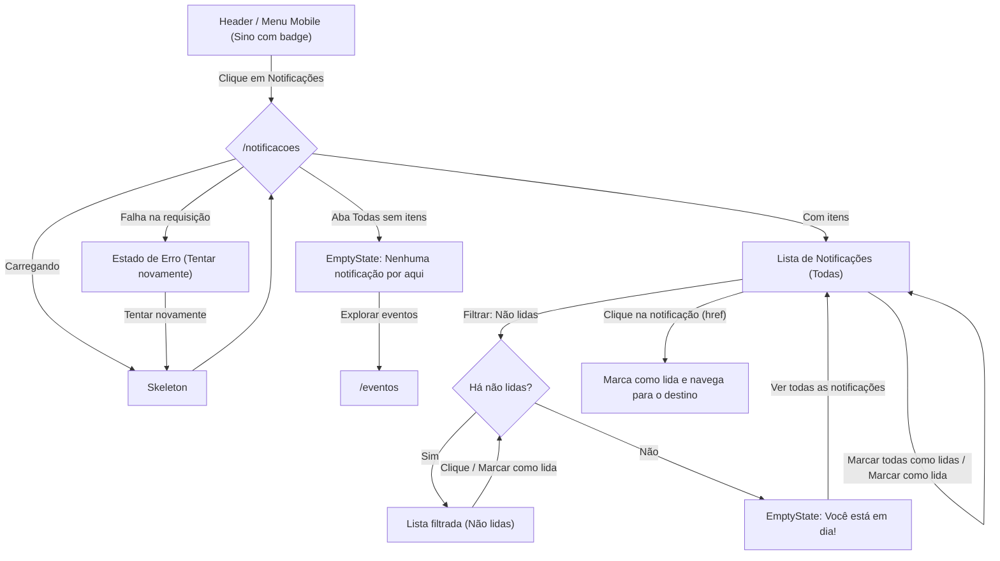

# Central de Notificações

Esta seção apresenta os desenhos de interface da **central de notificações in-app** e do **indicador numérico de notificações não lidas** no ícone de sino do Header, desenvolvidos no escopo da tarefa **GOL-267**. A central unifica em `/notificacoes` os avisos destinados a **compradores** (confirmação de pagamento/ingressos, cancelamentos e estornos) e a **organizadores** (novas vendas confirmadas e lotes esgotados).

- **Rotas e Componentes:** `/notificacoes` (página dedicada em `(logado)`) e ícone de sino (`Bell`) no Header desktop e menu mobile
- **Origem YouTrack:** [GOL-267 • Desenho da central de notificações e badge do sino no Header](https://es-unifesp.youtrack.cloud/issue/GOL-267)
- **Tasks relacionadas:** `GOL-268` (API `/notifications`), `GOL-270` (UI no `hubee-webpage`) e `GOL-271` (integração HTTP)
- **Documentação relacionada:** [Header / Navbar](./header-navbar.md), [Área Logada (Conta)](./tela-da-conta.md), [Interfaces do Organizador](./interfaces-do-organizador.md) e [Guia de Estilo](./guia-de-estilo.md)
- **Base técnica:** `hubee-webpage` (Next.js 16, Tailwind CSS 4, shadcn/ui)

Todas as telas estão em **Desktop (1440px)** e **Mobile (375px)**, nos temas **Claro** e **Escuro**, utilizando os tokens `hubee-*` definidos em `hubee-webpage/src/app/globals.css`.

---

## 1. Mapa de Implementação

| Peça visual | Estados desenhados | Observações para o front-end |
| :--- | :--- | :--- |
| **`HeaderActions` / `LoggedHeader`** | Sem badge (`0`), contagem (`3`, `12`), limite (`99+`), `hover`, `focus-visible` e rota ativa | Badge numérico posicionado sobre o ícone `Bell` (`-top-0.5 -right-0.5`), oculto quando `unreadCount === 0` e truncado em `99+` acima de 99. |
| **`MobileMenu` (Drawer `375px`)** | Sem badge, `3`, `12`, `99+` e rota `/notificacoes` ativa | Badge alinhado à direita da linha (`ml-auto`), preservando contraste elevado sobre o destaque amarelo da rota ativa no tema claro. |
| **Cabeçalho e filtros de `/notificacoes`** | Aba `Todas` ativa, aba `Não lidas` ativa (com contador), ação em massa habilitada e desabilitada | Título `Notificações` (`ContaPageTitle`), pílulas `Todas` / `Não lidas` e botão *"Marcar todas como lidas"* (`disabled` quando não há pendências). |
| **`NotificacaoCard`** | Não lida (`readAt === null`) e lida (`readAt !== null`), exemplos de comprador e organizador | Item não lido com superfície destacada, borda acentuada, título em negrito, ponto indicador circular e ação individual *"Marcar como lida"*. |
| **`NotificacoesSkeleton`** | Carregamento inicial | Esqueleto da barra de filtros/botão e 4 cards com ícone circular e linhas de texto pulsantes (`Skeleton`). |
| **`EmptyState` (Geral e Filtrado)** | Lista vazia (`Todas`) e sem pendências (`Não lidas`) | Reutiliza `EmptyState`: *"Nenhuma notificação por aqui"* (CTA *"Explorar eventos"*) e *"Você está em dia!"* (CTA *"Ver todas as notificações"*). |
| **`ListMessage` (Erro)** | Falha ao carregar | Reutiliza `ListMessage` com `role="alert"`, mensagem explicativa e botão *"Tentar novamente"*. |

### Tipos de notificação e ações contextuais

| Tipo (`type`) | Público | Ícone | Exemplo desenhado | Destino (`href`) |
| :--- | :---: | :--- | :--- | :--- |
| `ORDER_PAID` | Comprador | `Ticket` | *"Pagamento confirmado! Seus ingressos estão disponíveis"* | `/meus-ingressos` |
| `TICKET_TYPE_SOLD_OUT` | Organizador | `AlertCircle` | *"Lote esgotado em Semana de Computação UNIFESP"* | `/meus-eventos/[id]/editar` |
| `NEW_SALE` | Organizador | `ShoppingBag` | *"Nova venda confirmada"* | `/meus-eventos` |
| `ORDER_CANCELLED` | Comprador | `RotateCcw` | *"Pedido #7C19B cancelado e reembolso solicitado"* | `/conta/pedidos/[id]` |
| `EVENT_CANCELLED` | Comprador | `CalendarX2` | *"Evento cancelado pelo organizador: Mostra de Cinema ao Ar Livre"* | `/conta/pedidos/[id]` |

### Diferenciação visual: Não lida vs. Lida

- **Não lida (`readAt === null`)**: superfície destacada (`bg-hubee-100/80` no tema claro e `bg-hubee-800/70` no tema escuro), borda acentuada (`border-hubee-400`), título com maior peso tipográfico (`font-bold`), ponto indicador circular (`bg-hubee-500` / `dark:bg-hubee-400`) ao lado do tempo relativo e link individual *"Marcar como lida"*.
- **Lida (`readAt !== null`)**: superfície neutra (`bg-hubee-neutral-25` no tema claro e `bg-hubee-50/7` no tema escuro), borda suave (`border-hubee-200` / `dark:border-hubee-50/10`), título em `font-semibold` e ausência do ponto indicador e do botão *"Marcar como lida"*.

---

## 2. Fluxo de Telas

---

## 3. Indicador Numérico (Badge) no Header e Menu Mobile

O badge numérico é exibido somente quando `unreadCount > 0`, seguindo a mesma anatomia já adotada no badge do carrinho (`ShoppingCart`) em `HeaderActions`, `LoggedHeader` e `MobileMenu`. Acima de 99 notificações não lidas, o contador exibe `99+`. Clicar no ícone navega diretamente para `/notificacoes`, sem popover suspenso.

### Tema Claro

### Tema Escuro

---

## 4. Central de Notificações (`/notificacoes`)

A página utiliza o container padrão de `(logado)` (`max-w-6xl`), sem a sidebar lateral de `/conta/*`, exibindo o título da página, as pílulas de filtro (**Todas** e **Não lidas**), o botão **"Marcar todas como lidas"** e a listagem cronológica.

### 4.1. Lista Completa — Aba Todas (Não lidas e Lidas)

Exibe simultaneamente notificações não lidas de comprador e organizador no topo e notificações já lidas abaixo, com o contador de não lidas sincronizado tanto na aba *Não lidas* quanto no sino do Header.

| Tema Claro | Tema Escuro |
| :---: | :---: |
|  |  |

### 4.2. Filtro Não lidas Ativo

Ao selecionar a aba **Não lidas**, a listagem exibe exclusivamente os itens com `readAt === null`, mantendo o botão **"Marcar todas como lidas"** habilitado enquanto houver pendências.

| Tema Claro | Tema Escuro |
| :---: | :---: |
|  |  |

---

## 5. Estados de Tela

### 5.1. Carregamento (Skeleton)

Preserva a estrutura dos controles superiores (duas pílulas de filtro e botão de ação à direita) e renderiza quatro cards placeholder com ícone circular e linhas de texto pulsantes.

| Tema Claro | Tema Escuro |
| :---: | :---: |
|  |  |

### 5.2. Lista Vazia Geral ("Nenhuma notificação por aqui")

Exibido quando o usuário não possui nenhuma notificação registrada. O botão **"Marcar todas como lidas"** aparece desabilitado, o sino do Header não exibe badge e o `EmptyState` oferece o atalho **"Explorar eventos"**.

| Tema Claro | Tema Escuro |
| :---: | :---: |
|  |  |

### 5.3. Filtro Não lidas sem Pendências ("Você está em dia!")

Exibido quando a aba **Não lidas** está selecionada, mas todas as notificações do usuário já foram lidas. O `EmptyState` informa que não há avisos pendentes e oferece o botão **"Ver todas as notificações"** para retornar à aba *Todas*.

| Tema Claro | Tema Escuro |
| :---: | :---: |
|  |  |

### 5.4. Estado de Erro

Exibido em caso de falha ao buscar as notificações (`role="alert"`), com a mensagem padrão de erro de carregamento e botão **"Tentar novamente"**.

| Tema Claro | Tema Escuro |
| :---: | :---: |
|  |  |

---

## 6. Acessibilidade

- **Badge no Header e Menu Mobile**: o link do sino utiliza `aria-label` dinâmico (ex.: `"Notificações, 3 não lidas"` quando `unreadCount > 0`, ou `"Notificações"` quando zerado), enquanto o elemento visual do contador usa `aria-hidden="true"` para evitar leitura duplicada.
- **Rota ativa**: quando o usuário está em `/notificacoes`, o link do sino e o item correspondente no `MobileMenu` recebem `aria-current="page"`.
- **Diferenciação de não lidas**: não depende apenas de cor de fundo; combina ponto indicador geométrico, borda acentuada, maior peso tipográfico no título (`font-bold`) e rótulo semântico para leitores de tela (ex.: `"Não lida"`).
- **Estados assíncronos**: o skeleton usa `role="status"` com `aria-live="polite"` e texto oculto para leitores de tela; o estado de erro utiliza `role="alert"` para anúncio imediato; animações respeitam `prefers-reduced-motion`.

---

## 7. Encadeamento para a Implementação e Fora do Escopo

### Contratos previstos para as próximas tasks
- **`GOL-268` (`hubee-api`)**: persistência na tabela de notificações e rotas autenticadas `GET /notifications` (com filtro `unreadOnly` e `unreadCount`), `PATCH /notifications/:id/read` e `PATCH /notifications/read-all`.
- **`GOL-270` (`hubee-webpage`)**: implementação do badge do sino em `HeaderActions`, `LoggedHeader` e `MobileMenu`, e substituição do placeholder de `src/app/(logado)/notificacoes/page.tsx` pelos componentes em `src/components/notificacoes/`.
- **`GOL-271` (`hubee-webpage`)**: integração HTTP, sincronização do `unreadCount` global e navegação com marcação automática como lida.

### Fora do escopo
- Telas de preferências de notificação por canal (e-mail, push, WhatsApp ou SMS).
- Popover/dropdown flutuante de notificações diretamente no Header.
- Implementação em código no `hubee-webpage` ou na `hubee-api`.
