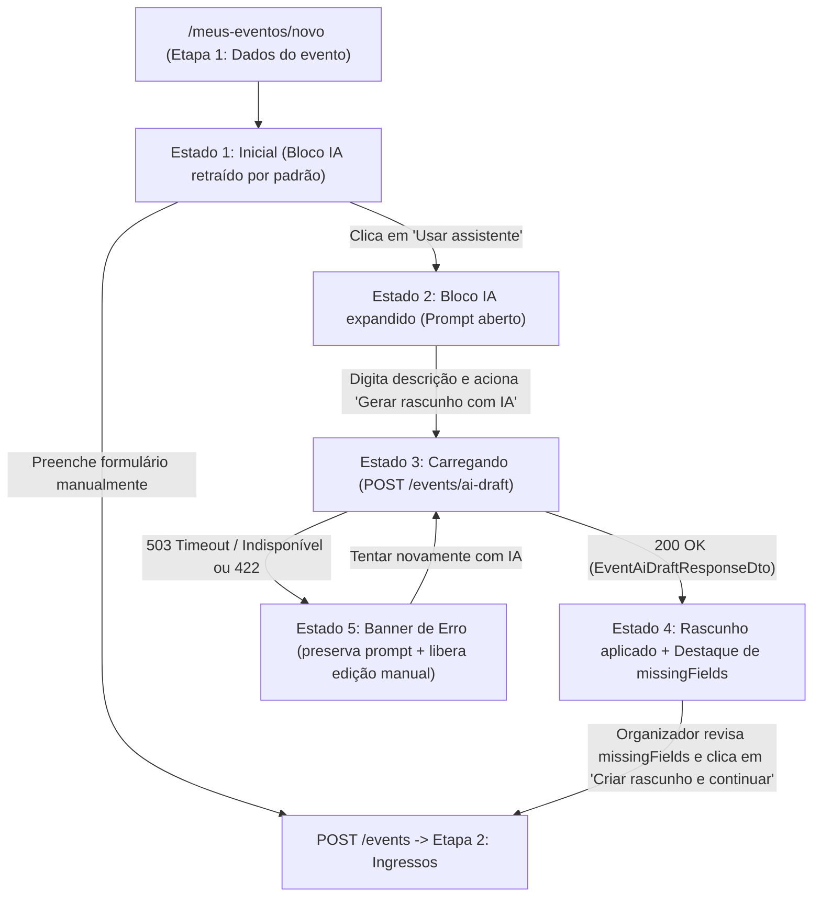

# Criação de Eventos com IA

Esta página documenta o desenho de interface e as especificações de handoff para a **geração de rascunho de evento por linguagem natural com Inteligência Artificial** na tela **`/meus-eventos/novo`**, desenvolvidos no escopo da tarefa **GOL-262**.

- **Rota:** `/meus-eventos/novo` (Etapa 1 — `1. Dados do evento` do `EventoEditor`, fora da árvore `/conta`)
- **Origem YouTrack:** [GOL-262 • Desenho da interface de criação de eventos com IA](https://es-unifesp.youtrack.cloud/issue/GOL-262)
- **Arquivo no Figma:** [Hubee Visual — GOL-262 (Criação de Eventos com IA)](https://www.figma.com/design/9vFaaHBOM04vapx6GzIHpR)
- **Documentação Relacionada:** [Criação de Eventos e Lotes](./criacao-eventos-lotes.md) (GOL-205), [Interfaces do Organizador](./interfaces-do-organizador.md), [Guia de Estilo](./guia-de-estilo.md) e [Matriz de Permissões RBAC](../regras-negocio/matriz-permissoes-rbac.md)
- **Base Técnica:** `hubee-webpage` (`src/components/conta/eventos/editor/`, Next.js 16, Tailwind CSS 4, shadcn/ui) e `hubee-api` (`POST /events/ai-draft`)

Todas as variações foram projetadas em **Desktop (`1440px`)** e **Mobile (`375px`)**, nos temas **Claro (Light)** e **Escuro (Dark)**, utilizando os tokens `hubee-*`.

---

## 1. Visão Geral e Handoff de Componentes

O bloco **`GeradorIaEvento`** ("Criar rascunho com IA") posiciona-se no início da Etapa 1 (**`1. Dados do evento`**) quando o organizador acessa `/meus-eventos/novo` (`evento === null`). Ele nasce **retraído por padrão** para não poluir a tela de quem prefere o preenchimento manual; quando o organizador deseja utilizá-lo, clica em **`Usar assistente ⌄`** para expandir o campo de texto livre em linguagem natural e aciona **`Gerar rascunho com IA`** (`POST /events/ai-draft`).

> **Princípio de revisão assistida (sem persistência automática):** A chamada à IA **nunca cria nem publica o evento automaticamente no banco**. Ela apenas preenche os campos do `DadosEventoForm` em memória, pré-carrega as sugestões de lotes (`suggestedTicketTypes`) para a Etapa 2 e destaca em âmbar todos os campos que não puderam ser inferidos do texto (`missingFields`).

### 1.1. Painel de Handoff e Anatomia dos Componentes

#### Tema Claro

#### Tema Escuro

### 1.2. Mapa de Componentes e Contratos Visuais

| Componente / Elemento | Estados e Regras Visuais | Integração com o Contrato (`EventAiDraftResponseDto`) |
| :--- | :--- | :--- |
| **Cartão Retrátil `GeradorIaEvento`** | Card destacado no topo da Etapa 1 com ícone `Sparkles` e título *"Criar rascunho com IA"*. **Fechado por padrão** exibindo o gatilho **`Usar assistente ⌄`** (ou chevron no mobile). Ao expandir, mostra **`Recolher ⌃`**, `Textarea` com placeholder natural e contador `0 / 500`, nota *"✦ Nenhum evento é salvo ou publicado automaticamente"* e o botão primário **`Gerar rascunho com IA`**. | Envia `{ prompt: string }` para `POST /events/ai-draft` (`@OrganizerOnly()`). |
| **Banner de Revisão (`missingFields`)** | Alerta âmbar (`border-amber-500`, fundo `#FFFBEB` no claro / `#3B1D04` no escuro) listando quantos campos foram preenchidos e quais campos precisam de revisão humana, acompanhado de atalhos de foco (`↓ Ir para Edição`, `↓ Ir para Local *`). | Renderizado quando `missingFields.length > 0` na resposta da IA. |
| **Faixa de Lotes Sugeridos (`suggestedTicketTypes`)** | Faixa esmeralda confirmando os lotes extraídos do prompt (nome do lote, modalidade, preço e quantidade) que serão pré-carregados ao avançar para a Etapa 2 (`2. Ingressos`). | Lê `suggestedTicketTypes[]` (`batch`, `modality`, `price`, `quantity`). |
| **Sinalização nos Campos do Formulário** | • **Inferido pela IA:** borda esmeralda sutil (`#10B981`) e badge `✦ Preenchido pela IA`. • **Não identificado (`missingFields`):** borda âmbar (`#F59E0B`), fundo âmbar suave, badge `⚠ Não identificado · Revise` e texto de apoio abaixo do campo. No mobile, seções colapsadas que contenham um campo obrigatório pendente (como `Local`) abrem automaticamente. | Mapeia `missingFields` (`name`, `category`, `edition`, `ageRating`, `description`, `startDate`, `endDate`, `venueId`). |
| **Banner de Erro / Timeout (`503` / `422`)** | Alerta vermelho (`role="alert"`) dentro do cartão da IA preservando integralmente o texto digitado pelo organizador, com botão **`Tentar novamente com IA`** e formulário manual 100% desbloqueado logo abaixo. | Trata `503 Service Unavailable` (timeout/indisponibilidade do provedor) e `422 Unprocessable Entity` (recusa/texto inválido). |

---

## 2. Fluxo de Interação

---

## 3. Estados em Desktop (`1440px`)

Na resolução Desktop (`1440px`), a página `/meus-eventos/novo` utiliza o `LoggedHeader` superior flutuante da área logada (fora da navegação lateral de `/conta`) e centraliza o `EventoEditor` em container `max-w-6xl` (`1104px`).

### 3.1. Estado 1 — Inicial (`Bloco IA Retraído por Padrão`)

Por padrão, o cartão **"Criar rascunho com IA"** inicia recolhido em uma faixa compacta no topo da Etapa 1 com o botão **`Usar assistente ⌄`**. Quem prefere preencher o formulário diretamente já visualiza **Informações básicas** sem ruído visual.

#### Tema Claro (Desktop)

#### Tema Escuro (Desktop)

---

### 3.2. Estado 2 — Expandido (`Prompt Aberto para Digitação`)

Ao clicar em **`Usar assistente ⌄`**, o cartão expande revelando o botão **`Recolher ⌃`**, o campo de descrição em linguagem natural com contador `0 / 500`, o lembrete de revisão manual e o botão **`Gerar rascunho com IA`**.

#### Tema Claro (Desktop)

#### Tema Escuro (Desktop)

---

### 3.3. Estado 3 — Carregando (`Gerando Rascunho com IA...`)

Enquanto aguarda a resposta de `POST /events/ai-draft`:
- O botão primário exibe spinner e o rótulo **`Gerando rascunho...`** (`aria-busy="true"`, `disabled`);
- Um banner de progresso informa que a IA está extraindo nome, categoria, datas, classificação indicativa e sugestões de lotes;
- Os campos do formulário abaixo entram em estado de carregamento (*shimmer*) temporário para evitar conflito de digitação concorrente.

#### Tema Claro (Desktop)

#### Tema Escuro (Desktop)

---

### 3.4. Estado 4 — Rascunho Aplicado com Sinalização de `missingFields`

Quando a API retorna o rascunho estruturado:
- Os campos inferidos (**Nome do evento**, **Categoria**, **Classificação indicativa**, **Descrição**, **Início** e **Término**) aparecem preenchidos e marcados com a pílula **`✦ Preenchido pela IA`**;
- Os campos listados em **`missingFields`** (no exemplo, **`Edição`** e **`Local do evento *`**) recebem destaque visual âmbar (`#F59E0B`), pílula **`⚠ Não identificado · Revise`** e instruções claras de preenchimento;
- O cartão da IA exibe o resumo da operação, atalhos rápidos de ancoragem (`↓ Ir para Edição`, `↓ Ir para Local *`), a prévia dos **2 lotes sugeridos** para a Etapa 2 e a opção **`Regerar rascunho com IA`** (podendo também ser recolhido a qualquer momento).

#### Tema Claro (Desktop)

#### Tema Escuro (Desktop)

---

### 3.5. Estado 5 — Erro ou Timeout do Provedor (`503 Service Unavailable`)

Caso o provedor de IA exceda o tempo limite (`AI_TIMEOUT_MS`), esteja indisponível (`503`) ou recuse o prompt (`422`):
- Um alerta vermelho (`role="alert"`) informa o motivo da falha de forma amigável;
- **O texto digitado pelo organizador nunca é apagado**, permitindo clicar em **`Tentar novamente com IA`** sem retrabalho;
- O formulário manual abaixo permanece totalmente liberado para preenchimento tradicional.

#### Tema Claro (Desktop)

#### Tema Escuro (Desktop)

---

## 4. Versões Mobile (`375px`)

No viewport Mobile (`375px`), o bloco inicia retraído ocupando apenas uma faixa compacta no topo (alinhado ao padrão sanfonado das seções do formulário). Ao expandir, o `Textarea` e o botão **`Gerar rascunho com IA`** ocupam largura total (`w-full`, altura mínima de toque `≥ 40px`). Quando o rascunho é aplicado e `venueId` consta em `missingFields`, a seção sanfonada **Local** abre-se automaticamente (`forcarAberta`) para destacar a pendência obrigatória.

### 4.1. Estado 1 — Inicial Retraído (Mobile `375px`)

| Tema Claro (Mobile 375px) | Tema Escuro (Mobile 375px) |
| :---: | :---: |
|  |  |

### 4.2. Estado 2 — Expandido (Mobile `375px`)

| Tema Claro (Mobile 375px) | Tema Escuro (Mobile 375px) |
| :---: | :---: |
|  |  |

### 4.3. Estado 3 — Carregando / Gerando Rascunho (Mobile `375px`)

| Tema Claro (Mobile 375px) | Tema Escuro (Mobile 375px) |
| :---: | :---: |
|  |  |

### 4.4. Estado 4 — Rascunho Aplicado + `missingFields` (Mobile `375px`)

| Tema Claro (Mobile 375px) | Tema Escuro (Mobile 375px) |
| :---: | :---: |
|  |  |

### 4.5. Estado 5 — Erro / Timeout (Mobile `375px`)

| Tema Claro (Mobile 375px) | Tema Escuro (Mobile 375px) |
| :---: | :---: |
|  |  |

---

## 5. Tokens de Cor e Acessibilidade

| Elemento | Tema Claro (Light) | Tema Escuro (Dark) |
| :--- | :--- | :--- |
| **Fundo da Página (`body`)** | `#FFFBED` (`hubee-50`) | `#181000` (`hubee-900`) |
| **Superfície do Card IA (`GeradorIaEvento`)** | Fundo `#FFF9E6`, borda `#FFCB33` (`hubee-400`) | Fundo `#2B1E04`, borda `#C98D00` (`hubee-600`) |
| **Gatilho Retrátil (`Usar assistente` / `Recolher`)** | Fundo `#FFF3CC` (`hubee-100`), borda `#FFDA66` (`hubee-300`), texto `#302100` (`hubee-800`) | Fundo `#332304`, borda `#7A5500`, texto `#FFE899` (`hubee-200`) |
| **Botão Primário (`Gerar rascunho com IA`)** | Fundo `#302100` (`hubee-800`), texto `#FFFBED` (`hubee-50`) | Fundo `#FFCB33` (`hubee-400`), texto `#302100` (`hubee-800`) |
| **Campo Inferido (`✦ Preenchido pela IA`)** | Borda `#10B981`, badge fundo `#ECFDF5`, texto `#065F46` | Borda `#10B981`, badge fundo `#072E20`, texto `#A7F3D0` |
| **Campo Pendente (`missingFields`)** | Borda `#F59E0B`, fundo `#FFFBEB`, badge `#FEF3C7`, texto `#92400E` | Borda `#F59E0B`, fundo `#3B1D04`, badge `#451A03`, texto `#FDE68A` |
| **Alerta de Erro / Timeout (`503`)** | Borda `#DC2626`, fundo `#FEF2F2`, texto `#991B1B` | Borda `#F87171`, fundo `#3B0A0A`, texto `#FECACA` |

### Diretrizes de Acessibilidade (WCAG AA)
- **Controle retrátil acessível:** O botão de expandir/recolher o bloco de IA utiliza `aria-expanded` e `aria-controls` apontando para o corpo do painel, mantendo foco visível via teclado.
- **Anúncio de estado assíncrono:** O container do gerador utiliza `aria-busy="true"` durante a geração e regiões `aria-live="polite"` para anunciar a conclusão do rascunho e a contagem de campos pendentes em `missingFields`, enquanto falhas (`503`/`422`) usam `role="alert"`.
- **Não dependência exclusiva de cor:** Campos listados em `missingFields` combinam borda âmbar, ícone de alerta (`⚠`), badge textual explícito (*"Não identificado · Revise"*) e mensagem descritiva vinculada via `aria-describedby`.
- **Controle de movimento:** O spinner de carregamento e o pulso de *shimmer* respeitam `prefers-reduced-motion: reduce` (`motion-reduce:animate-none`).
