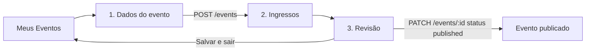

# Criação de Eventos e Lotes

Esta página registra o desenho da criação de eventos e do gerenciamento de lotes de ingressos, definido na **GOL-205**. O fluxo começa no botão **"Criar Novo Evento"** de [Meus Eventos](./interfaces-do-organizador.md) e contempla desktop e mobile (375 px), nos temas claro e escuro.

## Fluxo

O fluxo tem três etapas porque a API só cria lotes em um evento que já existe (`POST /events/:eventId/ticket-types`). Por isso, a primeira etapa termina criando um rascunho, e as etapas seguintes ficam travadas até esse rascunho ser salvo.

## Etapa 1: dados do evento

| Seção | Campo | Regra | Campo da API |
| :--- | :--- | :--- | :--- |
| **Informações básicas** | Nome | Obrigatório, até 255 caracteres | `name` |
| | Categoria | Opcional: Festas, Shows, Palestras, Esportes, Acadêmicos ou Outros | `category` |
| | Edição | Opcional, até 100 caracteres | `edition` |
| | Classificação indicativa | Opcional: L, 10, 12, 14, 16 ou 18 | `ageRating` |
| | Descrição | Opcional | `description` |
| **Capa** | Imagem | Opcional, JPG ou PNG, até 2 MB, proporção 16:9 | `photoUrl` |
| **Data e horário** | Início | Obrigatório | `startDate` |
| | Término | Obrigatório, posterior ao início | `endDate` |
| | Início das vendas | Opcional, não pode ser posterior ao início. Sem data, as vendas abrem quando o evento for publicado | `salesStartDate` |
| **Local** | Local do evento | Obrigatório, escolhido entre os locais cadastrados. A capacidade máxima aparece ao selecionar | `venueId` |

A organização vem da organização ativa em Meus Eventos (`organizerId`). O campo `featured` não aparece no formulário, porque só o administrador da plataforma pode destacar eventos.

### Erros de validação

## Etapa 2: ingressos

Cada lote tem nome (`batch`), preço (`price`) e quantidade (`quantity`). Preço zero aparece como **Gratuito**. A tela também mostra quanto da capacidade do local já está distribuída em lotes.

| Situação | Comportamento |
| :--- | :--- |
| Evento sem lotes | Estado vazio, informando que é preciso ao menos um lote para publicar |
| Lotes acima da capacidade do local | Aviso sem bloqueio |
| Lote esgotado | Badge **Esgotado** |
| Lote com vendas | Exclusão desabilitada, com explicação no botão |
| Quantidade menor que o total vendido | Erro no campo; não salva |
| Lote sem vendas | Exclusão com confirmação |
| Papel **Leitura** | Aviso de somente leitura, botão "Adicionar lote" com cadeado e sem ações por lote |

No desktop, os lotes aparecem em uma tabela. No mobile, cada lote vira um card.

### Novo lote

### Estados dos lotes

#### Evento sem lotes

#### Lotes acima da capacidade do local

#### Quantidade menor que o total vendido

#### Exclusão de lote sem vendas

#### Papel Leitura

## Etapa 3: revisão

A revisão lista as pendências ao lado de uma prévia do evento:

| Item | Efeito |
| :--- | :--- |
| Dados do evento válidos | Obrigatório para publicar |
| Ao menos um lote | Obrigatório para publicar |
| Lotes dentro da capacidade | Recomendado |
| Capa informada | Recomendado |

Depois de publicar, a mensagem de sucesso informa se os ingressos já podem ser comprados ou quando as vendas abrem.

### Publicação bloqueada

Sem lote, o botão **Publicar evento** fica desabilitado.

## Mobile (375 px)

| Tela | Tema claro | Tema escuro |
| :--- | :---: | :---: |
| **Dados do evento** |  |  |
| **Ingressos** |  |  |
| **Novo lote** |  |  |
| **Revisão** |  |  |

## Permissões

As permissões seguem a [Matriz de Permissões](../regras-negocio/matriz-permissoes-rbac.md): Administradores e Membros criam, editam e publicam eventos e lotes; o papel Leitura só consulta.

## Decisões

- **A capa fica em um storage de arquivos.** `photoUrl` guarda só a URL. O avatar de usuário fica em base64 no banco, mas esse caminho não serve aqui: `photo_url` é limitado a 2.048 caracteres e `photoUrl` vai nas respostas do evento, o que incharia o banco e essas respostas. O provedor ainda não foi escolhido.
- **Capacidade do local só gera aviso.** A API não valida esse limite hoje, e a regra de bloqueio ainda precisa ser confirmada pelo time.
- **Exigir um lote para publicar é regra do front-end.** A API aceita publicar um evento sem lotes.
- **Sem datas de venda por lote.** A tabela `ticket_types` só tem nome, preço e quantidade. Variações como inteira e meia continuam sendo parte do nome do lote.

## Dependências da API

O desenho depende destes ajustes na `hubee-api`:

| Ajuste | Situação atual | Impacto |
| :--- | :--- | :--- |
| Liberar `POST`, `PATCH` e `DELETE /events/:eventId/ticket-types` para o nível `write` | Rotas restritas a `ADMIN` | **Bloqueia a entrega:** organizadores não conseguem gerenciar lotes |
| Informar os vendidos por lote | A resposta do lote não traz esse dado | Sem ele, não há coluna "Vendidos" nem trava por vendas |
| Criar o upload da capa de evento | Não existe endpoint | Sem ele, a etapa 1 não envia a imagem |
| Tratar a exclusão de lote com vendas ([BUG-15](../spikes/catalogo-de-bugs.md#bug-15)) | Responde `500` | A tela evita o caso, mas a API continua sem resposta adequada |
| Recusar quantidade abaixo do vendido ([BUG-16](../spikes/catalogo-de-bugs.md#bug-16)) | Responde `200` | A tela evita o caso, mas a API continua aceitando |
| Definir como organizadores cadastram locais | `POST /venues` restrito a `ADMIN` | O organizador só escolhe entre locais já cadastrados |

## Ajuste no front-end

Hoje a capa só aparece no topo da página de detalhes: os cards de evento usam `EventMedia`, que não recebe `photoUrl`. Quem envia uma capa pode esperar vê-la também nas listagens, então vale incluir esse ajuste na implementação.
