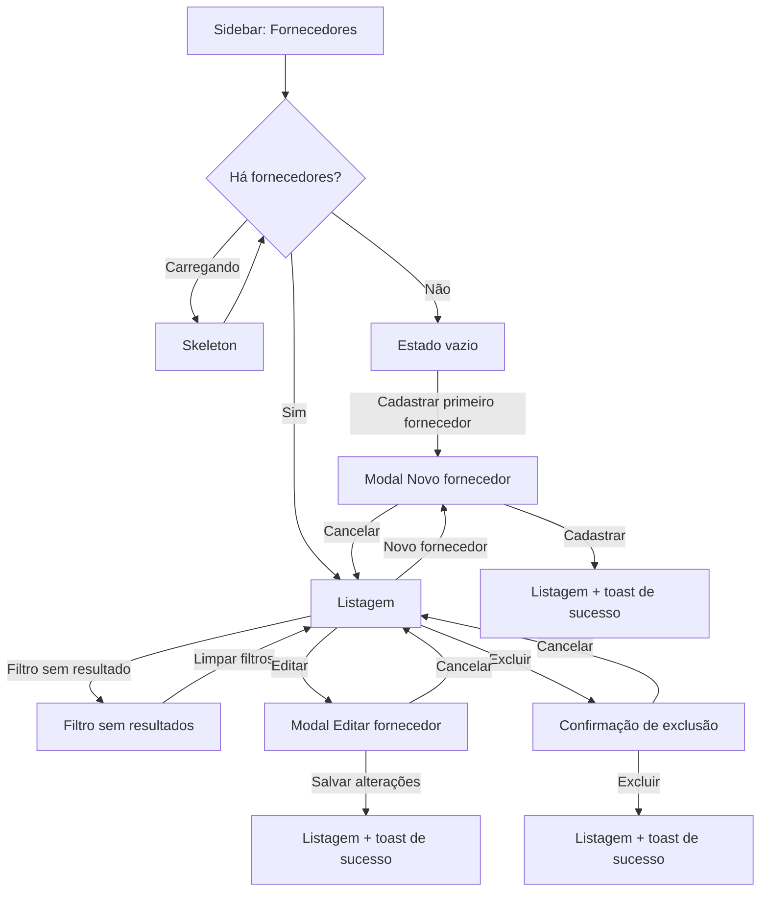

# Gestão de Fornecedores

Esta seção apresenta os desenhos de interface do módulo **Fornecedores** da área logada do organizador, desenvolvidos no escopo da tarefa **GOL-201**. O módulo cobre a listagem, a busca, o cadastro, a edição e a exclusão de fornecedores.

- **Rota:** `/conta/fornecedores`
- **Origem YouTrack:** [GOL-201 • Desenho da interface de cadastro e gestão de fornecedores](https://es-unifesp.youtrack.cloud/issue/GOL-201)
- **História:** [GOL-125 • Cadastrar fornecedor](https://es-unifesp.youtrack.cloud/issue/GOL-125)
- **Implementação:** [GOL-203 • Implementar componentes visuais de cadastro e listagem de fornecedores](https://es-unifesp.youtrack.cloud/issue/GOL-203)
- **API:** módulo `suppliers` da `hubee-api` (`POST`, `GET`, `PATCH` e `DELETE` em `/suppliers`)

Todas as telas foram desenhadas em **Desktop (1440px)** e **Mobile (375px)**, nos temas **Claro** e **Escuro**, com os tokens `hubee-*` e a tipografia do [Guia de Estilo](./guia-de-estilo.md).

---

## 1. Mapa de Implementação

| Peça visual | Estados desenhados | Observações para o front-end |
| :--- | :--- | :--- |
| **Item "Fornecedores" na navegação** | Ativo e inativo | Entra na sidebar da conta, abaixo de "Meus Eventos". No mobile aparece nas abas horizontais. Ícone `Truck` (Lucide). |
| **Cabeçalho da página** | Default | Título "Fornecedores" (`ContaPageTitle`) e botão primário "+ Novo fornecedor". |
| **Filtros** | Default, com filtro e sem resultados | Busca "Buscar por nome" (`companyName`) e dropdown "Categoria" com a opção "Todas". |
| **Tabela (desktop)** | Default, hover de linha, tooltips de ação | Colunas: Razão Social / Nome, CNPJ/CPF, Categoria (badge), Telefone, E-mail e Ações (Editar e Excluir). Campos opcionais vazios exibem "—". Nomes longos são truncados com reticências. |
| **Cards (mobile)** | Default, hover | Nome, badge de categoria, documento, telefone, e-mail e ações no rodapé do card. |
| **Rodapé da listagem** | Default | Contador "Mostrando X de Y fornecedores". |
| **EmptyState** | Vazio | Exibido quando não há fornecedores. A barra de filtros fica oculta. |
| **Skeleton** | Carregamento | Mesma estrutura da listagem. |
| **Modal de cadastro e edição** | Default, foco, erro, desabilitado e salvando | Mesmo formulário para "Novo fornecedor" e "Editar fornecedor". |
| **Modal de exclusão** | Default e carregando | Botão "Excluir" na cor destrutiva. |
| **Toasts** | Sucesso e erro | Exibidos no canto inferior direito. |

### Campos do formulário

Os campos seguem o `CreateSupplierDto` da `hubee-api`:

| Campo | Propriedade | Obrigatório | Regra / máscara |
| :--- | :--- | :---: | :--- |
| Razão Social / Nome | `companyName` | Sim | Até 255 caracteres, com contador `0 / 255`. |
| CNPJ/CPF | `cnpjCpf` | Sim | Somente números, de 11 a 14 dígitos. Máscara de CPF (`000.000.000-00`) ou CNPJ (`00.000.000/0000-00`). |
| Categoria | `category` | Não | Seleção ou texto livre, até 100 caracteres. |
| Telefone | `phone` | Não | Máscara `(00) 00000-0000`. |
| E-mail | `email` | Não | Formato de e-mail válido. |

### Mensagens de validação

| Situação | Mensagem |
| :--- | :--- |
| Nome vazio | O nome da empresa é obrigatório. |
| Documento vazio | O CNPJ ou CPF é obrigatório. |
| Documento com letras | O documento deve conter apenas números. |
| Documento com tamanho inválido | O documento deve ter entre 11 e 14 caracteres. |
| E-mail inválido | Formato de e-mail inválido. |
| CNPJ/CPF ou e-mail já cadastrado (erro 409 da API, alerta no topo do modal) | Já existe um fornecedor com este CNPJ/CPF ou E-mail. |

---

## 2. Fluxo de Telas

---

## 3. Listagem de Fornecedores

### Desktop

#### Tema Claro

#### Tema Escuro

### Mobile

| Tema Claro | Tema Escuro |
| :---: | :---: |
|  |  |

---

## 4. Navegação

Item "Fornecedores" no estado **inativo**, com outra seção da conta selecionada. O estado **ativo** aparece nas telas da listagem.

### Desktop

### Mobile

| Tema Claro | Tema Escuro |
| :---: | :---: |
|  |  |

---

## 5. Estados de Tela

### 5.1. Carregamento (Skeleton)

| Tema Claro | Tema Escuro |
| :---: | :---: |
|  |  |

### 5.2. Estado Vazio

Exibido quando a organização ainda não tem fornecedores cadastrados.

| Tema Claro | Tema Escuro |
| :---: | :---: |
|  |  |

### 5.3. Filtro sem Resultados

Exibido quando há fornecedores, mas nenhum corresponde aos filtros aplicados.

| Tema Claro | Tema Escuro |
| :---: | :---: |
|  |  |

---

## 6. Cadastro e Edição

### 6.1. Modal "Novo fornecedor"

| Tema Claro | Tema Escuro |
| :---: | :---: |
|  |  |

### 6.2. Modal "Editar fornecedor"

Mesmo formulário do cadastro, com os dados preenchidos e o botão "Salvar alterações".

| Tema Claro | Tema Escuro |
| :---: | :---: |
|  |  |

### 6.3. Validações

Campos com erro, alerta de fornecedor duplicado e exemplos alternativos de validação do CNPJ/CPF.

| Tema Claro | Tema Escuro |
| :---: | :---: |
|  |  |

### 6.4. Campo em Foco e Botão Desabilitado

O botão "Cadastrar fornecedor" fica desabilitado até os campos obrigatórios estarem preenchidos.

| Tema Claro | Tema Escuro |
| :---: | :---: |
|  |  |

### 6.5. Salvando

Botão primário em carregamento enquanto a requisição é processada.

| Tema Claro | Tema Escuro |
| :---: | :---: |
|  |  |

---

## 7. Exclusão

A exclusão é lógica na API (`deleted_at`), mas para o usuário o fornecedor sai da lista.

### 7.1. Confirmação

| Tema Claro | Tema Escuro |
| :---: | :---: |
|  |  |

### 7.2. Excluindo

| Tema Claro | Tema Escuro |
| :---: | :---: |
|  |  |

---

## 8. Feedback (Toasts)

| Ação | Mensagem |
| :--- | :--- |
| Cadastro | Fornecedor cadastrado com sucesso. |
| Edição | Fornecedor atualizado com sucesso. |
| Exclusão | Fornecedor excluído com sucesso. |
| Erro genérico | Não foi possível concluir a ação. Tente novamente. |

| Tema Claro | Tema Escuro |
| :---: | :---: |
|  |  |

---

## 9. Pontos em Aberto para a Implementação

- **Permissão de acesso:** os endpoints `/suppliers` da `hubee-api` usam `@AdminOnly()`, então hoje só o administrador da plataforma acessa o módulo. Para o organizador usar a tela, a API precisa liberar o acesso por organização.
- **Vínculo com organização:** a tabela `suppliers` não tem coluna de organização, então a listagem é global.
- **Categorias:** `category` é texto livre na API. As categorias das telas (Buffet, Som e iluminação, Fotografia, Decoração, Segurança) são exemplos. O filtro precisa de uma lista definida ou montada a partir das categorias já cadastradas.

## Fora do Escopo

- Implementação em código no `hubee-webpage` (GOL-203).
- Gestão de despesas financeiras do evento.
