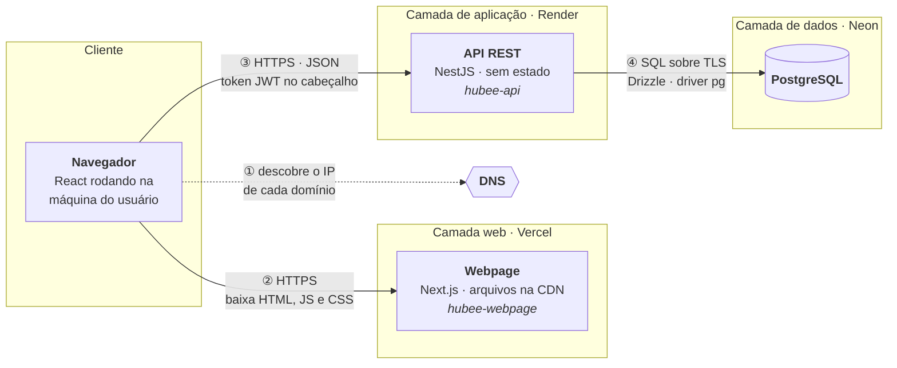
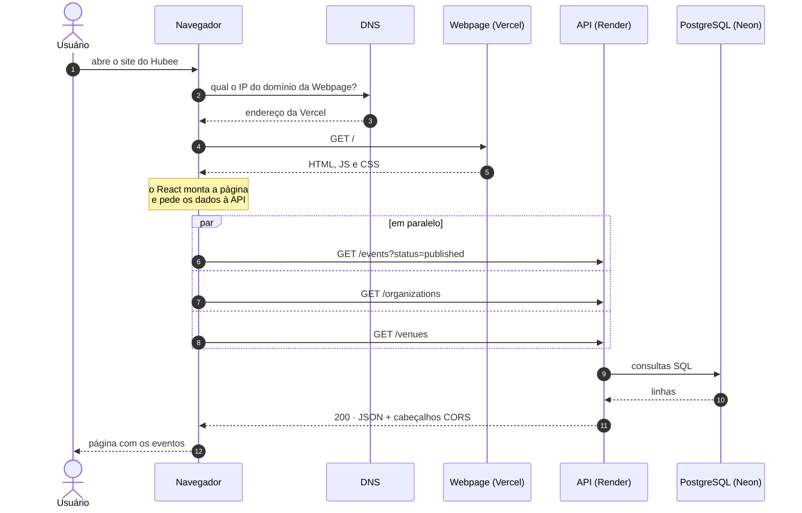
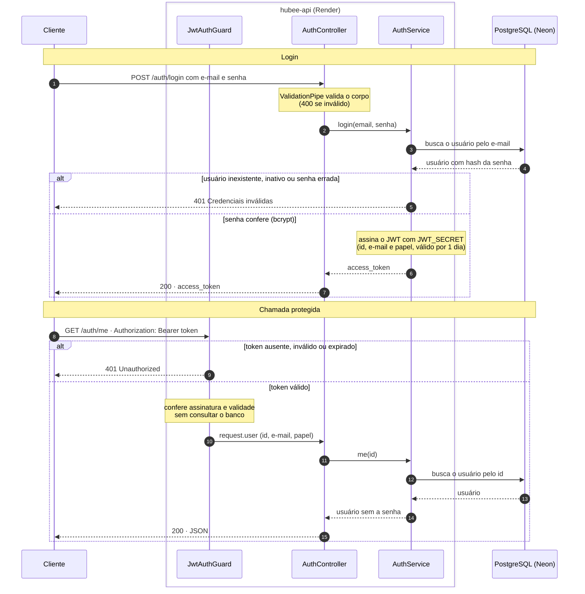

# Arquitetura do sistema

Visão geral de como as partes do Hubee se conectam e conversam: navegador,
Webpage, API e banco de dados. A página segue o roteiro de alto nível do livro
*System Design Interview* (Alex Xu): primeiro as camadas e quem fala com quem,
depois o caminho de cada requisição, passo a passo. O modelo do banco e os
detalhes de cada módulo estão fora desta página.

## Visão em camadas



Cada camada só conversa com a vizinha. O navegador nunca fala com o banco, e
a Webpage não fica no meio das chamadas à API: depois que as páginas chegam ao
navegador, é o JavaScript dele que chama a API.

| Camada | Componente | Repositório | Tecnologia | Onde roda | Papel |
| --- | --- | --- | --- | --- | --- |
| Cliente | Navegador | — | — | Máquina do usuário | Exibe a interface e chama a API. |
| Web | Webpage | `hubee-webpage` | Next.js, React | Vercel | Entrega as páginas (HTML, JS, CSS). Não guarda dados. |
| Aplicação | API | `hubee-api` | NestJS, Drizzle ORM | Render | Regras de negócio, validação e autenticação. |
| Dados | Banco de dados | — | PostgreSQL | Neon | Guarda os dados da plataforma. |

## Como as partes conversam

### Abrir a página inicial

O caminho de uma visita à home, do DNS até os eventos aparecerem na tela:



- O endereço da API vem de `NEXT_PUBLIC_API_URL`, embutido no JavaScript no
  momento do build. O navegador também consulta o DNS para esse domínio.
- A API e a Webpage estão em domínios diferentes, então o navegador só aceita
  a resposta se o domínio da Webpage estiver em `CORS_ORIGINS`.
- Essas rotas são públicas: não precisam de token.

### Login e rota protegida

O mesmo vale para qualquer cliente da API (navegador, Bruno, Swagger em
`/docs`). Aqui a API aparece aberta em suas peças, para mostrar quem decide
cada coisa:



O guard só lê o token: a API não guarda sessão, e cada requisição traz tudo o
que precisa para ser autorizada. Rotas restritas a administradores passam
também pelo `RolesGuard`, que compara o papel do token com o exigido. Hoje,
só `/auth/me` e `/users/*` exigem token. Os contratos completos estão em
[Autenticação e cadastro](../backend/autenticacao.md).

:::note[Estado atual]

A Webpage ainda usa um login simulado (`/login`) e não chama
`POST /auth/login` nem envia o token. O segundo diagrama mostra o contrato que
a API já cumpre, testado hoje com o Bruno ou o Swagger.

:::

## Princípios que a arquitetura segue

Estes são os princípios do livro de Alex Xu que já valem no Hubee:

- **Camadas separadas.** Web, aplicação e dados rodam em provedores
  diferentes e podem ser trocados ou escalados um sem o outro.
- **Camada de aplicação sem estado.** A API não guarda sessão na memória: a
  identidade vai no JWT e os dados ficam no banco. Por isso, uma segunda
  instância da API atenderia qualquer requisição sem combinar nada com a
  primeira.
- **Arquivos estáticos na CDN.** HTML, JS e CSS saem da rede da Vercel, perto
  do usuário, sem passar pela API.
- **Dados atrás de uma única porta.** Só a API conhece as credenciais do
  banco. O navegador nunca recebe a senha do banco.

O livro trata também de peças que o Hubee ainda **não** tem, por não serem
necessárias no volume atual: balanceador de carga com várias instâncias da
API, cache (como Redis) na frente do banco, réplicas de leitura e fila de
mensagens para tarefas demoradas. Se alguma delas entrar, ela ganha uma caixa
no diagrama de camadas.

## O que liga as partes

As peças se encontram por variáveis de ambiente, não por endereços fixos no
código:

| Variável | Onde | Para quê |
| --- | --- | --- |
| `NEXT_PUBLIC_API_URL` | Webpage | Endereço da API que o navegador chama. |
| `CORS_ORIGINS` | API | Domínios da Webpage autorizados a chamar a API pelo navegador. |
| `DB_HOST`, `DB_PORT`, `DB_USER`, `DB_PASSWORD`, `DB_NAME` | API | Conexão com o PostgreSQL. |
| `DB_SSL` | API | `true` no Neon, que exige TLS; `false` no Postgres local. |
| `JWT_SECRET` | API | Assina e verifica os tokens. |

Em desenvolvimento local, a mesma estrutura roda na sua máquina: a Webpage e a
API em `localhost` e o banco num container Docker. Veja
[O que você precisa fazer para começar](../primeiros-passos/intro.md).

## Editando os diagramas

Os diagramas são escritos em [Mermaid](https://mermaid.js.org/), nos blocos
` ```mermaid ` deste arquivo: um `flowchart` para as camadas e um
`sequenceDiagram` para cada fluxo. O site desenha os diagramas a partir desse
texto, então não há imagem para gerar: basta editar o bloco. Com `npm start`,
a alteração aparece na hora. O [Mermaid Live](https://mermaid.live) também
ajuda a testar mudanças maiores.

Atualize os diagramas sempre que um componente, provedor ou forma de
comunicação mudar. Um fluxo novo e importante (compra de ingresso, por
exemplo) merece seu próprio diagrama de sequência.
