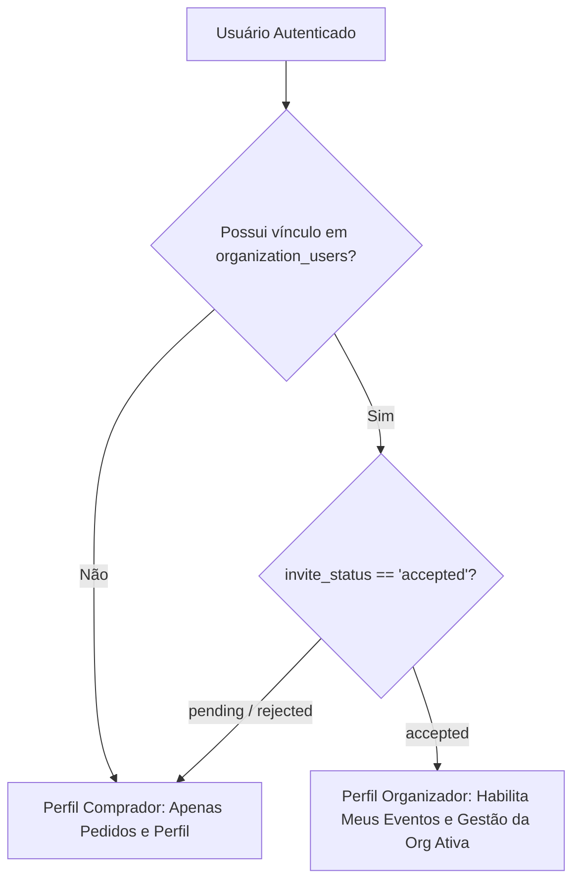
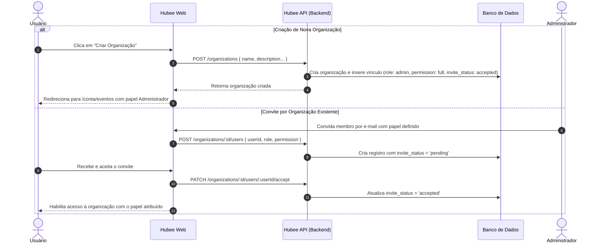

# Matriz de Permissões (RBAC) e Organizadores

Este documento estabelece formalmente as regras de negócio de como um usuário assume o papel de organizador e define a matriz de controle de acesso baseado em papéis (**RBAC**) da plataforma Hubee.

> **Origem e Rastreabilidade:** Especificação definida na tarefa **GOL-143**, fundamentada no estudo técnico de arquitetura **GOL-109** ([Spike: Modelo de permissões de organizador](../spikes/modelo-permissoes-organizador.md)).

---

## 1. O Vínculo Aceito é a Porta de Entrada

O acesso às funcionalidades e interfaces de organizador depende **exclusivamente** de um registro ativo na tabela `organization_users` com status `invite_status = 'accepted'`.

* **Independência de Perfis:** Um usuário que possui perfil de organizador continua acessando normalmente seus próprios ingressos, pedidos e dados de comprador.
* **Autodeclaração Não Concede Acesso:** A intenção de cadastro (`signupIntent = 'ORGANIZE'`) ou qualquer manipulação no front-end não concede privilégios de gestão. Apenas a existência do vínculo aceito no banco de dados habilita a área de organizador.
* **Escopo por Organização:** O papel pertence à organização ativa no momento, e não à conta global do usuário.

---

## 2. Níveis de Acesso e Papéis Formais

Dentro do escopo de uma organização, existem três papéis formais derivados das colunas `role` e `permission` de `organization_users`:

| Nível / Papel | Schema (`role` / `permission`) | Descrição e Escopo |
| :--- | :--- | :--- |
| **Administrador (`manage`)** | `role = 'admin'` `permission = 'full'` | Gestão completa da organização: gerenciar membros, editar dados da entidade, criar, editar, publicar e cancelar eventos. |
| **Membro / Operador (`write`)** | `role = 'member'` `permission = 'full'` | Operação de eventos: criar, duplicar, editar e publicar eventos e lotes de ingressos. Não gerencia membros nem dados cadastrais da organização. |
| **Leitura / Auditor (`read`)** | `role = 'member'` `permission = 'read_only'` | Consulta e auditoria: visualiza eventos, métricas de vendas e relatórios financeiros/operacionais. Não possui permissão de escrita, criação ou exclusão. |

> ⚠️ **Invariante de Domínio:** O papel `admin` sempre implica permissão `full`. A combinação `role = 'admin'` com `permission = 'read_only'` é terminantemente **inválida** e deve ser rejeitada em validações de schema e DTOs.

---

## 3. Matriz Formal de Capacidades por Papel

A tabela abaixo resume as capacidades de cada papel no contexto da **organização ativa**:

| Capacidade | Administrador (`manage`) | Membro (`write`) | Leitura (`read`) | Sem vínculo aceito |
| :--- | :---: | :---: | :---: | :---: |
| **Acessar eventos da organização** | Sim | Sim | Sim (somente visualização) | Não |
| **Ver relatórios e métricas de vendas** | Sim | Sim | Sim (somente visualização) | Não |
| **Criar e duplicar eventos** | Sim | Sim | Não (botão desabilitado) | Não |
| **Editar eventos e lotes de ingressos** | Sim | Sim | Não | Não |
| **Publicar eventos e lotes** | Sim | Sim | Não | Não |
| **Cancelar eventos** | Sim * | Não | Não | Não |
| **Gerenciar equipe e convites de membros** | Sim | Não | Não | Não |
| **Alterar dados cadastrais da organização** | Sim | Não | Não | Não |

*\* Regra de interface: Não oferecer ação de cancelamento para eventos que já se encontrem com status `Encerrado` (`finished`) ou `Cancelado` (`cancelled`). A ação "Ver página pública" só é disponibilizada para eventos `Publicado` ou `Encerrado` com página acessível.*

---

## 4. Contexto Organizacional e Troca de Papel

### "Trocar de organização troca o papel — nunca soma privilégios"

Um usuário pode pertencer a múltiplas organizações (por exemplo, Administrador na *Organização A* e Leitura na *Organização B*). O sistema opera sob isolamento estrito de contexto:

* Ao selecionar a *Organização A*, o usuário opera com privilégios de Administrador.
* Ao alternar para a *Organização B*, seus privilégios passam imediatamente a ser de Leitura.
* Em nenhuma hipótese permissões de diferentes organizações são combinadas ou herdadas.

### Situação do Vínculo e Efeito na Interface

| Situação do Vínculo | Efeito na Interface | Regra de Autorização |
| :--- | :--- | :--- |
| **`accepted`** | Habilita rota `/conta/eventos`, seletor de organização e atalhos no menu de navegação. | Aplica permissões estritas da organização ativa. |
| **`pending` ou `rejected`** | Mantém a visualização padrão de comprador (`/conta/pedidos`, `/conta/perfil`). A organização não aparece no seletor. | Bloqueio total de acesso e rotas da organização. |
| **`revoked` (Revogado)** | Contexto da organização é removido de imediato da sessão do usuário. | Bloqueio imediato; não afeta vínculos aceitos com outras entidades. |
| **Sem vínculo aceito** | Navegação de comprador pura. Exibe CTA informativo "Criar Organização" no perfil. | Sem acesso a rotas de gestão. |

---

## 5. Ciclo de Vida: Como um Usuário Vira Organizador

---

## 6. Diretrizes de Segurança na Implementação

### "Esconder controles não é autorização"

* **Validação Obrigatória no Servidor:** A ocultação ou desativação de botões no front-end serve para oferecer uma experiência de usuário (UX) clara. Toda operação de mutação (criação, edição, publicação, exclusão) é obrigatoriamente validada no backend via `OrganizationAccessGuard`.
* **Escopo por Tenant:** Todas as consultas no banco de dados devem incluir a cláusula `WHERE organization_id = :activeOrgId` para prevenir vazamento ou alteração indevida de dados entre organizações.
* **Revogação Instantânea:** O status e as permissões do usuário devem ser revalidados a cada requisição sensível, impedindo o uso de sessões obsoletas após a revogação de um membro.

---

## 7. Prancha Visual de Referência (Figma GOL-143)

Abaixo está a prancha oficial de especificação de regras de negócio e matriz RBAC desenhada no Figma:

